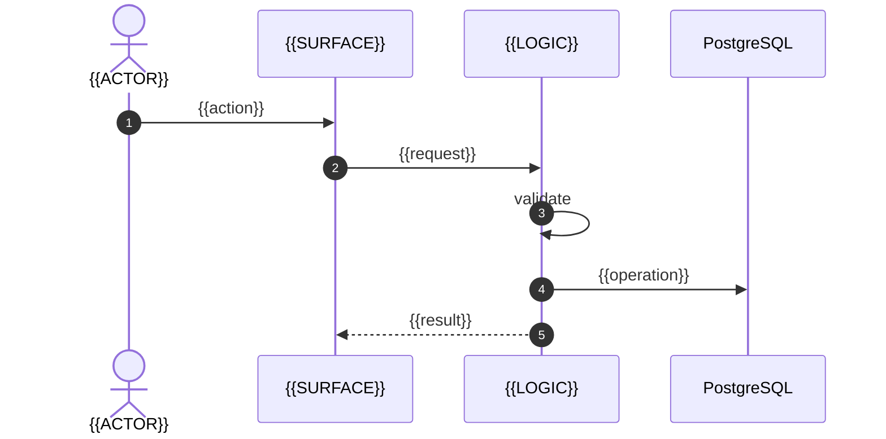

<!-- generated by the AI SDLC specification builder -->
# Online Shopping System Advanced — Software Specification

> This is the specification for **Online Shopping System Advanced**, assembled for the software development lifecycle and ordered by phase. It is the authority. Placeholders are written `{{LIKE_THIS}}`; **a remaining placeholder at review time is a review failure, not a cosmetic issue.**

| Field | Value |
|---|---|
| Application | Online Shopping System Advanced |
| Version | 0.1.0 |
| Owner |  |
| Date | 2026-10-23 |
| Application type | Web, Mobile |
| Architecture pattern | Layered monolith |
| Rigor tier | Standard |
| Lifecycle phases in this document | 11 |
| Capability modules specified | 8 |
| Source documents merged | 21 |
| Assembled from | Core document set · architecture pattern · domain packs · capability modules |

## How to read this document

Each phase below settles something the next phase depends on, and states the condition under which it is finished. Work them in order. Where a phase is absent, the tailoring rules excluded it for a recorded reason — the appendix names every exclusion and why.

Three conventions carry the weight:

- **Identifiers.** `REQ-`, `FEAT-`, `FLOW-`, `UI-`, `IF-`, `ENT-`, `THR-`, `CTL-`, `TEST-`, `GATE-`. Capability content is scoped to its module, in the form `REQ-<MODULE>-NN`, so any combination of modules composes without collision.
- **Provenance.** *(A)* given, *(B)* inherited, *(C)* derived. Anything undecided is marked `DECISION REQUIRED` and is visible, never silently assumed.
- **Acceptance vocabulary.** `PASS`, `FAIL`, `BLOCKED`, `NOT_APPLICABLE`, `NOT EVALUATED`. A gate that has not run reads `NOT EVALUATED`, never `PASS`.

## The scope this was built from

**Read as:** An advanced online shopping system with additional features such as wishlist, order listing, and review capabilities, using multiple frameworks like Vue, Django, Angular, and databases like MySQL.

The brief, kept verbatim. Where the specification below and this statement disagree, this statement is the one that was agreed and the specification is what needs correcting.

> # online-shopping-system-advanced
>
> ## What the repository says about itself
>
> 
> 
>
> <a href="https://www.buymeacoffee.com/puneethreddyhc" target="_blank"></a>
>
> > ## Updated project with extra Features like WISHLIST, List Orders, add Reviews, updated routing, resolved search bug is available for Premium 
>
> [](https://youtu.be/gLwfj67GI8A)
>
> <h3>Things I code with</h3>
> <p>
>   
>   
>   
>   
>   
>   
>   
>   
>   
>   
>   
>   
>   
>   
>   
>   
>   
>   
>   
>   
>
> </p>
> <h1>Projects We develop</h1>
>
> <ul>
> 	<li><b>Vue JS</b></li>
> 	<li><b>Nuxt JS</b></li>
> 	<li><b>Python</b></li>
> 	<li><b>Django</b></li>
> 	<li><b>PHP and MYSQL</b></li>
> 	<li><b>Angular JS</b></li>
> 	<li><b>React JS</b></li>
> 	<li><b>AI/ML</b></li>
> </ul>
>
> # Installation
>
> 1. Install XAMPP or WAMPP.
>
> 2. Open XAMPP Control panal and start [apache] and [mysql] .
>
> 3. Download project from github(https://github.com/PuneethReddyHC/online-shopping-system-with-advanced-admin-page.git)  
>     OR follow gitbash commands
>
>     i>cd C:\\xampp\htdocs\
>
>     ii>git clone https://github.com/PuneethReddyHC/online-shopping-system-with-advanced-admin-page.git
>
> 4. extract files in C:\\xampp\htdocs\.
>
> 5. open link localhost/phpmyadmin
>
> 6. click on new at side navbar.
>
> 7. give a database name as (onlineshop) hit on create button.
>
> 8. after creating database name click on import.
>
> 9. browse the file in directory[online-shopping-system-with-advanced-admin-page/database/onlineshop.sql].
>
> 10. after importing successfully.
>
> 11. open any browser and type http://localhost/online-shopping-system-with-advanced-admin-page-master.
>
> 12. first register and then login
>
> 13. admin login details  Email=admin@gmail.com or username = admin and Password=123456789.
>
> ## If you like my project 
> Bye me Cup of coffee
>
>
> ## visit my other repository with different admin pages with below link
> https://github.com/PuneethReddyHC/online-shopping-system-advanced
>
> https://github.com/PuneethReddyHC/event-management
>
> ##  If you like my project hit a star button
>
>
>
> # Screenshots
> 
> 
> 
> 
> 
> 
> 
> 
> 
> , JavaScript (11 files), SQL (1 files)
>
> ## What it is built on
>
> - Django — a server-rendered web application (seen in README.md)
> - React — a browser interface (seen in README.md)
> - Vue — a browser interface (seen in README.md)
> - Angular — a browser interface (seen in README.md)
> - MySQL — a relational database (seen in README.md, admin/admin/index.php)
> - Google Cloud — cloud services (seen in README.md)
>
> ## What is in the repository
>
> - files considered: 103
> - automated tests: none found
> - CI pipelines: none found
> - container or infrastructure files: none found
> - database migrations: none found
> - documentation files: 1

*Tailored by the deterministic keyword analyser. Every inclusion is listed in the appendix with its reason.*

## The business this was written for

Agreed before the technical specification below it was written. This was marked agreed by its author.

**Business outcomes**

- `BIZ-OUT-01` **Enhanced customer shopping experience** — The main objective of this business is to provide an advanced online shopping experience that not only replicates the efficiency of in-store purchasing but also adds value through digital convenience and innovations. This means user-friendly interfaces, quick and accurate information retrieval, and seamless checkout processes. Enhancing the shopping experience involves adding wishlist capabilities, streamlined order listings, and review functionalities to ensure customer engagement and satisfaction.

**People and organisations involved**

- `BIZ-AUD-01` **Members of the public** — Anybody who arrives without an account, whose intent and technical confidence cannot be assumed.
- `BIZ-AUD-02` **Online shoppers and reviewers** — The primary audience consists of individuals who engage regularly in online shopping activities, including browsing, purchasing, and reviewing products. These are tech-savvy individuals looking for a convenient, efficient, and enjoyable online shopping experience. Additionally, the platform caters to reviewers who are essential for providing feedback and enhancing the credibility of the products sold.

**How the work flows**

- `BIZ-PRO-01` **Somebody inside the business can run it day to day** — Without a developer. The back office is a real user group.
- `BIZ-PRO-02` **There is a record of who did what** — What must be reconstructable later, and how far back.
- `BIZ-PRO-03` **People sign in to their own account** — Who they are is known, so what they see and do can depend on it.
- `BIZ-PRO-04` **Money is taken and accounted for** — Including refunds, failures, and what the customer sees.
- `BIZ-PRO-05` **What somebody may do depends on their role** — Name the roles in business terms and what each may not do.
- `BIZ-PRO-06` **People can find what they are looking for** — Across what, and what they are allowed to find.
- `BIZ-PRO-07` **Somebody new can get started on their own** — Without a person setting them up, if that is what is wanted.
- `BIZ-PRO-08` **Somebody asks what we hold about them, or asks us to delete it** — A legal obligation with a clock on it, and a process almost no scope remembers until the first request arrives.
  - The request arrives and the person is identified
  - What is held about them is found, across everywhere it is held
  - It is supplied, corrected or removed
  - The response is recorded as evidence
  - **DECISION REQUIRED** — Who owns this, and what is the deadline?
  - **DECISION REQUIRED** — What may be refused, and on what grounds?
  - **DECISION REQUIRED** — What must be kept even after a deletion request?
- `BIZ-PRO-09` **Order fulfillment from checkout to delivery** — Once a customer places an order, the business needs to ensure the order is processed seamlessly from checkout to delivery. This includes confirming the order, preparing the items, packaging, dispatching, and delivering to the customer's location. Efficient handling of this process is critical to maintaining customer satisfaction and operational efficiency.
  - Customer checks out with their selected items
  - Order is confirmed with the customer
  - Items are picked and prepared for delivery
  - Items are packaged securely
  - Dispatched with a carrier service
  - Tracked and delivered to the customer
  - **DECISION REQUIRED** — What carriers will be used for delivery?
  - **DECISION REQUIRED** — What is the process for handling lost or damaged goods during delivery?

**Business rules and policies**

- `BIZ-RUL-01` **All transactions must be recorded and verified** — Each transaction conducted via the platform must be accurately recorded, ensuring both the buyer and the company maintain clear and accurate records of sales. This is crucial for financial reporting and auditing purposes, ensuring transparency and accountability in all business dealings.

**Success measures**

- `BIZ-MEA-01` **No finding on an audit of how regulated data is handled** — Zero material findings at {{AUDIT}}, with the evidence produced from the system rather than assembled by hand.

**Constraints**

- `BIZ-CON-01` **Regulated or personal data is held, so the law applies** — {{REGULATION}} governs what may be collected, how long it is kept, who may see it and what happens when somebody asks for it to be removed. Name the regulation — the technical half writes controls against whatever this says.
- `BIZ-CON-02` **Adherence to data protection laws** — The platform must operate in compliance with all applicable data protection laws and regulations. This includes ensuring customer data is stored securely, used appropriately, and not shared without consent. Regular audits should be conducted to verify compliance.

**Out of scope**

- `BIZ-EXC-01` **No support for offline retail operations** — This business scope covers only the online aspects of retail and does not extend to managing or supporting offline retail shop operations. This means no resources or systems will be dedicated to handling traditional store sales processes. *(Won't have this time)*

## Decisions taken

Answered while the specification was assembled. Each is binding on the build; changing one is a specification change, not an implementation choice.

| # | Area | Decision required | Decided |
|---|---|---|---|
| DEC-01 | `admin-console` | Who reviews staff access records, how often, and what happens when a pattern looks wrong? | The service owner, monthly, with a written outcome |
| DEC-02 | `admin-console` | Is there a break-glass path with elevated rights, and what constrains it? | Yes — time-boxed, logged, and reviewed within one working day |
| DEC-03 | `audit-log` | Which regulation sets 7 years, and does any record type need longer? | GDPR / UK GDPR |
| DEC-04 | `audit-log` | Who may read the audit trail, and who is notified when they do? | Security and compliance only; every read is itself audited |
| DEC-05 | `login` | Is self-service registration permitted, or is every account provisioned by an administrator? | Self-service, with email verification |
| DEC-06 | `login` | Must a successful sign-in from an unrecognised device notify the subject, and through which channel? | Yes — by email, every time |
| DEC-07 | `login` | What is the required retention period for authentication audit records? | One year |
| DEC-08 | `payments-billing` | Which taxes apply, who computes them, and is the provider the authority? | The payment provider computes and remits; it is the authority |
| DEC-09 | `payments-billing` | What is the refund policy, who may issue one, and up to what amount without approval? | Support may refund up to a stated amount; above that needs a team lead |
| DEC-10 | `payments-billing` | How is a disputed charge handled, and does it revoke the entitlement immediately? | Entitlement is suspended, and restored if the dispute fails |
| DEC-11 | `rbac` | Can a subject hold two roles whose permissions conflict, and which wins? | An explicit deny always beats an allow |
| DEC-12 | `rbac` | Who may grant the highest role, and can they grant it to themselves? | An existing holder, and never to themselves |
| DEC-13 | `search` | What is the maximum acceptable index lag, and what does the interface say while a record is not yet indexed? | Seconds, and the interface says a record is still being indexed |
| DEC-14 | `search` | Are search queries retained, and for how long? | 30 days, for relevance tuning |
| DEC-15 | `session-management` | Must a subject be able to see and revoke their own other sessions? | Yes — a session list with device, location, and a revoke action |
| DEC-16 | `session-management` | What is the maximum acceptable delay between an administrator revoking a session and that session being refused? | Immediate — every request checks the session against the store |
| DEC-17 | `signup-onboarding` | Is an unverified account purged after a period, and what period? | Purged after 30 days |
| DEC-18 | `signup-onboarding` | Where Self-service, invitation only is invitation only, may an invitation be forwarded, and what stops it? | An invitation is bound to one email address and cannot be forwarded |

## Decisions required before build

Each is `DECISION REQUIRED`. They are collected here because a decision buried in a document nobody reached is a decision nobody made. Answer them on the review screen and regenerate, or record each in a decision record before the readiness gate.

- **DECISION REQUIRED** — Exact details about AI/ML features.
- **DECISION REQUIRED** — Specifics on the scope of cloud services usage.
- **DECISION REQUIRED** — Automated testing and CI pipeline requirements.

## Lifecycle contents

| Phase | Settles | Finished when |
|---|---|---|
| **1. [Inception and Scope](#phase-1-inception-and-scope)** | What is being built, for whom, and why — in the author's own words, before any structure is imposed on it. | The scope statement and the glossary are agreed, and no term in the rest of the document is used before it is defined here. |
| **2. [Requirements](#phase-2-requirements)** | Every requirement, each with an identifier that a test and an acceptance gate will cite later. | Every requirement has an ID, a provenance tag, and a verification method. No requirement reads *should probably*. |
| **3. [Architecture and Design](#phase-3-architecture-and-design)** | The shape of the system: components, boundaries, the layering pattern, and the data it holds. | Every layer states what may never cross its boundary, something enforces it, and every entity has its fields, types, and invariants. |
| **4. [Detailed Design](#phase-4-detailed-design)** | Behaviour in full: features, flows, surfaces, and the contracts other software calls. | Every flow has its preconditions, happy path, postconditions, failure modes, concurrency, and idempotency. Every surface has its empty, loading, error, denied, and offline states. |
| **5. [Security and Compliance](#phase-5-security-and-compliance)** | Threats, the controls that answer them, and the obligations that come with the data being handled. | Every threat has a control, every control has a test, and the system fails closed by default. |
| **6. [Quality Attributes](#phase-6-quality-attributes)** | The non-functional targets — performance, availability, scalability, accessibility — as numbers rather than adjectives. | Every target is measurable and has a stated measurement method. *Fast* is not a target; a p95 in milliseconds is. |
| **7. [Verification and Test](#phase-7-verification-and-test)** | How every requirement is proved, and what a failure means. | Every requirement ID appears in at least one test case, and every test has a PASS / FAIL / BLOCKED / NOT_APPLICABLE outcome defined. |
| **8. [Build, Package, and Deploy](#phase-8-build-package-and-deploy)** | How the thing is built reproducibly, configured per environment, and rolled out — and rolled back. | A clean machine can build and deploy it from this document, and every configuration key states whether it is a secret. |
| **9. [Acceptance and Sign-off](#phase-9-acceptance-and-sign-off)** | The gates that decide whether it is done, in a vocabulary that cannot be argued with. | Every gate is objective, cites the requirements it covers, and has a named approver. |
| **10. [Build Guide and Handover](#phase-10-build-guide-and-handover)** | What a developer or a coding agent needs in order to build this without asking a question. | No placeholder remains, and every open question has been decided rather than carried. |
| **11. [Appendices](#phase-11-appendices)** | The record of how this document was tailored, and the conventions it relies on. | The profile matches the document: every inclusion and exclusion in the appendix is reflected in the body. |


---

<a id="phase-1-inception-and-scope"></a>

## Phase 1 — Inception and Scope

**This phase settles.** What is being built, for whom, and why — in the author's own words, before any structure is imposed on it.

**Finished when.** The scope statement and the glossary are agreed, and no term in the rest of the document is used before it is defined here.

<a id="02-master-specification-md"></a>

### Online Shopping System Advanced — Master Specification

<!-- source: 02-MASTER-SPECIFICATION.md -->

| Field | Value |
|---|---|
| Application | Online Shopping System Advanced |
| Application type | Web, Mobile |
| Document | `02-MASTER-SPECIFICATION.md` |
| Version | 0.1.0 |
| Status | DRAFT / IN REVIEW / **APPROVED** |
| Date | 2026-10-23 |
| Owner | {{OWNER}} |
| Derived from | `01-PRODUCT-REQUIREMENTS-SPEC.md` v0.1.0 |
| Authority | **This is the canonical document for Online Shopping System Advanced.** Where any other document in the set conflicts with it, this one wins until the conflict is resolved and recorded here. |
| Nature | **Design-only.** Nothing here is implemented or authorized. |

---

#### 0. How to read this set

##### 0.1 Normative keywords

**MUST / MUST NOT / SHOULD / SHOULD NOT / MAY** in the RFC-2119 sense. Prose without a keyword is
context, not a requirement.

##### 0.2 Provenance tags

Every requirement, rule, and decision carries exactly one:

| Tag | Meaning |
|---|---|
| **(A)** | Given — from the approved requirement, customer, or regulation |
| **(B)** | Inherited — from an existing system, standard, or platform constraint |
| **(C)** | Derived — a new design decision made in this specification |

A **(C)** item MUST NOT be phrased so it reads as **(A)** or **(B)**. A (C) item needing an owner
decision additionally carries `DECISION REQUIRED`.

##### 0.3 Acceptance vocabulary

`PASS` · `FAIL` · `BLOCKED` · `NOT_APPLICABLE`, and `NOT EVALUATED` for anything not yet run. There
is no *mostly passed*, *conditional*, or *fix-later*. Nothing is `PASS` by reasoning.

#### 1. System overview

{{TWO_PARAGRAPHS}} — what the system is, in terms someone can hold in their head. Then the one
diagram that shows it.

```mermaid
flowchart LR
    User([{{USER}}]) --> App[Online Shopping System Advanced<br/>Web, Mobile]
    App --> Store[({{DATA_STORE}})]
    App --> Ext[{{EXTERNAL_DEPENDENCY}}]
```

#### 2. Glossary

Every domain term used anywhere in the set. Where two words could mean the same thing, pick one and
say the other is not used.

| Term | Means | Not to be confused with |
|---|---|---|
| {{TERM}} | {{DEFINITION}} | {{OTHER_TERM}} |

**Terms deliberately not used:** {{LIST}} — and what to say instead.

<!-- Module content injected at `02.glossary`. Each block below comes from a selected module in `_modules/`. -->

##### Administration console — terms

| Term | Means exactly |
|---|---|
| Administrative action | Anything staff do to a resource they do not own |
| Impersonation | Acting within the application as another subject. Never anonymous, always dual-recorded |
| View-as | Reading what a subject would see, without the ability to act |
| Break-glass | A time-boxed elevation for an incident, recorded and reviewed afterwards |

##### Audit trail — terms

| Term | Means exactly |
|---|---|
| Audit record | An immutable statement that an actor performed an action on a resource at a time, with the outcome |
| Actor | The subject, key, or system component that caused the action. Never a request identifier alone |
| Audit trail | The ordered, tamper-evident sequence of audit records |
| Application log | Diagnostic output. Not evidence, not retained on the audit schedule, and not a substitute for the trail |

##### Login and authentication — terms

| Term | Means exactly |
|---|---|
| Subject | The account attempting to authenticate. Not the same as a person: one person may hold several subjects, and a service account is a subject with no person behind it |
| Credential | The secret or key the subject presents. Never the subject identifier itself |
| Authentication | Establishing *which subject* is present. It answers who, never what they may do |
| Lockout | A temporary refusal to evaluate further credentials for a subject, regardless of whether the next credential presented would have been correct |

##### Payments and billing — terms

| Term | Means exactly |
|---|---|
| Charge | One attempt to move money. Identified by our idempotency key and the provider's identifier |
| Entitlement | What the customer may do because they paid. Derived from payment state, never set directly |
| Reconciliation | Comparing our projection to the provider's authority and resolving differences |
| Minor units | The smallest currency unit — cents, pence. **The only representation used for money** |
| Dunning | The sequence of retries and notices after a failed recurring payment |

##### Roles and authorization — terms

| Term | Means exactly |
|---|---|
| Permission | One named, atomic capability — `invoice.refund`. Never a screen, never a role |
| Role | A named bundle of permissions. It carries no logic of its own |
| Grant | The assignment of a role to a subject, optionally within a scope |
| Policy decision point | The one place that answers *may this subject perform this action on this resource* |
| Ownership | A relationship between a subject and a specific resource that grants permissions no role could express |

##### Search and filtering — terms

| Term | Means exactly |
|---|---|
| Query | The user's text plus every active filter and sort. One object, not scattered parameters |
| Facet | A filter dimension with counts, computed within the caller's permitted set |
| Cursor | An opaque position token. Never an offset, and never a row identifier the client can craft |
| Index lag | The delay between a record changing and the search reflecting it |

##### Session management — terms

| Term | Means exactly |
|---|---|
| Session | Server-side state that a subject is authenticated, addressed by an identifier the client carries. Not the cookie, and not the token — those carry the address |
| Idle timeout | Time since the last request before the session stops being accepted |
| Absolute lifetime | Time since issuance before the session stops being accepted, whatever the activity |
| Revocation | Making a session identifier stop being accepted before it would have expired |

##### Registration and onboarding — terms

| Term | Means exactly |
|---|---|
| Registration | Creating the subject and its credential. It does not imply an active account |
| Activation | The transition to `ACTIVE` after the contact channel is proved |
| Onboarding | The steps between activation and the subject's first useful state. Not a security boundary |

#### 3. The conceptual model

How the domain concepts connect, before any storage or interface detail. A reader who understands
only this section should be able to follow every downstream document.

```text
{{CONCEPT_A}} ──owns──> {{CONCEPT_B}} ──produces──> {{CONCEPT_C}}
```

| Concept | Is | Is not | Lifecycle |
|---|---|---|---|
| {{CONCEPT}} | {{DEFINITION}} | {{BOUNDARY}} | {{STATES}} |

#### 4. The rules that govern everything

The three to seven statements that, if violated, mean the application is wrong regardless of what
else works. Repeat each verbatim wherever it could be misread.

> ## **{{RULE_1}}**

> ## **{{RULE_2}}**

#### 5. Scope boundary

##### 5.1 This system owns

| Owns | Meaning |
|---|---|

##### 5.2 This system does not own

| Does not own | Owned instead by | Interface |
|---|---|---|

##### 5.3 Explicit non-goals

Inherited from `01` §6.2 and extended with design-level non-goals discovered here.

#### 6. Key architecture decisions

Summarised here, detailed in `03`. Every row cites the register in §8.

| ID | Decision | Alternatives considered | Why this one | Consequence |
|---|---|---|---|---|
| `DEC-001` | {{DECISION}} | {{ALTERNATIVES}} | {{RATIONALE}} | {{WHAT_FOLLOWS}} |

#### 7. Vocabularies that MUST stay separate

Where the system carries several similar-sounding concepts, name them here and forbid conflating
them. This section prevents the most expensive class of downstream error.

| Vocabulary | Values | Owner | Never conflated with |
|---|---|---|---|

#### 8. Decision register

**This is the one register.** Every other document cites it; none restates a decision as a second
authority.

| ID | Decision | Standing | Rationale | Affects | Date |
|---|---|---|---|---|---|
| `DEC-001` | {{DECISION}} | `RESOLVED` | {{WHY}} | `03`, `05` | 2026-10-23 |
| `DEC-002` | {{DECISION}} | `DECISION REQUIRED` | — | {{DOCS}} | — |
| `DEC-003` | {{DECISION}} | `NOT EVIDENCED` | Settled from live evidence during implementation | {{DOCS}} | — |
| `DEC-004` | {{DECISION}} | `SUPERSEDED BY DEC-00N` | {{WHY}} | {{DOCS}} | 2026-10-23 |

Standings: `RESOLVED` · `DECISION REQUIRED` · `NOT EVIDENCED` · `SUPERSEDED BY DEC-NNN` · `RETIRED`.
A retired identifier is never reused.

<!-- Module content injected at `02.decisions`. Each block below comes from a selected module in `_modules/`. -->

##### Administration console — decisions

| ID | Decision | Standing | Rationale | Affects |
|---|---|---|---|---|
| `DEC-ADMIN-01` | Every administrative action is authorized by a named permission and recorded with the acting staff subject | `RESOLVED` | An administration surface that inherits *is staff* as its only check is a single role away from total access | `08` |
| `DEC-ADMIN-02` | Impersonation is Read-only view-as, and every action taken while impersonating records **both** the staff subject and the impersonated subject | `RESOLVED` | A record naming only the user makes the action indistinguishable from something the user did | `04`, `08` |
| `DEC-ADMIN-03` | Destructive actions require With a second approver | `RESOLVED` | An irreversible action one click away from a list view is an accident waiting for a tired afternoon | `05`, `08` |
| `DEC-ADMIN-Q1` | Whether staff may read a customer's content, or only its metadata | `DECISION REQUIRED` | Reading content resolves support cases faster and is a standing disclosure path | `08` |

##### Audit trail — decisions

| ID | Decision | Standing | Rationale | Affects |
|---|---|---|---|---|
| `DEC-AUDIT-01` | The audit trail is A dedicated append-only table, separate from application logging | `RESOLVED` | Application logs are for diagnosis and rotate on their own schedule; an audit trail is evidence and must not | `03`, `04` |
| `DEC-AUDIT-02` | Audit records are append-only: no update, no delete before 7 years elapses | `RESOLVED` | A mutable audit trail proves nothing, because the first thing to be changed is the record of the change | `04`, `08` |
| `DEC-AUDIT-03` | Tamper evidence is Hash chain over records | `RESOLVED` | Without it the trail is only as trustworthy as the account that can write to it | `08` |
| `DEC-AUDIT-Q1` | Whether an audit write failure fails the audited operation | `DECISION REQUIRED` | Failing the operation guarantees the record and makes the audit store a hard dependency of everything | `03`, `09` |

##### Login and authentication — decisions

| ID | Decision | Standing | Rationale | Affects |
|---|---|---|---|---|
| `DEC-LOGIN-01` | Passwords are stored only as a Argon2id digest with a per-credential salt | `RESOLVED` | A stolen store must not yield usable credentials; a reversible or fast digest makes the breach total rather than partial | `04`, `08` |
| `DEC-LOGIN-02` | Authentication failure returns one indistinguishable result for unknown subject and wrong credential | `RESOLVED` | Distinguishing them turns the sign-in form into a subject-enumeration oracle | `07`, `08` |
| `DEC-LOGIN-03` | Sign-in is rate limited per subject and per source address, and the two limits are independent | `RESOLVED` | Per-subject alone lets a spray attack across many subjects through; per-address alone lets a distributed attack on one subject through | `08`, `09` |
| `DEC-LOGIN-Q1` | Whether a locked account unlocks on a timer, on a reset, or only by an administrator | `DECISION REQUIRED` | Timer unlock is self-service but leaves a slow-drip attack viable; administrator unlock is safe and expensive | `05`, `08` |

##### Payments and billing — decisions

| ID | Decision | Standing | Rationale | Affects |
|---|---|---|---|---|
| `DEC-BILLING-01` | Card data is captured by Provider-hosted fields or redirect (no card data touches us) and **never touches this application** | `RESOLVED` | Any other choice brings full PCI DSS scope onto every component that could see the data | `03`, `08` |
| `DEC-BILLING-02` | The provider is the authority on payment state; our records are a reconciled projection | `RESOLVED` | Two systems both believing they know the payment state is how money goes missing | `04` |
| `DEC-BILLING-03` | Every charge carries an idempotency key derived from the business intent | `RESOLVED` | A retried charge without one takes the money twice, and the customer discovers it before you do | `05`, `07` |
| `DEC-BILLING-04` | Provider webhooks are verified, deduplicated, and reconciled; a webhook is never trusted unverified | `RESOLVED` | A forged webhook grants entitlements without payment | `07`, `08` |
| `DEC-BILLING-05` | Monetary amounts are integers in minor currency units, with the currency stored alongside | `RESOLVED` | A floating-point amount is wrong eventually, and the error is money | `04` |
| `DEC-BILLING-Q1` | Whether an entitlement is granted on payment intent or on settlement | `DECISION REQUIRED` | Granting on intent is better experience and carries the chargeback risk | `05`, `08` |

##### Roles and authorization — decisions

| ID | Decision | Standing | Rationale | Affects |
|---|---|---|---|---|
| `DEC-RBAC-01` | Authorization is denied by default; a permission not granted is refused | `RESOLVED` | A default-allow model fails open on every route somebody forgets to annotate | `05`, `08` |
| `DEC-RBAC-02` | Every decision is made at A single policy service every handler calls | `RESOLVED` | Scattered checks cannot be audited, and the coverage question becomes unanswerable | `03`, `08` |
| `DEC-RBAC-03` | Authorization is evaluated on every request against current state, never cached in the session | `RESOLVED` | A role change that takes effect at next sign-in is not a revocation | `08` |
| `DEC-RBAC-Q1` | Whether a role may be granted with a scope narrower than the tenant | `DECISION REQUIRED` | Scoped grants are more precise and considerably harder to reason about | `04`, `08` |

##### Search and filtering — decisions

| ID | Decision | Standing | Rationale | Affects |
|---|---|---|---|---|
| `DEC-SEARCH-01` | Permission and tenant filtering happen **inside** the search query, never as a post-filter | `RESOLVED` | A post-filter leaks existence through result counts and wastes the page budget | `04`, `08` |
| `DEC-SEARCH-02` | Pagination is Cursor (keyset) | `RESOLVED` | Offset pagination silently duplicates and skips rows when the underlying data changes, which it does constantly | `07` |
| `DEC-SEARCH-03` | A query returning nothing is a first-class state with its own content | `RESOLVED` | An empty result rendered as a blank area reads as a broken screen | `06` |

##### Session management — decisions

| ID | Decision | Standing | Rationale | Affects |
|---|---|---|---|---|
| `DEC-SESSION-01` | The session is carried by Opaque server-side session id in a cookie | `RESOLVED` | Chosen for its revocation properties, which matter more than its request cost | `07`, `08` |
| `DEC-SESSION-02` | The session has both an idle timeout of 30 minutes and an absolute lifetime of 12 hours | `RESOLVED` | Idle alone lets a stolen session live indefinitely under synthetic activity | `08`, `09` |
| `DEC-SESSION-Q1` | Whether revocation must be effective globally within one second, or within the access-token lifetime | `DECISION REQUIRED` | Immediate global revocation rules out a purely stateless token | `03`, `08` |

##### Registration and onboarding — decisions

| ID | Decision | Standing | Rationale | Affects |
|---|---|---|---|---|
| `DEC-SIGNUP-01` | Account creation reports the same outcome whether or not the identifier is already registered | `RESOLVED` | A distinct already-registered message turns registration into the enumeration oracle the sign-in form was built to avoid | `05`, `08` |
| `DEC-SIGNUP-02` | An account is `PENDING_VERIFICATION` until the contact channel is proved | `RESOLVED` | An unproved channel is not a channel you can send a reset to, which makes recovery unsafe from day one | `04`, `05` |
| `DEC-SIGNUP-03` | Onboarding progress is stored on the subject, not in the session | `RESOLVED` | Progress in the session is progress lost on every device change | `04` |

#### 9. Identifier conventions

| Kind | Pattern | Allocated range | Owner document |
|---|---|---|---|
| Requirement | `REQ-NNN` | 001– | `01` |
| Non-functional | `NFR-NNN` | 001– | `01`, `09` |
| Decision | `DEC-NNN` | 001– | this document |
| Feature | `FEAT-NNN` | 001– | `05` |
| Flow | `FLOW-NNN` | 001– | `05` |
| Surface | `UI-NNN` | 001– | `06` |
| Interface operation | `IF-NNN` | 001– | `07` |
| Entity | `ENT-NNN` | 001– | `04` |
| Threat / control | `THR-NNN` / `CTL-NNN` | 001– | `08` |
| Test | `TEST-NNN` | 001– | `10` |
| Gate | `GATE-NNN` | 001– | `13` |

#### 10. Traceability approach

```text
REQ  →  FEAT  →  FLOW  →  UI / IF  →  ENT  →  TEST  →  GATE
```

| Hop | Table that carries it |
|---|---|
| REQ → FEAT | `05` §2 |
| FLOW → UI / IF | `05` per-flow sections |
| UI / IF → ENT | `06` / `07` per-item sections |
| Everything → TEST | `10` §H |
| TEST → GATE | `13` §5 |

A requirement absent from `10` §H is unverifiable, and that is a finding.

#### 11. Package contents

| Document | Owns | Depends on this document's |
|---|---|---|
| `03-ARCHITECTURE-SPEC.md` | Stack, components, boundaries | §5, §6 |
| `04-DATA-MODEL-SPEC.md` | Entities and storage | §3 |
| `05-FUNCTIONAL-SPEC.md` | Features and flows | §3, §4 |

#### 12. Validation checklist

- [ ] Every term used in the set appears in §2.
- [ ] Every decision in §6 appears in the §8 register with the same standing.
- [ ] No `DECISION REQUIRED` row is unsurfaced in `00-SPEC-INDEX.md` §5.
- [ ] Every identifier series in §9 is used consistently across the set.
- [ ] §5.2 names an interface for every non-owned concern.
- [ ] Every document in §11 exists and cites this document's current version.
- [ ] No document restates a §8 decision as its own authority.


---

<a id="phase-2-requirements"></a>

## Phase 2 — Requirements

**This phase settles.** Every requirement, each with an identifier that a test and an acceptance gate will cite later.

**Finished when.** Every requirement has an ID, a provenance tag, and a verification method. No requirement reads *should probably*.

<a id="01-product-requirements-spec-md"></a>

### Online Shopping System Advanced — Product Requirements Specification

<!-- source: 01-PRODUCT-REQUIREMENTS-SPEC.md -->

| Field | Value |
|---|---|
| Application | Online Shopping System Advanced |
| Application type | Web, Mobile |
| Document | `01-PRODUCT-REQUIREMENTS-SPEC.md` |
| Version | 0.1.0 |
| Status | DRAFT / IN REVIEW / **APPROVED** |
| Date | 2026-10-23 |
| Owner | {{OWNER}} |
| Derived from | {{SOURCE}} — customer request, discovery notes, regulation, or prior product |
| Nature | **Requirements only.** This document says *what* and *why*. It never says *how* — that is `03`. |

---

#### 1. The problem

{{TWO_PARAGRAPHS}} — the situation today, what it costs, and who feels it. Write it so a reader who
disagrees can say precisely what they disagree with.

**What happens if we build nothing:** {{CONSEQUENCE}}

#### 2. Users

| ID | User | Context | Technical level | What they need |
|---|---|---|---|---|
| `USR-01` | {{ROLE}} | {{WHERE_AND_WHEN}} | {{LEVEL}} | {{NEED}} |

For each user, state the **environment they actually work in** — offline, shared machine, locked-down
corporate device, small screen, noisy floor, screen reader. This constrains the design more than any
feature list.

#### 3. Jobs to be done

| ID | Job | Today | With Online Shopping System Advanced | Frequency |
|---|---|---|---|---|
| `JOB-01` | {{JOB}} | {{CURRENT}} | {{FUTURE}} | {{HOW_OFTEN}} |

#### 4. Functional requirements

Each row is testable. If you cannot imagine the test, the requirement is not yet a requirement.

| ID | Requirement | Priority | Provenance | Verified by |
|---|---|---|---|---|
| `REQ-001` | The system MUST {{BEHAVIOR}} | MUST / SHOULD / MAY | (A) / (B) / (C) | `TEST-NNN` |

Priority meaning, fixed:

| Priority | Meaning |
|---|---|
| **MUST** | v1 does not ship without it |
| **SHOULD** | v1 ships without it only with a recorded decision |
| **MAY** | Explicitly optional; never allowed to delay v1 |

<!-- Module content injected at `01.requirements`. Each block below comes from a selected module in `_modules/`. -->

##### Administration console — functional requirements

| ID | Requirement | Priority | Provenance | Module |
|---|---|:---:|:---:|---|
| `REQ-ADMIN-01` | The system MUST authorize every administrative action by a specific permission, and MUST NOT grant access on the basis of a staff role alone | **MUST** | (C) | `admin-console` |
| `REQ-ADMIN-02` | The system MUST record every administrative action with the acting staff subject, the target subject or resource, the action, and the outcome | **MUST** | (C) | `admin-console` |
| `REQ-ADMIN-03` | The system MUST record both the staff subject and the impersonated subject on every action taken while impersonating | **MUST** | (C) | `admin-console` |
| `REQ-ADMIN-04` | The system MUST bound an impersonation session to {{ADMIN_IMPERSONATION_TTL}} and MUST make it visibly distinct in the interface at all times | **MUST** | (C) | `admin-console` |
| `REQ-ADMIN-05` | The system MUST require With a second approver for any irreversible action | **MUST** | (C) | `admin-console` |
| `REQ-ADMIN-06` | The system MUST show the subject that staff accessed their data where Yes is enabled | **MUST** | (A) | `admin-console` |
| `REQ-ADMIN-07` | The system MUST NOT allow staff to read a credential, a full payment instrument, or a regulated special-category value through any administrative surface | **MUST NOT** | (A) | `admin-console` |
| `REQ-ADMIN-08` | The system MUST scope every administrative list and search by the same tenant and permission predicates as the subject-facing surfaces | **MUST** | (C) | `admin-console` |
| `REQ-ADMIN-09` | The system MUST require re-authentication before entering the administrative surface and before any destructive action | **MUST** | (C) | `admin-console` |

##### Audit trail — functional requirements

| ID | Requirement | Priority | Provenance | Module |
|---|---|:---:|:---:|---|
| `REQ-AUDIT-01` | The system MUST write an audit record for every authentication event, authorization denial, permission change, credential change, data export, and destructive operation | **MUST** | (C) | `audit-log` |
| `REQ-AUDIT-02` | The system MUST record actor, action, resource, outcome, source address, correlation identifier, and UTC timestamp on every record | **MUST** | (C) | `audit-log` |
| `REQ-AUDIT-03` | The system MUST make audit records append-only, and MUST NOT permit update or delete before 7 years elapses | **MUST** | (C) | `audit-log` |
| `REQ-AUDIT-04` | The system MUST provide tamper evidence by Hash chain over records, and MUST be able to demonstrate that a record was not altered | **MUST** | (C) | `audit-log` |
| `REQ-AUDIT-05` | The system MUST NOT write a credential, token, key, or regulated personal data value into an audit record | **MUST NOT** | (C) | `audit-log` |
| `REQ-AUDIT-06` | The system MUST record reads of the audit trail itself as audit records | **MUST** | (C) | `audit-log` |
| `REQ-AUDIT-07` | The system MUST keep the audit clock in UTC and MUST record the sequence such that ordering survives a clock adjustment | **MUST** | (C) | `audit-log` |
| `REQ-AUDIT-08` | The system MUST retain records for 7 years and MUST purge them on a documented schedule afterwards, recording the purge | **MUST** | (A) | `audit-log` |

##### Login and authentication — functional requirements

| ID | Requirement | Priority | Provenance | Module |
|---|---|:---:|:---:|---|
| `REQ-LOGIN-01` | The system MUST authenticate a subject by Email and password before issuing any authenticated session | **MUST** | (C) | `login` |
| `REQ-LOGIN-02` | The system MUST store local passwords only as a Argon2id digest with a unique per-credential salt, and MUST NOT store, log, or transmit the plaintext at any point | **MUST** | (B) | `login` |
| `REQ-LOGIN-03` | The system MUST return an identical failure response and an indistinguishable response time for an unknown subject and for a wrong credential | **MUST** | (C) | `login` |
| `REQ-LOGIN-04` | The system MUST lock a subject after 10 consecutive failed attempts, for 15 minutes | **MUST** | (C) | `login` |
| `REQ-LOGIN-05` | The system MUST record every authentication attempt — subject, result, source address, user agent, and UTC timestamp — whether it succeeded or failed | **MUST** | (C) | `login` |
| `REQ-LOGIN-06` | The system MUST invalidate every existing session for a subject when that subject's credential changes | **MUST** | (C) | `login` |
| `REQ-LOGIN-07` | The system MUST NOT include the credential in any URL, query string, log line, error message, or crash report | **MUST NOT** | (B) | `login` |
| `REQ-LOGIN-08` | The system SHOULD offer a remember-me session of Yes that is separately revocable from the ordinary session | **SHOULD** | (C) | `login` |
| `REQ-LOGIN-09` | The system MUST re-authenticate the subject before any credential change, regardless of how recently the session was issued | **MUST** | (C) | `login` |

##### Payments and billing — functional requirements

| ID | Requirement | Priority | Provenance | Module |
|---|---|:---:|:---:|---|
| `REQ-BILLING-01` | The system MUST NOT receive, store, log, or transmit a primary account number, CVV, or full magnetic-stripe data | **MUST NOT** | (A) | `payments-billing` |
| `REQ-BILLING-02` | The system MUST represent every monetary amount as an integer in minor units with an explicit currency, and MUST NOT use a floating-point type for money | **MUST NOT** | (B) | `payments-billing` |
| `REQ-BILLING-03` | The system MUST attach an idempotency key derived from the business intent to every charge, refund, and subscription mutation | **MUST** | (C) | `payments-billing` |
| `REQ-BILLING-04` | The system MUST verify the signature of every provider webhook and MUST reject an unverified one | **MUST** | (B) | `payments-billing` |
| `REQ-BILLING-05` | The system MUST deduplicate webhooks by provider event identifier and MUST handle them in an order-independent way | **MUST** | (C) | `payments-billing` |
| `REQ-BILLING-06` | The system MUST reconcile its payment projection against the provider on a schedule and MUST raise a discrepancy rather than resolve it silently | **MUST** | (C) | `payments-billing` |
| `REQ-BILLING-07` | The system MUST derive every entitlement from payment state and MUST NOT permit an entitlement to be set independently | **MUST** | (C) | `payments-billing` |
| `REQ-BILLING-08` | The system MUST record every payment state change with actor, amount, currency, provider identifier, and timestamp, in an append-only ledger | **MUST** | (A) | `payments-billing` |
| `REQ-BILLING-09` | The system MUST behave as Retry on a schedule, notify, then suspend after the grace period on a failed recurring payment and MUST notify the customer before any suspension | **MUST** | (C) | `payments-billing` |
| `REQ-BILLING-10` | The system MUST require re-authentication and record an approval for any refund above {{BILLING_REFUND_THRESHOLD}} | **MUST** | (C) | `payments-billing` |

##### Roles and authorization — functional requirements

| ID | Requirement | Priority | Provenance | Module |
|---|---|:---:|:---:|---|
| `REQ-RBAC-01` | The system MUST deny any action for which no permission has been granted | **MUST** | (C) | `rbac` |
| `REQ-RBAC-02` | The system MUST evaluate authorization at A single policy service every handler calls for every request, with no route exempt | **MUST** | (C) | `rbac` |
| `REQ-RBAC-03` | The system MUST evaluate against current grants, and MUST NOT rely on permissions embedded in the session at issuance | **MUST** | (C) | `rbac` |
| `REQ-RBAC-04` | The system MUST express permissions as atomic capabilities, and MUST NOT key authorization on a surface name or a role name inside business logic | **MUST** | (C) | `rbac` |
| `REQ-RBAC-05` | The system MUST record every denied attempt with subject, action, resource, and reason | **MUST** | (C) | `rbac` |
| `REQ-RBAC-06` | The system MUST return one indistinguishable result for *not permitted* and *does not exist* where revealing existence would itself leak | **MUST** | (C) | `rbac` |
| `REQ-RBAC-07` | The system MUST re-evaluate an in-flight long operation's authorization before any irreversible step | **SHOULD** | (C) | `rbac` |
| `REQ-RBAC-08` | The system MUST NOT allow a subject to grant a permission they do not themselves hold | **MUST NOT** | (C) | `rbac` |

##### Search and filtering — functional requirements

| ID | Requirement | Priority | Provenance | Module |
|---|---|:---:|:---:|---|
| `REQ-SEARCH-01` | The system MUST apply tenant and permission predicates inside the search query, before scoring and paging | **MUST** | (C) | `search` |
| `REQ-SEARCH-02` | The system MUST use Cursor (keyset) and MUST return a stable page sequence when the underlying data changes mid-traversal | **MUST** | (C) | `search` |
| `REQ-SEARCH-03` | The system MUST compute facet counts within the caller's permitted set only | **MUST** | (C) | `search` |
| `REQ-SEARCH-04` | The system MUST bound page size at {{SEARCH_MAX_PAGE}} and MUST clamp rather than refuse an over-large request | **MUST** | (C) | `search` |
| `REQ-SEARCH-05` | The system MUST validate and reject a malformed or crafted cursor without disclosing internal structure | **MUST** | (C) | `search` |
| `REQ-SEARCH-06` | The system MUST NOT interpolate user text into a query expression; every term is passed as a bound parameter or through the engine's own escaping | **MUST NOT** | (B) | `search` |
| `REQ-SEARCH-07` | The system MUST report index lag where an asynchronous index is used, and MUST NOT present a stale result as current | **MUST** | (C) | `search` |
| `REQ-SEARCH-08` | The system MUST return results within {{SEARCH_LATENCY}} or return partial results marked incomplete, and MUST NOT hold the request indefinitely | **MUST** | (C) | `search` |

##### Session management — functional requirements

| ID | Requirement | Priority | Provenance | Module |
|---|---|:---:|:---:|---|
| `REQ-SESSION-01` | The system MUST issue a session only after authentication completes, including any second factor | **MUST** | (C) | `session-management` |
| `REQ-SESSION-02` | The system MUST generate the session identifier from a cryptographically secure random source with at least 128 bits of entropy | **MUST** | (B) | `session-management` |
| `REQ-SESSION-03` | The system MUST refuse a session after 30 minutes of inactivity or 12 hours since issuance, whichever comes first | **MUST** | (C) | `session-management` |
| `REQ-SESSION-04` | The system MUST regenerate the session identifier on every privilege change | **MUST** | (B) | `session-management` |
| `REQ-SESSION-05` | The system MUST support revoking a single session and every session for a subject | **MUST** | (C) | `session-management` |
| `REQ-SESSION-06` | The system MUST carry the session in an `HttpOnly`, `Secure`, `SameSite={{SAMESITE}}` cookie where a browser is the client, and MUST NOT place it in `localStorage` | **MUST** | (B) | `session-management` |
| `REQ-SESSION-07` | The system MUST NOT accept a session identifier supplied in a URL or query string | **MUST NOT** | (B) | `session-management` |
| `REQ-SESSION-08` | The system MUST treat a revoked, expired, or unknown identifier identically | **MUST** | (C) | `session-management` |

##### Registration and onboarding — functional requirements

| ID | Requirement | Priority | Provenance | Module |
|---|---|:---:|:---:|---|
| `REQ-SIGNUP-01` | The system MUST return an identical response whether or not the identifier is already registered | **MUST** | (C) | `signup-onboarding` |
| `REQ-SIGNUP-02` | The system MUST create the subject as `PENDING_VERIFICATION` where Yes is enabled, and MUST NOT issue a full session before activation | **MUST** | (C) | `signup-onboarding` |
| `REQ-SIGNUP-03` | The system MUST validate the credential against {{PASSWORD_POLICY}} and screen it against {{BREACH_LIST}} at registration | **MUST** | (C) | `signup-onboarding` |
| `REQ-SIGNUP-04` | The system MUST rate limit registration per source address and per identifier | **MUST** | (C) | `signup-onboarding` |
| `REQ-SIGNUP-05` | The system MUST make every onboarding step resumable on any device, and MUST NOT lose progress on sign-out | **MUST** | (C) | `signup-onboarding` |
| `REQ-SIGNUP-06` | The system MUST record acceptance of {{TERMS_VERSION}} with the subject, the version, and the UTC timestamp | **MUST** | (A) | `signup-onboarding` |
| `REQ-SIGNUP-07` | The system MUST NOT reveal, in the registration response, that an identifier belongs to an existing account — including through a different response time | **MUST NOT** | (C) | `signup-onboarding` |
| `REQ-SIGNUP-08` | Where Self-service, invitation only is invitation only, the system MUST refuse registration without a valid, unconsumed invitation | **MUST** | (C) | `signup-onboarding` |

#### 5. Non-functional requirements

Numbers, not adjectives. "Fast" is not a requirement; "opens a 50 MB project in under 2 seconds on
the reference machine" is.

| ID | Requirement | Target | Measured how | Priority |
|---|---|---|---|---|
| `NFR-001` | {{QUALITY}} | {{NUMBER}} | {{METHOD}} | MUST |

Cover at least: startup time, responsiveness under normal load, resource ceiling, availability,
data-loss tolerance, accessibility standard, supported platform versions. `09` expands each.

<!-- Module content injected at `01.nfr`. Each block below comes from a selected module in `_modules/`. -->

##### Administration console — non-functional requirements

| ID | Aspect | Target | Measured by |
|---|---|---|---|
| `NFR-ADMIN-01` | Action traceability | 100% of administrative actions have a complete record | `TEST-ADMIN-02` |
| `NFR-ADMIN-02` | Impersonation visibility | The indicator is present on every surface during impersonation | `TEST-ADMIN-04` |

##### Audit trail — non-functional requirements

| ID | Aspect | Target | Measured by |
|---|---|---|---|
| `NFR-AUDIT-01` | Write latency | Under 10 ms at the 95th percentile on the request path | `TEST-AUDIT-06` |
| `NFR-AUDIT-02` | Durability | No record lost during a node failure or a deployment | `TEST-AUDIT-04` |
| `NFR-AUDIT-03` | Query latency | A single actor's or resource's history within 2 seconds over 7 years | `TEST-AUDIT-07` |

##### Login and authentication — non-functional requirements

| ID | Aspect | Target | Measured by |
|---|---|---|---|
| `NFR-LOGIN-01` | Sign-in latency | 95th percentile under 400 ms at {{PEAK_CONCURRENT}} concurrent attempts, excluding deliberate hash cost | Load test `TEST-LOGIN-09` |
| `NFR-LOGIN-02` | Hash cost | Argon2id tuned so a single verification takes 150–500 ms on the reference environment | Benchmark recorded in `09` section 1 |
| `NFR-LOGIN-03` | Credential store availability | Sign-in fails closed and states so; it never falls back to a weaker check | Fault injection `TEST-LOGIN-10` |

##### Payments and billing — non-functional requirements

| ID | Aspect | Target | Measured by |
|---|---|---|---|
| `NFR-BILLING-01` | Checkout latency | Under {{BILLING_CHECKOUT_LATENCY}} at the 95th percentile excluding provider redirects | `TEST-BILLING-08` |
| `NFR-BILLING-02` | Webhook processing | Under 5 seconds at the 95th percentile from receipt to handled | `TEST-BILLING-09` |
| `NFR-BILLING-03` | Ledger integrity | The ledger balances against the provider on every reconciliation | `TEST-BILLING-05` |

##### Roles and authorization — non-functional requirements

| ID | Aspect | Target | Measured by |
|---|---|---|---|
| `NFR-RBAC-01` | Decision latency | Under 2 ms at the 95th percentile including grant lookup | `TEST-RBAC-06` |
| `NFR-RBAC-02` | Decision availability | A policy service failure denies rather than allows | `TEST-RBAC-07` |
| `NFR-RBAC-03` | Grant propagation | A revoked grant is effective within {{AUTHZ_PROPAGATION}} | `TEST-RBAC-03` |

##### Search and filtering — non-functional requirements

| ID | Aspect | Target | Measured by |
|---|---|---|---|
| `NFR-SEARCH-01` | Query latency | Under {{SEARCH_LATENCY}} at the 95th percentile over {{SEARCH_CORPUS}} records | `TEST-SEARCH-06` |
| `NFR-SEARCH-02` | Index lag | Under {{SEARCH_INDEX_LAG}} at the 95th percentile | `TEST-SEARCH-07` |
| `NFR-SEARCH-03` | Pagination stability | No duplicate or skipped record across a full traversal with concurrent writes | `TEST-SEARCH-02` |

##### Session management — non-functional requirements

| ID | Aspect | Target | Measured by |
|---|---|---|---|
| `NFR-SESSION-01` | Session validation cost | Under 5 ms at the 95th percentile, cache included | `TEST-SESSION-06` |
| `NFR-SESSION-02` | Revocation latency | A revoked session is refused within {{REVOCATION_SLA}} everywhere | `TEST-SESSION-04` |

##### Registration and onboarding — non-functional requirements

| ID | Aspect | Target | Measured by |
|---|---|---|---|
| `NFR-SIGNUP-01` | Registration latency | Under 600 ms at the 95th percentile including the hash cost | `TEST-SIGNUP-06` |
| `NFR-SIGNUP-02` | Verification delivery | Leaves the system within 30 seconds at the 95th percentile | `TEST-SIGNUP-07` |

#### 6. Scope

##### 6.1 In scope for v1

| # | Item | Requirements |
|---|---|---|
| 1 | {{ITEM}} | `REQ-001`, `REQ-004` |

##### 6.2 Explicit non-goals

The most-read section of this document six months from now. Be generous with it.

| # | Not doing | Why | Revisit when |
|---|---|---|---|
| 1 | {{NON_GOAL}} | {{REASON}} | {{CONDITION}} |

##### 6.3 Deferred to a later version

| Item | Version | Why deferred |
|---|---|---|

#### 7. Success criteria

How you will know, after release, whether this worked. Stated before building, so it cannot be
rewritten to match the outcome.

| # | Criterion | Target | Measured how | When |
|---|---|---|---|---|
| 1 | {{CRITERION}} | {{TARGET}} | {{METHOD}} | {{WHEN}} |

#### 8. Constraints

| Kind | Constraint | Source | Consequence |
|---|---|---|---|
| Platform | {{CONSTRAINT}} | (B) | {{WHAT_IT_RULES_OUT}} |
| Regulatory / policy | | (A) | |
| Budget / time | | (A) | |
| Existing systems | | (B) | |
| Team skills | | (A) | |

#### 9. Assumptions

Each one is a risk. State how you would find out it was wrong.

| ID | Assumption | If wrong | How we would learn |
|---|---|---|---|
| `ASM-01` | {{ASSUMPTION}} | {{IMPACT}} | {{SIGNAL}} |

#### 10. Open questions

| ID | Question | Blocks | Owner | Standing |
|---|---|---|---|---|
| `Q-001` | {{QUESTION}} | `REQ-NNN` | {{OWNER}} | `DECISION REQUIRED` |

#### 11. Validation checklist

- [ ] Every requirement has an ID, a priority, a provenance tag, and a verification method.
- [ ] Every requirement is testable as written.
- [ ] Every NFR carries a number and a measurement method.
- [ ] Every user in §2 has at least one requirement serving them.
- [ ] §6.2 non-goals contradict nothing in §6.1.
- [ ] No requirement specifies an implementation — no framework, library, or schema appears here.
- [ ] Every assumption states how it would be falsified.
- [ ] Every open question is `DECISION REQUIRED` and named in `00-SPEC-INDEX.md` §5.


---

<a id="phase-3-architecture-and-design"></a>

## Phase 3 — Architecture and Design

**This phase settles.** The shape of the system: components, boundaries, the layering pattern, and the data it holds.

**Finished when.** Every layer states what may never cross its boundary, something enforces it, and every entity has its fields, types, and invariants.

Parts: *Online Shopping System Advanced — Architecture Specification* · *Online Shopping System Advanced — Architecture Pattern: Layered Monolith* · *Online Shopping System Advanced — Data Model Specification*

<a id="03-architecture-spec-md"></a>

### Online Shopping System Advanced — Architecture Specification

<!-- source: 03-ARCHITECTURE-SPEC.md -->

| Field | Value |
|---|---|
| Application | Online Shopping System Advanced |
| Application type | Web, Mobile |
| Document | `03-ARCHITECTURE-SPEC.md` |
| Version | 0.1.0 |
| Status | DRAFT / IN REVIEW / **APPROVED** |
| Date | 2026-10-23 |
| Owner | {{OWNER}} |
| Derived from | `02-MASTER-SPECIFICATION.md` v0.1.0 |
| Nature | **Design-only.** Nothing here is implemented. |

---

#### 1. Application type resolution

**This section is what makes the rest of the set concrete.** Fill it before any other document below
`03`. See `00-APPLICATION-TYPE-PROFILES.md`.

| Concept | Resolves to | Specified in |
|---|---|---|
| **Application type** | Web, Mobile | this document |
| **Surface** | {{WINDOW_PAGE_SCREEN_COMMAND}} | `06` |
| **Interface contract** | {{HTTP_GRPC_CLI_IPC_FILE_EVENT}} | `07` |
| **Data store** | PostgreSQL | `04` |
| **Distribution** | {{INSTALLER_CONTAINER_STORE_REGISTRY}} | `11` |

Where the application is more than one type, state which component is which, and name the document
that owns the boundary between them.

#### 2. Technology stack

Every entry is pinned. "Latest" is not a version, and an unpinned dependency is an unspecified one.

| Layer | Technology | Version | Why this | Alternatives rejected |
|---|---|---|---|---|
| Language | **Swift** | 6.0 | The first-party language for Apple platforms; everything else is a wrapper around it | React Native — one codebase, and a lag behind every OS release |
| Runtime / framework | **SwiftUI** | iOS 18 / macOS 15 | The first-party declarative UI stack for Apple platforms | UIKit — more control, far more code |
| Frontend / UI toolkit | **SwiftUI** | iOS 18 | First-party, and the only stack that gets a new OS feature on the day | React Native — cross-platform, and always a release behind |
| Data access | **Driver and hand-written SQL** | — | No mapping layer at all, where the access pattern is narrow and the SQL is the specification | An ORM — an abstraction this application does not need |
| Data store | **PostgreSQL** | 17 | Transactional, relational, and extensible — JSON, full text, and vectors in the store you already run, which removes a second store and its consistency problem | MySQL — comparable, with fewer extensions |
| Data platform | `DECISION REQUIRED` | — | Where analytical data is moved and modelled | — |
| Model and serving | `DECISION REQUIRED` | — | Which model answers, and who runs it | — |
| Retrieval index | `DECISION REQUIRED` | — | Where embeddings live, when retrieval is used | — |
| Messaging / streaming | **None — synchronous calls only** | — | Components call each other and wait. The correct default: a broker is an operational commitment, and most systems do not yet need one | A queue you are not yet using |
| Key libraries | `DECISION REQUIRED` | — | Anything else a reader must have to build it | — |
| Testing | **XCTest / Swift Testing, Playwright** | Xcode 16 / 1.49 | First-party, and the only runner the device tooling drives | {{ALTERNATIVES}} |
| Build | **Xcode / `xcodebuild`** | 16 | The only supported path to a signed Apple artefact | {{ALTERNATIVES}} |
| Packaging | **App Store / Play Store package** | — | The only supported distribution to a consumer device | Sideloading — unsupported, and blocked by default |
| Hosting / runtime target | **The end user's device** | — | A desktop, mobile, or CLI artefact runs where its user is | {{ALTERNATIVES}} |
| Cloud services | `DECISION REQUIRED` | — | The managed services it is actually built from | — |

**5 of 15 layers are undecided.** Each is a `DECISION REQUIRED` above, not an omission: some of them genuinely do not apply to this application, and saying so in the row is what records that it was considered. Replace the marker either way — with the technology, or with `NOT_APPLICABLE` and the reason.

> **Confirm every version before this document is approved.** The versions above are the current stable line as at the template's release, proposed so the table is not empty. A version that is wrong and looks decided is more dangerous than one that is visibly still a question.

**Minimum supported platform versions:** {{OS_AND_RUNTIME_FLOOR}} — and what happens on an older one.

#### 3. Component structure

| ID | Component | Responsibility | Depends on | May never |
|---|---|---|---|---|
| `CMP-01` | {{NAME}} | {{ONE_SENTENCE}} | {{DEPS}} | {{PROHIBITION}} |

**The `May never` column is load-bearing.** It is what stops a presentation layer reaching the data
store directly, or a domain component taking a UI dependency. State it as a rule a reviewer can check.

<!-- Module content injected at `03.components`. Each block below comes from a selected module in `_modules/`. -->

##### Audit trail — components

| Component | Responsibility | Must not | Depends on |
|---|---|---|---|
| `AuditWriter` | Appends a record | Update or delete a record, or be bypassable by any write path | A dedicated append-only table |
| `AuditChain` | Maintains the tamper evidence | Recompute history, or accept a record out of sequence | `AuditWriter` |
| `AuditReader` | Serves queries and writes its own access record | Return records outside the caller's tenant | `AuditWriter`, `rbac` |

##### Login and authentication — components

| Component | Responsibility | Must not | Depends on |
|---|---|---|---|
| `AuthController` | Accepts the sign-in request, applies rate limits, returns the result | Read the credential store directly, or branch on why authentication failed | `AuthService` |
| `AuthService` | Verifies the credential, applies lockout, issues the session | Format any user-facing message, or know about HTTP | `CredentialStore`, `SessionIssuer` |
| `CredentialStore` | Reads and writes credential digests | Return a digest to any caller, or accept a plaintext for storage | Data layer |
| `LoginAuditSink` | Appends the attempt record | Be skipped when the attempt fails, or block the response path | `audit-log` module |

##### Payments and billing — components

| Component | Responsibility | Must not | Depends on |
|---|---|---|---|
| `CheckoutService` | Creates payment intents and hands off to the provider | Receive, forward, or log card data | Provider SDK |
| `WebhookReceiver` | Verifies, deduplicates, and enqueues provider events | Act on an unverified event, or assume ordering | Provider SDK |
| `PaymentLedger` | Append-only record of every state change | Permit an update or a delete | Data layer |
| `EntitlementResolver` | Derives entitlements from payment state | Accept a directly-set entitlement | `PaymentLedger`, `rbac` |
| `Reconciler` | Compares projection to provider | Silently correct a discrepancy | Provider SDK, `PaymentLedger` |

##### Roles and authorization — components

| Component | Responsibility | Must not | Depends on |
|---|---|---|---|
| `PolicyDecisionPoint` | Answers may-this-subject-do-this | Contain business logic, or know about HTTP | `GrantStore`, `PermissionRegistry` |
| `PermissionRegistry` | Holds the closed set of permission names | Accept an unregistered permission name at runtime | — |
| `GrantStore` | Reads and writes grants | Cache a grant past {{AUTHZ_PROPAGATION}} | Data layer |
| `AuthorizationFilter` | Refuses the request before the handler runs | Be the only check for a resource-scoped action | `PolicyDecisionPoint` |

##### Session management — components

| Component | Responsibility | Must not | Depends on |
|---|---|---|---|
| `SessionIssuer` | Creates the session and its identifier | Reuse an identifier, or issue before authentication completes | Random source, session store |
| `SessionValidator` | Resolves an identifier to a subject on every request | Extend the absolute lifetime, or accept an identifier it cannot find | Session store |
| `SessionStore` | Persists session state | Be the only revocation path where a stateless token is also in use | Data layer or cache |

#### 4. Project / module layout

The exact structure the repository will have. An agent creating a project not listed here is
violating the specification.

```text
{{SOLUTION_OR_ROOT}}
├── {{PROJECT_1}}/          {{RESPONSIBILITY}}
├── {{PROJECT_2}}/          {{RESPONSIBILITY}}
├── {{TEST_PROJECT}}/       Unit and integration tests
└── {{E2E_PROJECT}}/        End-to-end / UI automation
```

**No component, project, or module is added to this layout without a recorded decision (`DEC-NNN`).**

#### 5. Layering and boundaries

```mermaid
flowchart TD
    UI[Presentation<br/>{{PROJECT}}] --> APP[Application / domain<br/>{{PROJECT}}]
    APP --> DATA[Data access<br/>{{PROJECT}}]
    DATA --> STORE[(PostgreSQL)]
    APP --> EXT[{{EXTERNAL}}]
```

| Boundary | Crossed by | Never crossed by | Enforced how |
|---|---|---|---|
| {{FROM}} → {{TO}} | {{ALLOWED}} | {{FORBIDDEN}} | {{MECHANISM}} |

For any application with a client and a server: **the server independently enforces every rule.**
Client-side validation is a convenience; it is never the enforcement point, and UI visibility is
never authorization.

#### 7. External dependencies

| ID | Dependency | Version | Purpose | If unavailable | Licence |
|---|---|---|---|---|---|
| `EXT-01` | {{NAME}} | 0.1.0 | {{PURPOSE}} | **{{DEGRADED_BEHAVIOR}}** | {{LICENCE}} |

**Every dependency states its failure behavior.** "If unavailable" left blank means the application's
behavior in that case is unspecified, and it will be discovered in production.

<!-- Module content injected at `03.dependencies`. Each block below comes from a selected module in `_modules/`. -->

##### Login and authentication — external dependencies

| Dependency | Pinned version | Used for | When unavailable |
|---|---|---|---|
| Argon2id implementation | 0.1.0 — pinned, no floating range | Credential digesting | Sign-in fails closed with `AUTH_UNAVAILABLE`; it never degrades to a weaker algorithm |

##### Payments and billing — external dependencies

| Dependency | Pinned version | Used for | When unavailable |
|---|---|---|---|
| {{PAYMENT_PROVIDER}} API | 0.1.0, pinned API version | Payment processing | Checkout is refused with a clear message; **no entitlement is granted and no local payment record is created**. Pending states are reconciled when the provider returns |

#### 8. Cross-cutting concerns

| Concern | Approach | Where it lives |
|---|---|---|
| Configuration | {{APPROACH}} | `11` |
| Secrets | {{APPROACH}} — never in source, never in logs | `08`, `11` |
| Logging | {{APPROACH}} | `09` |
| Error handling | {{APPROACH}} | `05` |
| Validation | {{APPROACH}} | `05`, `07` |
| Concurrency | {{APPROACH}} | `04`, `05` |
| Caching | {{APPROACH}} | `09` |
| Background work | {{APPROACH}} | `05` |
| Dependency injection | {{APPROACH}} | this document |
| Threading / async | {{APPROACH}} | this document |

#### 9. Architecture decisions

Detail for the summary in `02` §6. One subsection per significant decision.

##### `DEC-NNN` — {{DECISION}}

**Context.** What forced a choice.
**Options.** Each with its real trade-off, not a straw man.
**Decision.** What was chosen, and by whom.
**Consequences.** What becomes easy, what becomes hard, what is now hard to reverse.

#### 10. What this architecture deliberately does not do

| Not doing | Why | What would change the answer |
|---|---|---|

#### 11. Validation checklist

- [ ] §1 resolves all five concepts, and every downstream document uses those resolutions.
- [ ] Every technology in §2 has a pinned version.
- [ ] Every component in §3 has a `May never` rule.
- [ ] The §4 layout matches what `12-IMPLEMENTATION-PLAN.md` phase 1 will create.
- [ ] Every boundary in §5 names its enforcement mechanism.
- [ ] Every external dependency in §7 states its unavailable-behavior and licence.
- [ ] Every §8 concern names where it is specified in full.
- [ ] Every significant decision appears in the `02` §8 register.

<a id="03a-architecture-pattern-md"></a>

### Online Shopping System Advanced — Architecture Pattern: Layered Monolith

<!-- source: 03A-ARCHITECTURE-PATTERN.md -->

| Field | Value |
|---|---|
| Application | Online Shopping System Advanced |
| Document | `03A-ARCHITECTURE-PATTERN.md` |
| Pattern | **Layered monolith** — one deployable, horizontal layers |
| Version | 0.1.0 |
| Status | DRAFT / IN REVIEW / **APPROVED** |
| Companion | `03-ARCHITECTURE-SPEC.md` — this document supplies its layering; that one supplies stack and components |

---

#### 1. When this pattern is right

| Fits | Does not fit |
|---|---|
| One team, or a few working closely | Teams that must deploy independently |
| A domain you do not yet fully understand | Parts with wildly different scaling needs |
| Fast iteration, simple operations | Parts with different availability requirements |
| Most applications, most of the time | |

**This is the correct default.** Start here and extract services when a real pressure appears —
independent deployment, independent scaling, or team autonomy. Starting with microservices to avoid
a future migration usually buys distributed-systems cost before earning any of the benefit.

#### 2. Layers

```text
┌─────────────────────────────────────────────┐
│  Presentation      controllers, views, DTOs │
├─────────────────────────────────────────────┤
│  Application       use cases, orchestration │
├─────────────────────────────────────────────┤
│  Domain            entities, rules, logic   │
├─────────────────────────────────────────────┤
│  Infrastructure    persistence, external IO │
└─────────────────────────────────────────────┘
```

| Layer | Contains | Must never contain |
|---|---|---|
| **Presentation** | Request handling, validation of shape, view models, serialization | Business rules, direct data access |
| **Application** | Use-case orchestration, transactions, authorization decisions | Rendering, SQL, HTTP concerns |
| **Domain** | Entities, value objects, invariants, business rules | Framework types, persistence, IO |
| **Infrastructure** | Repositories, ORM, HTTP clients, file and queue access | Business rules |

#### 3. The dependency rule

> ## **Dependencies point inward. Nothing in Domain knows anything outside it.**

| From | May call | May never call |
|---|---|---|
| Presentation | Application | Domain directly, Infrastructure |
| Application | Domain, Infrastructure abstractions | Presentation, concrete Infrastructure |
| Domain | Nothing | Everything |
| Infrastructure | Domain (to implement its abstractions) | Presentation, Application |

**Infrastructure implements interfaces the Application or Domain defines** — the interface lives
inward, the implementation outward. That inversion is what makes the Domain testable without a
database.

#### 4. Project layout

```text
{{SOLUTION}}/
├── Online Shopping System Advanced.Presentation/     Web, API, or UI entry point
├── Online Shopping System Advanced.Application/      Use cases, orchestration, ports
├── Online Shopping System Advanced.Domain/           Entities, rules - zero external dependencies
├── Online Shopping System Advanced.Infrastructure/   Adapters: persistence, external services
├── Online Shopping System Advanced.Tests.Unit/       Domain and Application, no IO
└── Online Shopping System Advanced.Tests.Integration/ Infrastructure and end-to-end
```

Where the platform prefers fewer projects, the layers may be folders inside one — **but the
dependency rule still holds**, and something must enforce it (an architecture test, a linter rule,
or a review checklist).

#### 5. Crossing the layers — a request end to end

| # | Layer | Does |
|---:|---|---|
| 1 | Presentation | Receives request, validates shape, maps to a command |
| 2 | Application | Authorizes, begins transaction, loads aggregates |
| 3 | Domain | Applies rules, enforces invariants, produces the outcome |
| 4 | Application | Persists through a repository abstraction, commits, raises events |
| 5 | Infrastructure | Executes the actual persistence and outbound calls |
| 6 | Presentation | Maps the result to a response |

Fill this in with a real flow from `05-FUNCTIONAL-SPEC.md`, naming the actual types.

#### 6. Transactions and consistency

| Aspect | Value |
|---|---|
| Transaction boundary | {{USUALLY_ONE_USE_CASE}} |
| Who opens it | Application layer — not Domain, not a repository |
| Consistency | **Strong.** One database, one transaction — the main advantage of this pattern |
| Long-running work | {{APPROACH}} — a background worker inside the same deployable |

#### 7. Common failure modes

| Failure | Looks like | Prevention |
|---|---|---|
| Anaemic domain | Entities are property bags; all logic sits in services | Rules live with the data they constrain |
| Leaky presentation | Controllers query the database directly | Architecture test on project references |
| Fat application layer | Business rules migrate out of Domain | Review: could this rule be stated without a framework? |
| Framework in Domain | ORM attributes, HTTP types on entities | Domain project references nothing external |
| Layer-shaped modules | Layers are clean but features span all of them messily | Consider the modular monolith instead |

#### 8. Migration path

When a real pressure appears, this pattern extracts cleanly **if** the dependency rule was kept:
identify a domain boundary → make it a module (see `MODULAR-MONOLITH`) → give it its own data →
extract it as a service. Each step is independently valuable, and you stop when the pressure stops.

#### 9. Validation checklist

- [ ] Every layer's "must never contain" list is enforced by something automatic.
- [ ] Domain references no framework, ORM, or IO type.
- [ ] Infrastructure implements abstractions defined inward.
- [ ] Transaction boundaries are opened in the Application layer only.
- [ ] A real flow from `05` is traced through §5 with actual type names.
- [ ] The project layout matches `03-ARCHITECTURE-SPEC.md` §4 exactly.

<a id="04-data-model-spec-md"></a>

### Online Shopping System Advanced — Data Model Specification

<!-- source: 04-DATA-MODEL-SPEC.md -->

| Field | Value |
|---|---|
| Application | Online Shopping System Advanced |
| Application type | Web, Mobile |
| Document | `04-DATA-MODEL-SPEC.md` |
| Version | 0.1.0 |
| Status | DRAFT / IN REVIEW / **APPROVED** |
| Date | 2026-10-23 |
| Owner | {{OWNER}} |
| Derived from | `02-MASTER-SPECIFICATION.md` v0.1.0 §3 |
| Store technology | PostgreSQL — relational, document, key-value, file, registry, or in-memory |
| Nature | **Design-only.** No schema is created by this document. |

---

#### 1. Storage strategy

| Aspect | Decision | Why |
|---|---|---|
| Store technology | PostgreSQL | `DEC-NNN` |
| Location | {{PATH_OR_ENDPOINT}} — e.g. `%LocalAppData%\Online Shopping System Advanced\data.db`, or a server instance | |
| Per-user or shared | {{SCOPE}} | |
| Encryption at rest | {{APPROACH}} | `08` |
| Backup responsibility | {{WHO}} | |
| Portability | Whether the store can be copied to another machine, and what breaks if it is | |

For a desktop or mobile application, be explicit about **what a second user on the same device
sees**, and what happens on a roaming or synced profile.

#### 2. Naming and type conventions

| Aspect | Convention | Example |
|---|---|---|
| Entity / table naming | {{RULE}} | |
| Field naming | {{RULE}} | |
| Identifier strategy | {{RULE}} — GUID, sequence, natural key | |
| Timestamps | {{RULE}} — **UTC always**, with the precision stated | |
| Enumerated values | {{RULE}} — stored as string or integer, and which | |
| Soft delete | {{RULE}} — or explicitly none | |
| Concurrency token | {{RULE}} | |

#### 3. Entity overview

| ID | Entity | Purpose | Owns | Lifetime |
|---|---|---|---|---|
| `ENT-01` | {{NAME}} | {{ONE_SENTENCE}} | {{WHAT_IT_OWNS}} | {{CREATED_TO_DELETED}} |

<!-- Module content injected at `04.entities`. Each block below comes from a selected module in `_modules/`. -->

##### Administration console — entities

| ID | Entity | Purpose | Owns | Lifetime |
|---|---|---|---|---|
| `ENT-ADMIN-01` | `AdminAction` | One recorded administrative action | Nothing; append-only evidence | Written once, retained on the audit schedule |
| `ENT-ADMIN-02` | `ImpersonationSession` | One period of acting as another subject | Its staff subject, target, reason, and bounds | Created on entry, ends at exit or expiry |

##### Audit trail — entities

| ID | Entity | Purpose | Owns | Lifetime |
|---|---|---|---|---|
| `ENT-AUDIT-01` | `AuditRecord` | One immutable statement of an action | Nothing; it is the evidence | Written once, retained 7 years, then purged with the purge itself recorded |

##### Login and authentication — entities

| ID | Entity | Purpose | Owns | Lifetime |
|---|---|---|---|---|
| `ENT-LOGIN-01` | `Subject` | The authenticatable account | Its identifier, status, and credential reference | Created at provisioning, retained per `04` retention policy after deactivation |
| `ENT-LOGIN-02` | `Credential` | One password digest belonging to one subject | Its digest, salt, algorithm, and rotation history | Created with the subject, replaced on every change, never updated in place |
| `ENT-LOGIN-03` | `LoginAttempt` | The immutable record of one authentication attempt | Nothing; it is append-only evidence | Written once, never updated, purged on the audit retention schedule |

##### Payments and billing — entities

| ID | Entity | Purpose | Owns | Lifetime |
|---|---|---|---|---|
| `ENT-BILLING-01` | `Customer` | One billing relationship | Its provider customer identifier and billing details | Created at first checkout, retained per tax and accounting law |
| `ENT-BILLING-02` | `PaymentIntent` | One attempt to collect | Its amount, currency, idempotency key, provider identifier, and state | Created at checkout, terminal on success or failure |
| `ENT-BILLING-03` | `LedgerEntry` | One append-only monetary movement | Nothing; it is the record | Written once, never updated, retained per accounting law |
| `ENT-BILLING-04` | `Subscription` | One recurring arrangement | Its plan, period, state, and dunning position | Created at subscribe, ends at cancellation |
| `ENT-BILLING-05` | `WebhookEvent` | One received provider event | Its provider identifier, type, and handled state | Written on receipt, retained {{BILLING_WEBHOOK_RETENTION}} |

##### Roles and authorization — entities

| ID | Entity | Purpose | Owns | Lifetime |
|---|---|---|---|---|
| `ENT-RBAC-01` | `Role` | A named bundle of permissions | Its name and permission set | Defined at deployment, changed by migration |
| `ENT-RBAC-02` | `Permission` | One atomic capability | Its name and description | Defined in code, registered at startup |
| `ENT-RBAC-03` | `Grant` | One role assigned to one subject in one scope | Its subject, role, scope, and audit trail | Created on assignment, revoked explicitly, never silently expired |

##### Search and filtering — entities

| ID | Entity | Purpose | Owns | Lifetime |
|---|---|---|---|---|
| `ENT-SEARCH-01` | `SearchIndexEntry` | One indexed projection of a record | Its searchable fields, facets, and access scope | Created and updated with its source record, deleted with it |
| `ENT-SEARCH-02` | `SavedQuery` | One stored query for a subject | Its text, filters, and sort | Created by the subject, deleted by them |

##### Session management — entities

| ID | Entity | Purpose | Owns | Lifetime |
|---|---|---|---|---|
| `ENT-SESSION-01` | `Session` | One authenticated session | Its identifier hash, subject, timestamps, and device fingerprint | Created at sign-in, ends at expiry or revocation, purged after {{SESSION_RETENTION}} |

##### Registration and onboarding — entities

| ID | Entity | Purpose | Owns | Lifetime |
|---|---|---|---|---|
| `ENT-SIGNUP-01` | `Invitation` | One authorisation to register | Its token hash, target identifier, inviter, and use state | Issued by an inviter, dies on use or expiry |
| `ENT-SIGNUP-02` | `OnboardingProgress` | One subject's position in the onboarding sequence | Its completed steps and timestamps | Created at activation, retained after completion as evidence |
| `ENT-SIGNUP-03` | `TermsAcceptance` | One recorded acceptance of terms | Nothing; append-only evidence | Written once per acceptance, never updated |

#### 4…N. Entity specifications

One section per entity.

##### `ENT-NN` — {{EntityName}}

**Purpose.** One sentence. **What it deliberately does not store:** {{EXCLUSIONS}}.

| # | Field | Type | Size / range | Required | Default | Validation | Notes |
|---:|---|---|---|:---:|---|---|---|
| 1 | `Id` | {{TYPE}} | — | yes | {{GENERATED}} | — | Primary identity |
| 2 | `{{Field}}` | {{TYPE}} | {{RANGE}} | yes | — | {{RULE}} | |
| 3 | `CreatedUtc` | timestamp | — | yes | now (UTC) | — | |
| 4 | `Version` | {{TYPE}} | — | yes | — | — | Concurrency token |

**Invariants.** Rules that are true at all times, stated so a test could check each.

| ID | Invariant | Enforced by |
|---|---|---|
| `INV-NN` | {{RULE}} | Store constraint / application code / both |

**States.** Where the entity has a lifecycle:

| From | Event | To | Guard | Side effects |
|---|---|---|---|---|

**Uniqueness and lookup.** Which combinations are unique, and which fields are queried often enough
to need an index.

<!-- Module content injected at `04.entityspecs`. Each block below comes from a selected module in `_modules/`. -->

##### Administration console — entity specifications

###### `ENT-ADMIN-02` — ImpersonationSession

**Purpose.** One period of acting as another subject **What it deliberately does not store:** the impersonated subject's credential or session — impersonation issues a distinct session that is never the subject's own, so ending it cannot end theirs

| # | Field | Type | Size / range | Required | Default | Validation | Notes |
|---:|---|---|---|:---:|---|---|---|
| 1 | `Id` | {{ID_TYPE}} | — | yes | generated | — | — |
| 2 | `StaffSubjectId` | {{ID_TYPE}} | — | yes | — | references a `Subject` holding `admin.impersonate` | **Always recorded; never anonymised** |
| 3 | `TargetSubjectId` | {{ID_TYPE}} | — | yes | — | references a `Subject` | — |
| 4 | `Reason` | string | 10–512 characters | yes | — | non-empty; a free-text justification is required, not optional | The answer to *why were you in this account* |
| 5 | `TicketReference` | string | 0–64 characters | no | null | — | Ties the access to a support case |
| 6 | `Mode` | enum | `VIEW_AS`, `FULL` | yes | `VIEW_AS` | one of the two | `FULL` requires Read-only view-as to permit it |
| 7 | `ConsentedUtc` | timestamp | — | no | null | required where consent is required | — |
| 8 | `StartedUtc` | timestamp | — | yes | now (UTC) | — | — |
| 9 | `ExpiresUtc` | timestamp | — | yes | now + {{ADMIN_IMPERSONATION_TTL}} | never extended | Rotation is a new session, recorded again |
| 10 | `EndedUtc` | timestamp | — | no | null | set once | — |

**Invariants.** True at all times, each stated so a test could check it.

| ID | Invariant | Enforced by |
|---|---|---|
| `INV-ADMIN-021` | `Reason` is non-empty for every session | Store check constraint, asserted by `TEST-ADMIN-05` |
| `INV-ADMIN-022` | `ExpiresUtc` is never increased after insert | Append-only update policy |
| `INV-ADMIN-023` | A session with `Mode = FULL` exists only where Read-only view-as permits it | Application check, asserted by `TEST-ADMIN-06` |

##### Audit trail — entity specifications

###### `ENT-AUDIT-01` — AuditRecord

**Purpose.** One immutable statement of an action **What it deliberately does not store:** any credential, token, key, or regulated personal data value — the record names the resource and the change, never the sensitive content of it

| # | Field | Type | Size / range | Required | Default | Validation | Notes |
|---:|---|---|---|:---:|---|---|---|
| 1 | `Sequence` | integer | monotonic, gapless | yes | assigned by the store | strictly increasing with no gaps | Ordering survives any clock adjustment |
| 2 | `Id` | {{ID_TYPE}} | — | yes | generated | — | — |
| 3 | `OccurredUtc` | timestamp | — | yes | now (UTC) | UTC always, with the precision stated | Never the ordering key on its own |
| 4 | `ActorType` | enum | `SUBJECT`, `API_KEY`, `SYSTEM`, `SUPPORT` | yes | — | one of the four | `SYSTEM` requires a named component |
| 5 | `ActorId` | string | 1–128 characters | yes | — | a subject id, key prefix, or component name | Never a bare request identifier |
| 6 | `Action` | string | 1–64 characters | yes | — | a registered action name | Closed vocabulary; an unregistered action is a defect |
| 7 | `ResourceType` | string | 1–64 characters | yes | — | a registered entity name | — |
| 8 | `ResourceId` | string | 0–128 characters | no | — | — | Empty for actions with no single resource |
| 9 | `TenantId` | {{ID_TYPE}} | — | no | null | required where `multi-tenancy` is selected | Scopes every audit read |
| 10 | `Outcome` | enum | `SUCCESS`, `DENIED`, `FAILED` | yes | — | one of the three | Denials matter most and are recorded most often |
| 11 | `CorrelationId` | string | 1–64 characters | yes | — | matches the request's correlation id | Ties the record to the application log without depending on it |
| 12 | `Detail` | json | at most 4 KB | no | null | contains no credential, token, key, or regulated value | Validated on write, not trusted from the caller |
| 13 | `PreviousHash` | binary | 32 bytes | yes | — | the hash of record `Sequence - 1` | Null only for the genesis record |
| 14 | `RecordHash` | binary | 32 bytes | yes | computed | hash over every field above plus `PreviousHash` | The tamper evidence |

**Invariants.** True at all times, each stated so a test could check it.

| ID | Invariant | Enforced by |
|---|---|---|
| `INV-AUDIT-011` | No `UPDATE` or `DELETE` statement against this table succeeds before 7 years elapses | Store permissions plus an append-only trigger, asserted by `TEST-AUDIT-02` |
| `INV-AUDIT-012` | `RecordHash` equals the recomputed hash for every record, and `PreviousHash` matches the prior record | Chain verification job, asserted by `TEST-AUDIT-03` |
| `INV-AUDIT-013` | `Sequence` has no gaps | Store sequence with a gap-detection check |
| `INV-AUDIT-014` | `Detail` never matches a credential, token, or key pattern | Write-time validation, asserted by `TEST-AUDIT-05` |

##### Login and authentication — entity specifications

###### `ENT-LOGIN-01` — Subject

**Purpose.** The authenticatable account **What it deliberately does not store:** the credential digest, which belongs to `Credential`, and any profile attribute, which belongs to the `user-profile` module

| # | Field | Type | Size / range | Required | Default | Validation | Notes |
|---:|---|---|---|:---:|---|---|---|
| 1 | `Id` | {{ID_TYPE}} | — | yes | generated | — | Primary identity; never reused after deletion |
| 2 | `Identifier` | string | 3–254 characters | yes | — | normalised to lowercase and trimmed; unique case-insensitively | The Email and password subject part |
| 3 | `Status` | enum | `ACTIVE`, `LOCKED`, `DISABLED`, `PENDING_VERIFICATION` | yes | `PENDING_VERIFICATION` | one of the four; no other value is accepted | Only `ACTIVE` may authenticate |
| 4 | `FailedAttemptCount` | integer | 0–255 | yes | 0 | reset to 0 on any success | Drives lockout |
| 5 | `LockedUntilUtc` | timestamp | — | no | null | null or strictly in the future when set | UTC always |
| 6 | `LastSuccessUtc` | timestamp | — | no | null | — | Shown to the subject on next sign-in |
| 7 | `CreatedUtc` | timestamp | — | yes | now (UTC) | — | — |
| 8 | `Version` | {{CONCURRENCY_TYPE}} | — | yes | — | — | Concurrency token |

**Invariants.** True at all times, each stated so a test could check it.

| ID | Invariant | Enforced by |
|---|---|---|
| `INV-LOGIN-011` | A subject with `Status = LOCKED` MUST have a non-null `LockedUntilUtc` | Store check constraint and application code |
| `INV-LOGIN-012` | `Identifier` is unique case-insensitively across all subjects, including disabled ones | Unique index on the normalised column |
| `INV-LOGIN-013` | `FailedAttemptCount` is 0 whenever `LastSuccessUtc` equals the most recent attempt | Application code, asserted by `TEST-LOGIN-04` |

###### `ENT-LOGIN-02` — Credential

**Purpose.** One password digest belonging to one subject **What it deliberately does not store:** any plaintext, any reversible form, and any password hint

| # | Field | Type | Size / range | Required | Default | Validation | Notes |
|---:|---|---|---|:---:|---|---|---|
| 1 | `Id` | {{ID_TYPE}} | — | yes | generated | — | — |
| 2 | `SubjectId` | {{ID_TYPE}} | — | yes | — | references an existing `Subject` | Cascade on subject delete |
| 3 | `Digest` | binary | algorithm-defined length | yes | — | never empty; never compared with a non-constant-time comparison | Opaque to every layer above the store |
| 4 | `Salt` | binary | at least 16 bytes | yes | generated per credential | cryptographically random; never shared between credentials | — |
| 5 | `Algorithm` | string | 1–32 characters | yes | `Argon2id` | a currently approved algorithm | Recorded so a rotation can re-hash on next successful sign-in |
| 6 | `CreatedUtc` | timestamp | — | yes | now (UTC) | — | Drives age-based rotation policy |
| 7 | `SupersededUtc` | timestamp | — | no | null | null for exactly one credential per subject | Retained to block reuse of the last {{PASSWORD_HISTORY}} credentials |

**Invariants.** True at all times, each stated so a test could check it.

| ID | Invariant | Enforced by |
|---|---|---|
| `INV-LOGIN-021` | Exactly one `Credential` per subject has a null `SupersededUtc` | Partial unique index |
| `INV-LOGIN-022` | `Digest` is never returned by any query that a layer above `CredentialStore` can call | Repository interface shape, asserted by `TEST-LOGIN-11` |

##### Payments and billing — entity specifications

###### `ENT-BILLING-03` — LedgerEntry

**Purpose.** One append-only monetary movement **What it deliberately does not store:** **any card data whatsoever**, and any balance — a balance is derived by summing entries, never stored, because a stored balance and its entries disagree eventually and then nobody knows which is right

| # | Field | Type | Size / range | Required | Default | Validation | Notes |
|---:|---|---|---|:---:|---|---|---|
| 1 | `Sequence` | integer | monotonic, gapless | yes | assigned by the store | strictly increasing | Ordering that survives clock adjustment |
| 2 | `Id` | {{ID_TYPE}} | — | yes | generated | — | — |
| 3 | `CustomerId` | {{ID_TYPE}} | — | yes | — | references a `Customer` | — |
| 4 | `Kind` | enum | `CHARGE`, `REFUND`, `CHARGEBACK`, `ADJUSTMENT`, `CREDIT` | yes | — | one of the five | An `ADJUSTMENT` requires a recorded approval |
| 5 | `AmountMinor` | integer | — | yes | — | non-zero; **integer only**; sign expresses direction | Never a decimal or float |
| 6 | `Currency` | string | exactly 3 characters | yes | — | ISO 4217 | Stored with every amount; a bare amount is meaningless |
| 7 | `ProviderReference` | string | 1–128 characters | yes | — | the provider's identifier for the movement | The reconciliation join key |
| 8 | `IdempotencyKey` | string | 1–128 characters | yes | — | unique per business intent | What makes a retry safe |
| 9 | `ApprovedBySubjectId` | {{ID_TYPE}} | — | no | null | required for `ADJUSTMENT` and for a refund above {{BILLING_REFUND_THRESHOLD}} | — |
| 10 | `OccurredUtc` | timestamp | — | yes | now (UTC) | — | — |

**Invariants.** True at all times, each stated so a test could check it.

| ID | Invariant | Enforced by |
|---|---|---|
| `INV-BILLING-031` | No `UPDATE` or `DELETE` against this table succeeds | Store permissions plus an append-only trigger, asserted by `TEST-BILLING-02` |
| `INV-BILLING-032` | The sum of entries per customer and currency equals the provider's balance at reconciliation | Reconciliation job, asserted by `TEST-BILLING-05` |
| `INV-BILLING-033` | `IdempotencyKey` is unique | Unique index — the duplicate-charge defence |
| `INV-BILLING-034` | `AmountMinor` is an integer type in the schema, not a decimal or float | Schema review, asserted by `TEST-BILLING-03` |

##### Roles and authorization — entity specifications

###### `ENT-RBAC-03` — Grant

**Purpose.** One role assigned to one subject in one scope **What it deliberately does not store:** any derived permission list — permissions are resolved from the role at decision time, never denormalised onto the grant, so a role change takes effect immediately

| # | Field | Type | Size / range | Required | Default | Validation | Notes |
|---:|---|---|---|:---:|---|---|---|
| 1 | `Id` | {{ID_TYPE}} | — | yes | generated | — | — |
| 2 | `SubjectId` | {{ID_TYPE}} | — | yes | — | references an existing `Subject` | — |
| 3 | `RoleName` | string | 1–64 characters | yes | — | must exist in the role set | — |
| 4 | `ScopeType` | enum | `GLOBAL`, `TENANT`, `RESOURCE` | yes | `TENANT` | one of the three | `GLOBAL` requires an explicit approval record |
| 5 | `ScopeId` | {{ID_TYPE}} | — | no | null | null when `ScopeType = GLOBAL`, otherwise required | — |
| 6 | `GrantedBySubjectId` | {{ID_TYPE}} | — | yes | — | references a `Subject` that held the permission at grant time | Never the system, except for the seeded first owner |
| 7 | `GrantedUtc` | timestamp | — | yes | now (UTC) | — | — |
| 8 | `RevokedUtc` | timestamp | — | no | null | set once, never cleared | Revocation is append-only |

**Invariants.** True at all times, each stated so a test could check it.

| ID | Invariant | Enforced by |
|---|---|---|
| `INV-RBAC-031` | A subject and role and scope combination appears at most once un-revoked | Partial unique index |
| `INV-RBAC-032` | `GrantedBySubjectId` held every permission in `RoleName` at `GrantedUtc` | Application check, asserted by `TEST-RBAC-05` |
| `INV-RBAC-033` | `ScopeId` is null exactly when `ScopeType = GLOBAL` | Store check constraint |

##### Search and filtering — entity specifications

###### `ENT-SEARCH-01` — SearchIndexEntry

**Purpose.** One indexed projection of a record **What it deliberately does not store:** any field the caller may not see — a projection contains only what a permitted reader may read, so a snippet cannot leak a restricted field

| # | Field | Type | Size / range | Required | Default | Validation | Notes |
|---:|---|---|---|:---:|---|---|---|
| 1 | `Id` | {{ID_TYPE}} | — | yes | — | matches the source record's identifier | Not a separate identity |
| 2 | `EntityType` | string | 1–64 characters | yes | — | a registered indexable type | — |
| 3 | `TenantId` | {{ID_TYPE}} | — | no | null | required where `multi-tenancy` is selected | **Part of the query predicate, not a post-filter** |
| 4 | `AccessScope` | json | — | yes | — | the permissions required to see this entry | Evaluated inside the query |
| 5 | `SearchableText` | text | 0–{{SEARCH_TEXT_MAX}} characters | yes | — | contains no field the access scope forbids | Snippets are taken from here |
| 6 | `Facets` | json | at most 32 keys | no | null | only registered facet fields | — |
| 7 | `SortKey` | {{SORT_KEY_TYPE}} | — | yes | — | unique with `Id` | **The cursor's basis; a non-unique sort key makes keyset paging unstable** |
| 8 | `IndexedUtc` | timestamp | — | yes | now (UTC) | — | Drives the lag measure |

**Invariants.** True at all times, each stated so a test could check it.

| ID | Invariant | Enforced by |
|---|---|---|
| `INV-SEARCH-011` | `SortKey` combined with `Id` is unique | Unique index — without it, keyset pagination skips rows |
| `INV-SEARCH-012` | `SearchableText` contains no value the entry's `AccessScope` forbids | Projection review, asserted by `TEST-SEARCH-04` |
| `INV-SEARCH-013` | An entry exists for a record if and only if the record exists | Reconciliation job, asserted by `TEST-SEARCH-08` |

##### Session management — entity specifications

###### `ENT-SESSION-01` — Session

**Purpose.** One authenticated session **What it deliberately does not store:** the raw session identifier — only its hash is stored, so a store breach does not yield usable sessions

| # | Field | Type | Size / range | Required | Default | Validation | Notes |
|---:|---|---|---|:---:|---|---|---|
| 1 | `Id` | {{ID_TYPE}} | — | yes | generated | — | Internal key, not the client-visible identifier |
| 2 | `IdentifierHash` | binary | 32 bytes | yes | — | SHA-256 of the raw identifier | Indexed; the raw value is never stored |
| 3 | `SubjectId` | {{ID_TYPE}} | — | yes | — | references an active `Subject` | — |
| 4 | `IssuedUtc` | timestamp | — | yes | now (UTC) | — | Drives absolute lifetime |
| 5 | `LastSeenUtc` | timestamp | — | yes | now (UTC) | monotonically non-decreasing | Drives idle timeout |
| 6 | `AbsoluteExpiryUtc` | timestamp | — | yes | `IssuedUtc` + 12 hours | never extended after issuance | The invariant that makes a stolen session mortal |
| 7 | `RevokedUtc` | timestamp | — | no | null | null or in the past | Set once, never cleared |
| 8 | `DeviceFingerprint` | string | 0–256 characters | no | — | — | Shown to the subject in a session list |

**Invariants.** True at all times, each stated so a test could check it.

| ID | Invariant | Enforced by |
|---|---|---|
| `INV-SESSION-011` | `AbsoluteExpiryUtc` is never increased after insert | Store trigger or append-only update policy, asserted by `TEST-SESSION-03` |
| `INV-SESSION-012` | A session with a non-null `RevokedUtc` is never accepted, whatever its expiry | `SessionValidator`, asserted by `TEST-SESSION-04` |
| `INV-SESSION-013` | `IdentifierHash` is unique | Unique index |

##### Registration and onboarding — entity specifications

###### `ENT-SIGNUP-01` — Invitation

**Purpose.** One authorisation to register **What it deliberately does not store:** the raw token, and any credential — an invitation authorises registration, it does not carry one

| # | Field | Type | Size / range | Required | Default | Validation | Notes |
|---:|---|---|---|:---:|---|---|---|
| 1 | `Id` | {{ID_TYPE}} | — | yes | generated | — | — |
| 2 | `TokenHash` | binary | 32 bytes | yes | — | SHA-256 of the raw token | Unique index |
| 3 | `TargetIdentifier` | string | 3–254 characters | no | null | normalised the same way as a subject identifier | Null means the invitation is not bound to one address |
| 4 | `TenantId` | {{ID_TYPE}} | — | no | null | required where `multi-tenancy` is selected | — |
| 5 | `InvitedBySubjectId` | {{ID_TYPE}} | — | yes | — | references a `Subject` holding `iam.invite` | — |
| 6 | `ExpiresUtc` | timestamp | — | yes | now + {{INVITE_TTL}} | never extended | — |
| 7 | `ConsumedUtc` | timestamp | — | no | null | set exactly once | Single-use enforcement |

**Invariants.** True at all times, each stated so a test could check it.

| ID | Invariant | Enforced by |
|---|---|---|
| `INV-SIGNUP-011` | `ConsumedUtc` is set in the same transaction as the subject creation | Transaction boundary, asserted by `TEST-SIGNUP-03` |
| `INV-SIGNUP-012` | An invitation with a non-null `TargetIdentifier` registers only that identifier | Application check, asserted by `TEST-SIGNUP-04` |

#### N+1. Relationships

| From | To | Cardinality | On delete | Reason |
|---|---|---|---|---|

```mermaid
erDiagram
    {{ENTITY_A}} ||--o{ {{ENTITY_B}} : "{{relationship}}"
```

#### N+2. Constraints and indexes

| Name | Kind | Target | Enforces / serves |
|---|---|---|---|
| {{NAME}} | unique / check / foreign key / index | {{FIELDS}} | {{INVARIANT_OR_QUERY}} |

Every index names the query it exists for. Every invariant in §4 appears here, or in the table below.

**Invariants enforced in application code, not the store:**

| Invariant | Why not a store constraint | Where enforced | How tested |
|---|---|---|---|

An invariant in neither table is unenforced. That is a finding, not a gap to fill later.

#### N+3. Seed and initial data

| Data | Source | Initial state | Idempotent on re-run |
|---|---|---|---|

**No seeded record arrives in an approved, verified, or completed state that no human set.** Check
this explicitly; it is a recurring real defect.

#### N+4. Migration and versioning

| Aspect | Approach |
|---|---|
| Schema version tracking | {{APPROACH}} |
| Forward migration | {{APPROACH}} |
| Rollback | {{APPROACH}} — or explicitly "not supported", and what to do instead |
| Opening an older store | {{BEHAVIOR}} |
| Opening a newer store | {{BEHAVIOR}} — refuse rather than corrupt |
| Data loss risk | {{ASSESSMENT}} per migration |

For file-based and desktop applications this section is critical: a user *will* open a file written
by a newer version, and the behavior must be specified, not discovered.

#### N+5. Retention, size and concurrency

| Aspect | Rule |
|---|---|
| Retention | {{WHAT_IS_KEPT_HOW_LONG}} |
| Purge mechanism | {{HOW}} |
| Expected size | {{ESTIMATE}} with the assumptions stated |
| Growth rate | {{ESTIMATE}} |
| Concurrent writers | {{HOW_MANY}} and how conflicts resolve |
| Conflict resolution | {{RULE}} — last-write-wins, merge, or reject |

#### N+6. Validation checklist

- [ ] Every entity in `02` §3 appears here, and nothing extra.
- [ ] Every field has type, size, required, default, and validation.
- [ ] Every timestamp is UTC with a stated precision.
- [ ] Every invariant is enforced in §N+2 or listed as application-enforced with its test.
- [ ] Every relationship states its delete behavior.
- [ ] Every index names the query it serves.
- [ ] Migration specifies both older-store and newer-store behavior.
- [ ] No seeded record arrives in a state no human approved.
- [ ] Field types and sizes match `07-INTERFACE-CONTRACT-SPEC.md` exactly.


---

<a id="phase-4-detailed-design"></a>

## Phase 4 — Detailed Design

**This phase settles.** Behaviour in full: features, flows, surfaces, and the contracts other software calls.

**Finished when.** Every flow has its preconditions, happy path, postconditions, failure modes, concurrency, and idempotency. Every surface has its empty, loading, error, denied, and offline states.

Parts: *Online Shopping System Advanced — Functional Specification* · *Online Shopping System Advanced — User Interface Specification* · *Online Shopping System Advanced — Interface Contract Specification*

<a id="05-functional-spec-md"></a>

### Online Shopping System Advanced — Functional Specification

<!-- source: 05-FUNCTIONAL-SPEC.md -->

| Field | Value |
|---|---|
| Application | Online Shopping System Advanced |
| Application type | Web, Mobile |
| Document | `05-FUNCTIONAL-SPEC.md` |
| Version | 0.1.0 |
| Status | DRAFT / IN REVIEW / **APPROVED** |
| Date | 2026-10-23 |
| Owner | {{OWNER}} |
| Derived from | `02-MASTER-SPECIFICATION.md` v0.1.0 |
| Nature | **Design-only.** Describes behavior to be built. |

---

#### 1. The rules that govern every behavior here

Restate the `02` §4 rules verbatim. Every flow below obeys them without exception.

> ## **{{RULE}}**

#### 2. Feature inventory

| ID | Feature | Requirements | Flows | Surfaces | Priority |
|---|---|---|---|---|---|
| `FEAT-01` | {{NAME}} | `REQ-001`, `REQ-004` | `FLOW-01`, `FLOW-02` | `UI-01` | MUST |

Every `REQ` from `01` §4 appears in this table. A requirement with no feature is unimplemented, and
a feature with no requirement is unexplained.

<!-- Module content injected at `05.features`. Each block below comes from a selected module in `_modules/`. -->

##### Administration console — features

| ID | Feature | Requirements | Flows | Surfaces | Priority |
|---|---|---|---|---|:---:|
| `FEAT-ADMIN-01` | Permissioned administration | `REQ-ADMIN-01`, `REQ-ADMIN-08` | `FLOW-ADMIN-01` | `UI-ADMIN-01` | **MUST** |
| `FEAT-ADMIN-02` | Action recording | `REQ-ADMIN-02` | `FLOW-ADMIN-01` | — | **MUST** |
| `FEAT-ADMIN-03` | Impersonation | `REQ-ADMIN-03`, `REQ-ADMIN-04` | `FLOW-ADMIN-02` | `UI-ADMIN-02` | **SHOULD** |
| `FEAT-ADMIN-04` | Guarded destructive actions | `REQ-ADMIN-05` | `FLOW-ADMIN-03` | `UI-ADMIN-01` | **MUST** |
| `FEAT-ADMIN-05` | Access transparency | `REQ-ADMIN-06` | `FLOW-ADMIN-04` | `UI-ADMIN-03` | **MUST** |

##### Audit trail — features

| ID | Feature | Requirements | Flows | Surfaces | Priority |
|---|---|---|---|---|:---:|
| `FEAT-AUDIT-01` | Record an auditable action | `REQ-AUDIT-01`, `REQ-AUDIT-02` | `FLOW-AUDIT-01` | — | **MUST** |
| `FEAT-AUDIT-02` | Tamper evidence | `REQ-AUDIT-03`, `REQ-AUDIT-04` | `FLOW-AUDIT-02` | — | **MUST** |
| `FEAT-AUDIT-03` | Query the trail | `REQ-AUDIT-06` | `FLOW-AUDIT-03` | `UI-AUDIT-01` | **MUST** |
| `FEAT-AUDIT-04` | Retention and purge | `REQ-AUDIT-08` | `FLOW-AUDIT-04` | — | **MUST** |

##### Login and authentication — features

| ID | Feature | Requirements | Flows | Surfaces | Priority |
|---|---|---|---|---|:---:|
| `FEAT-LOGIN-01` | Credential sign-in | `REQ-LOGIN-01`, `REQ-LOGIN-02`, `REQ-LOGIN-03` | `FLOW-LOGIN-01` | `UI-LOGIN-01` | **MUST** |
| `FEAT-LOGIN-02` | Attempt throttling and lockout | `REQ-LOGIN-03`, `REQ-LOGIN-04` | `FLOW-LOGIN-02` | `UI-LOGIN-01` | **MUST** |
| `FEAT-LOGIN-03` | Sign-out | `REQ-LOGIN-06` | `FLOW-LOGIN-03` | `UI-LOGIN-02` | **MUST** |
| `FEAT-LOGIN-04` | Credential change | `REQ-LOGIN-06`, `REQ-LOGIN-09` | `FLOW-LOGIN-04` | `UI-LOGIN-03` | **MUST** |
| `FEAT-LOGIN-05` | Authentication audit | `REQ-LOGIN-05` | `FLOW-LOGIN-01`, `FLOW-LOGIN-02` | — | **MUST** |

##### Payments and billing — features

| ID | Feature | Requirements | Flows | Surfaces | Priority |
|---|---|---|---|---|:---:|
| `FEAT-BILLING-01` | Checkout | `REQ-BILLING-01`, `REQ-BILLING-03` | `FLOW-BILLING-01` | `UI-BILLING-01` | **MUST** |
| `FEAT-BILLING-02` | Webhook handling | `REQ-BILLING-04`, `REQ-BILLING-05` | `FLOW-BILLING-02` | — | **MUST** |
| `FEAT-BILLING-03` | Entitlement derivation | `REQ-BILLING-07` | `FLOW-BILLING-03` | — | **MUST** |
| `FEAT-BILLING-04` | Reconciliation | `REQ-BILLING-06` | `FLOW-BILLING-04` | `UI-BILLING-01` | **MUST** |
| `FEAT-BILLING-05` | Dunning | `REQ-BILLING-09` | `FLOW-BILLING-05` | `UI-BILLING-01` | **MUST** |
| `FEAT-BILLING-06` | Refunds | `REQ-BILLING-10` | `FLOW-BILLING-06` | `UI-BILLING-01` | **SHOULD** |

##### Roles and authorization — features

| ID | Feature | Requirements | Flows | Surfaces | Priority |
|---|---|---|---|---|:---:|
| `FEAT-RBAC-01` | Permission evaluation | `REQ-RBAC-01`, `REQ-RBAC-02`, `REQ-RBAC-03` | `FLOW-RBAC-01` | — | **MUST** |
| `FEAT-RBAC-02` | Grant and revoke | `REQ-RBAC-08` | `FLOW-RBAC-02` | `UI-RBAC-01` | **MUST** |
| `FEAT-RBAC-03` | Denial audit | `REQ-RBAC-05` | `FLOW-RBAC-01` | — | **MUST** |

##### Search and filtering — features

| ID | Feature | Requirements | Flows | Surfaces | Priority |
|---|---|---|---|---|:---:|
| `FEAT-SEARCH-01` | Scoped querying | `REQ-SEARCH-01`, `REQ-SEARCH-06` | `FLOW-SEARCH-01` | `UI-SEARCH-01` | **MUST** |
| `FEAT-SEARCH-02` | Stable pagination | `REQ-SEARCH-02`, `REQ-SEARCH-05` | `FLOW-SEARCH-01` | `UI-SEARCH-01` | **MUST** |
| `FEAT-SEARCH-03` | Faceting | `REQ-SEARCH-03` | `FLOW-SEARCH-01` | `UI-SEARCH-01` | **SHOULD** |
| `FEAT-SEARCH-04` | Index maintenance | `REQ-SEARCH-07` | `FLOW-SEARCH-02` | — | **MUST** |

##### Session management — features

| ID | Feature | Requirements | Flows | Surfaces | Priority |
|---|---|---|---|---|:---:|
| `FEAT-SESSION-01` | Session issuance | `REQ-SESSION-01`, `REQ-SESSION-02` | `FLOW-SESSION-01` | — | **MUST** |
| `FEAT-SESSION-02` | Session validation and expiry | `REQ-SESSION-03`, `REQ-SESSION-08` | `FLOW-SESSION-02` | — | **MUST** |
| `FEAT-SESSION-03` | Revocation | `REQ-SESSION-05` | `FLOW-SESSION-03` | `UI-SESSION-01` | **MUST** |

##### Registration and onboarding — features

| ID | Feature | Requirements | Flows | Surfaces | Priority |
|---|---|---|---|---|:---:|
| `FEAT-SIGNUP-01` | Register an account | `REQ-SIGNUP-01`, `REQ-SIGNUP-02`, `REQ-SIGNUP-03` | `FLOW-SIGNUP-01` | `UI-SIGNUP-01` | **MUST** |
| `FEAT-SIGNUP-02` | Verify the contact channel | `REQ-SIGNUP-02` | `FLOW-SIGNUP-02` | `UI-SIGNUP-02` | **MUST** |
| `FEAT-SIGNUP-03` | Invitation-based registration | `REQ-SIGNUP-08` | `FLOW-SIGNUP-01` | `UI-SIGNUP-01` | **MUST** |
| `FEAT-SIGNUP-04` | Onboarding sequence | `REQ-SIGNUP-05` | `FLOW-SIGNUP-03` | `UI-SIGNUP-03` | **SHOULD** |

#### 3. Flow inventory

| ID | Flow | Feature | Trigger | Actor | Outcome |
|---|---|---|---|---|---|
| `FLOW-01` | {{NAME}} | `FEAT-01` | {{TRIGGER}} | {{ACTOR}} | {{OUTCOME}} |

<!-- Module content injected at `05.flows`. Each block below comes from a selected module in `_modules/`. -->

##### Administration console — flows

| ID | Flow | Feature | Trigger | Actor | Outcome |
|---|---|---|---|---|---|
| `FLOW-ADMIN-01` | Perform an administrative action | `FEAT-ADMIN-01` | Staff act on a resource they do not own | Staff subject | The action performed and recorded, or refused |
| `FLOW-ADMIN-02` | Impersonate a subject | `FEAT-ADMIN-03` | Staff need to see or act as a user | Staff subject | A bounded, visibly-marked, dual-recorded session |
| `FLOW-ADMIN-03` | Perform a destructive action | `FEAT-ADMIN-04` | Staff delete or purge | Staff subject plus an approver | The action performed with both parties recorded |
| `FLOW-ADMIN-04` | Show access to the subject | `FEAT-ADMIN-05` | Staff accessed a subject's data | System | The subject can see who, when, and why |

##### Audit trail — flows

| ID | Flow | Feature | Trigger | Actor | Outcome |
|---|---|---|---|---|---|
| `FLOW-AUDIT-01` | Write an audit record | `FEAT-AUDIT-01` | Any auditable action | System | An appended, chained record |
| `FLOW-AUDIT-02` | Verify the chain | `FEAT-AUDIT-02` | Scheduled, and on demand during an investigation | System | A verification report naming any break |
| `FLOW-AUDIT-03` | Query the trail | `FEAT-AUDIT-03` | An investigation or a subject request | Authorized reader | Records returned, and the read itself recorded |
| `FLOW-AUDIT-04` | Purge expired records | `FEAT-AUDIT-04` | The retention schedule | System | Expired records removed, and the purge recorded |

##### Login and authentication — flows

| ID | Flow | Feature | Trigger | Actor | Outcome |
|---|---|---|---|---|---|
| `FLOW-LOGIN-01` | Sign in with a credential | `FEAT-LOGIN-01` | Subject submits the sign-in form | Unauthenticated visitor | An authenticated session, or an indistinguishable refusal |
| `FLOW-LOGIN-02` | Lock a subject after repeated failure | `FEAT-LOGIN-02` | The threshold-th consecutive failure | System | Subject locked for 15 minutes, attempt recorded |
| `FLOW-LOGIN-03` | Sign out | `FEAT-LOGIN-03` | Subject activates sign-out | Authenticated subject | Session revoked server-side and cookie cleared |
| `FLOW-LOGIN-04` | Change a credential | `FEAT-LOGIN-04` | Subject submits a new credential | Authenticated subject | New credential stored, every other session revoked |

##### Payments and billing — flows

| ID | Flow | Feature | Trigger | Actor | Outcome |
|---|---|---|---|---|---|
| `FLOW-BILLING-01` | Take a payment | `FEAT-BILLING-01` | A customer checks out | Customer | Money collected and an entitlement derived, or a recorded failure |
| `FLOW-BILLING-02` | Handle a provider webhook | `FEAT-BILLING-02` | The provider sends an event | Provider | Our projection updated, idempotently and order-independently |
| `FLOW-BILLING-03` | Derive entitlements | `FEAT-BILLING-03` | Payment state changes | System | Entitlements matching payment state |
| `FLOW-BILLING-04` | Reconcile | `FEAT-BILLING-04` | The reconciliation schedule | System | A balanced ledger, or a raised discrepancy |
| `FLOW-BILLING-05` | Run dunning | `FEAT-BILLING-05` | A recurring payment fails | System | Retries, notices, then suspension after the grace period |
| `FLOW-BILLING-06` | Issue a refund | `FEAT-BILLING-06` | An operator or policy refunds | Operator | Money returned and the ledger entry written |

##### Roles and authorization — flows

| ID | Flow | Feature | Trigger | Actor | Outcome |
|---|---|---|---|---|---|
| `FLOW-RBAC-01` | Authorize an action | `FEAT-RBAC-01` | Any request that touches a protected action | System | Allowed, or refused and recorded |
| `FLOW-RBAC-02` | Grant or revoke a role | `FEAT-RBAC-02` | An administrator changes a grant | Administrator | Grant created or revoked, effective within {{AUTHZ_PROPAGATION}} |

##### Search and filtering — flows

| ID | Flow | Feature | Trigger | Actor | Outcome |
|---|---|---|---|---|---|
| `FLOW-SEARCH-01` | Run a query | `FEAT-SEARCH-01` | A subject searches or filters | Subject | A permitted, paged, ranked result set |
| `FLOW-SEARCH-02` | Maintain the index | `FEAT-SEARCH-04` | A record changes | System | The index reflects it within {{SEARCH_INDEX_LAG}} |

##### Session management — flows

| ID | Flow | Feature | Trigger | Actor | Outcome |
|---|---|---|---|---|---|
| `FLOW-SESSION-01` | Issue a session | `FEAT-SESSION-01` | Authentication completes | System | A session bound to the subject |
| `FLOW-SESSION-02` | Validate a session on a request | `FEAT-SESSION-02` | Any authenticated request | System | The subject resolved, or the request refused |
| `FLOW-SESSION-03` | Revoke a session | `FEAT-SESSION-03` | Sign-out, credential change, or administrator action | Subject or administrator | The identifier stops being accepted |

##### Registration and onboarding — flows

| ID | Flow | Feature | Trigger | Actor | Outcome |
|---|---|---|---|---|---|
| `FLOW-SIGNUP-01` | Register | `FEAT-SIGNUP-01` | Subject submits the registration form | Visitor | A pending subject and a verification message, reported identically either way |
| `FLOW-SIGNUP-02` | Verify and activate | `FEAT-SIGNUP-02` | Subject follows the verification token | Visitor | The subject becomes `ACTIVE` |
| `FLOW-SIGNUP-03` | Complete onboarding | `FEAT-SIGNUP-04` | First sign-in after activation | Subject | Progress recorded, resumable anywhere |

#### 4…N. Flow specifications

One section per flow. All six parts, every time — 4, 5, and 6 are the ones that get skipped, and they
are where real applications fail.

##### `FLOW-NN` — {{NAME}}

| Aspect | Value |
|---|---|
| Feature | `FEAT-NN` |
| Requirements | `REQ-NNN` |
| Actor | {{WHO}} |
| Surfaces | `UI-NNN` |
| Interface operations | `IF-NNN` |
| Entities touched | `ENT-NNN` |
| Tests | `TEST-NNN` |

**1. Preconditions.** What must be true to start, and exactly what happens when it is not.

| Precondition | If not met |
|---|---|

**2. Happy path.**

| # | Actor | Action | System response | State change |
|---:|---|---|---|---|
| 1 | {{ACTOR}} | {{ACTION}} | {{RESPONSE}} | {{CHANGE}} |

**3. Postconditions.** What is true afterwards, including what was persisted, recorded, or notified.

**4. Failure modes.** Every one. A failure not listed here is a failure nobody designed.

| # | Failure | Cause | User sees | System records | Recoverable |
|---:|---|---|---|---|:---:|
| 1 | {{FAILURE}} | {{CAUSE}} | {{MESSAGE}} | {{LOG_ENTRY}} | yes / no |

**Fail closed by default.** Any failure that continues, grants, or keeps data needs `DEC-NNN`.

**5. Concurrency.** What happens when two actors do this simultaneously, or the same actor does it
twice quickly.

**6. Idempotency.** Whether a repeat is safe, what makes it safe, and what a duplicate returns.

**Edge cases.**

| Case | Behavior |
|---|---|
| Empty input | |
| Maximum-size input | |
| Cancelled mid-flow | |
| Interrupted — crash, kill, power loss | |
| Network lost mid-flow *(if applicable)* | |
| Permission revoked mid-flow *(if applicable)* | |

**Diagram.**



<!-- Module content injected at `05.flowspecs`. Each block below comes from a selected module in `_modules/`. -->

##### Administration console — flow specifications

###### `FLOW-ADMIN-02` — Impersonate a subject

| Aspect | Value |
|---|---|
| Actor | Staff subject |
| Trigger | Staff need to see or act as a user |
| Requirements | `REQ-ADMIN-03`, `REQ-ADMIN-04`, `REQ-ADMIN-06`, `REQ-ADMIN-09` |
| Entities touched | `ENT-ADMIN-01`, `ENT-ADMIN-02` |
| Interface operations | `IF-ADMIN-03` |
| Tests | `TEST-ADMIN-04`, `TEST-ADMIN-05`, `TEST-ADMIN-07` |

**1. Preconditions.** What must be true to start, and what happens when it is not.

| Precondition | If not met |
|---|---|
| Read-only view-as permits the requested mode | Refuse with `FORBIDDEN`; a read-only policy does not bend for an urgent case |
| The staff subject holds `admin.impersonate` and has re-authenticated | Refuse with `REAUTH_REQUIRED` |
| A non-empty reason is supplied | Refuse with `VALIDATION_FAILED`. **The reason is the control**, not paperwork |
| Consent exists where the policy requires it | Refuse until the subject consents |

**2. Happy path.**

| # | Actor | Action | System response | State change |
|---:|---|---|---|---|
| 1 | Staff | Requests impersonation with a reason | Creates the session bounded at {{ADMIN_IMPERSONATION_TTL}} | `ImpersonationSession` created |
| 2 | System | Issues a **distinct** session carrying both identities | The interface shows a persistent impersonation indicator | `Session` created, never the subject's own |
| 3 | Staff | Acts within the application | Each action records both subjects | `AdminAction` rows created |
| 4 | System | Notifies the subject where Yes is enabled | Notice queued | Notification created |
| 5 | Staff | Exits, or the session expires | The session ends; ordinary staff identity resumes | `EndedUtc` set |

**3. Postconditions.** Every action taken during the session names both the staff subject and the impersonated subject. The subject's own sessions were untouched. The session could not outlive {{ADMIN_IMPERSONATION_TTL}}, and the subject can see that it happened.

**4. Failure modes.** Every one. A failure not listed here is a failure nobody designed.

| # | Failure | Cause | User sees | System records | Recoverable |
|---:|---|---|---|---|:---:|
| 1 | Reason missing or trivial | Staff skipped it | Refused; the session is not created | Recorded as a refused attempt | Yes |
| 2 | Mode not permitted | Policy is read-only | Refused | Recorded | No |
| 3 | Session expires mid-action | Time bound reached | The action **fails**; the staff subject must start a new session with a new reason | Recorded | Yes |
| 4 | Staff attempts a forbidden read | A credential or special-category field | Refused even while impersonating — **impersonation does not grant what the subject cannot see either** | Security event | No |
| 5 | Subject withdraws consent mid-session | Consent revoked | The session is ended immediately | Recorded | No |
| 6 | Notification to the subject fails | Channel outage | The session still ends correctly; the notice is retried | Error with correlation id | Yes |

**5. Concurrency.** Two staff subjects impersonating the same subject concurrently each hold a distinct session, and both are recorded. Neither can end the subject's own sessions. A credential change by the subject during impersonation ends the impersonation sessions too, because they are sessions for that subject.

**6. Idempotency.** Not idempotent — each request creates a distinct recorded session with its own reason, which is exactly what an audit needs.

##### Audit trail — flow specifications

###### `FLOW-AUDIT-01` — Write an audit record

| Aspect | Value |
|---|---|
| Actor | System |
| Trigger | Any auditable action |
| Requirements | `REQ-AUDIT-01`, `REQ-AUDIT-02`, `REQ-AUDIT-05`, `REQ-AUDIT-07` |
| Entities touched | `ENT-AUDIT-01` |
| Interface operations | Every auditable operation |
| Tests | `TEST-AUDIT-01`, `TEST-AUDIT-04`, `TEST-AUDIT-05` |

**1. Preconditions.** What must be true to start, and what happens when it is not.

| Precondition | If not met |
|---|---|
| The action is in the registered action vocabulary | Fail the write and raise a configuration alert — an unregistered action means an unreviewed audit decision |
| An actor is resolved | Fail the write; `SYSTEM` requires a named component, and an anonymous actor is not an audit record |
| `Detail` contains no credential, token, key, or regulated value | Strip the offending field and record that it was stripped, rather than dropping the whole record |

**2. Happy path.**

| # | Actor | Action | System response | State change |
|---:|---|---|---|---|
| 1 | Component | Calls `AuditWriter` with the action, resource, and outcome | Validates the action name and the detail payload | None |
| 2 | System | Reads the previous record's hash | Chain head loaded | None |
| 3 | System | Computes `RecordHash` over the fields and `PreviousHash` | — | None |
| 4 | System | Appends the record within the audited operation's transaction | — | `AuditRecord` created |

**3. Postconditions.** Exactly one record exists for the action, linked to its predecessor by hash. The record names the actor, the resource, and the outcome. It contains no credential, token, key, or regulated value.

**4. Failure modes.** Every one. A failure not listed here is a failure nobody designed.

| # | Failure | Cause | User sees | System records | Recoverable |
|---:|---|---|---|---|:---:|
| 1 | Audit store unreachable | Infrastructure failure | The audited operation fails with `AUDIT_UNAVAILABLE` where policy requires a guaranteed record; otherwise the record is queued durably and the operation proceeds | Critical alert; the queue depth is monitored | Yes |
| 2 | Unregistered action name | Code and vocabulary drift | Write fails plus a configuration alert | Error, escalated as a coverage defect | Yes, by registering it |
| 3 | Detail carries a forbidden value | A caller passed a token or personal data | The field is stripped; the record is written with a `detail_stripped` marker | Warning naming the field, never its value | Yes |
| 4 | Chain head contention | Two writers racing for the same sequence | One retries against the new head | None; retry is expected under load | Yes |
| 5 | Clock moved backwards | NTP correction | The record is written with the corrected time; `Sequence` preserves order | Warning naming the adjustment | Yes |

**5. Concurrency.** Concurrent writers contend for the chain head. The append is a conditional insert against the expected head sequence, retried on conflict; the sequence is assigned by the store, never by the application. Where write volume exceeds what a single chain sustains, records are chained per {{AUDIT_CHAIN_PARTITION}} and each partition is verified independently — a design decision to record, not to discover under load.

**6. Idempotency.** Not idempotent: each call records a distinct occurrence. A retried business operation carrying the same correlation identifier produces two records, which is correct — two attempts happened.

##### Login and authentication — flow specifications

###### `FLOW-LOGIN-01` — Sign in with a credential

| Aspect | Value |
|---|---|
| Actor | Unauthenticated visitor |
| Trigger | Subject submits the sign-in form |
| Requirements | `REQ-LOGIN-01`, `REQ-LOGIN-02`, `REQ-LOGIN-03`, `REQ-LOGIN-05` |
| Entities touched | `ENT-LOGIN-01`, `ENT-LOGIN-02`, `ENT-LOGIN-03` |
| Interface operations | `IF-LOGIN-01` |
| Tests | `TEST-LOGIN-01`, `TEST-LOGIN-02`, `TEST-LOGIN-03` |

**1. Preconditions.** What must be true to start, and what happens when it is not.

| Precondition | If not met |
|---|---|
| The request arrives over TLS | Reject with `TLS_REQUIRED`; never evaluate a credential presented in clear text |
| The source address is within its rate-limit budget | Reject with `RATE_LIMITED` and a `Retry-After`; do not evaluate the credential and do not increment the subject counter |
| The subject exists and `Status = ACTIVE` | Perform a dummy verification of equivalent cost, then return the standard `AUTH_FAILED` |
| `LockedUntilUtc` is null or in the past | Return the standard `AUTH_FAILED`; never reveal that the subject is locked |

**2. Happy path.**

| # | Actor | Action | System response | State change |
|---:|---|---|---|---|
| 1 | Subject | Submits Email and password | Normalises the identifier and looks up the active credential | None |
| 2 | System | Verifies the presented secret against `Digest` in constant time | Match | None |
| 3 | System | Resets `FailedAttemptCount` to 0 and sets `LastSuccessUtc` | — | `Subject` updated |
| 4 | System | Issues a session per the `session-management` module | Sets the session cookie | `Session` created |
| 5 | System | Appends the attempt record | — | `LoginAttempt` created with `result = SUCCESS` |
| 6 | Subject | Is redirected to the originally requested surface, or the default surface | Authenticated view renders | None |

**3. Postconditions.** An active session exists and is bound to the subject. `FailedAttemptCount` is 0. Exactly one `LoginAttempt` record exists for this attempt with `result = SUCCESS`. The plaintext exists nowhere — not in a log, a trace, an error payload, or a request-body capture.

**4. Failure modes.** Every one. A failure not listed here is a failure nobody designed.

| # | Failure | Cause | User sees | System records | Recoverable |
|---:|---|---|---|---|:---:|
| 1 | Wrong secret | Digest mismatch | The single `AUTH_FAILED` message, identical to the unknown-subject case | `LoginAttempt` with `result = BAD_CREDENTIAL`, and the counter increments | Yes |
| 2 | Unknown subject | No such identifier | The same `AUTH_FAILED` message, after a dummy verification of equivalent cost | `LoginAttempt` with `result = UNKNOWN_SUBJECT`; no counter to increment | Yes |
| 3 | Subject locked | `LockedUntilUtc` in the future | The same `AUTH_FAILED` message | `LoginAttempt` with `result = LOCKED` | Yes, after the window |
| 4 | Subject disabled | `Status = DISABLED` | The same `AUTH_FAILED` message | `LoginAttempt` with `result = DISABLED` | No, not without an administrator |
| 5 | Rate limit exceeded | Too many attempts from this source | `RATE_LIMITED` with a `Retry-After` | Rate-limit event; the credential is never evaluated | Yes, after the window |
| 6 | Credential store unreachable | Infrastructure failure | `AUTH_UNAVAILABLE`, stated plainly as a system fault | Error with correlation id; **no session issued** | Yes |
| 7 | Second factor required | `mfa` module is active for the subject | The challenge surface, with a partial session that authorises nothing else | `LoginAttempt` with `result = MFA_PENDING` | Yes |

**5. Concurrency.** Two simultaneous attempts for one subject are serialised on the `Subject` row using its concurrency token. Both are recorded. A lost update to `FailedAttemptCount` would let the lockout threshold be exceeded, so the increment is a conditional update, retried once on conflict, never a read-then-write.

**6. Idempotency.** Not idempotent, and deliberately so: each attempt must count against the threshold. A replayed request is a fresh attempt. A successful attempt does **not** reuse an existing session; it issues a new one and leaves prior sessions alone unless No is set.

###### `FLOW-LOGIN-04` — Change a credential

| Aspect | Value |
|---|---|
| Actor | Authenticated subject |
| Trigger | Subject submits a new credential |
| Requirements | `REQ-LOGIN-06`, `REQ-LOGIN-09` |
| Entities touched | `ENT-LOGIN-02` |
| Interface operations | `IF-LOGIN-04` |
| Tests | `TEST-LOGIN-06`, `TEST-LOGIN-07` |

**1. Preconditions.** What must be true to start, and what happens when it is not.

| Precondition | If not met |
|---|---|
| The subject holds a session | Reject with `UNAUTHENTICATED` |
| The subject has re-presented the current credential in this request | Reject with `REAUTH_REQUIRED`; a recent sign-in is not a substitute |
| The new secret satisfies {{PASSWORD_POLICY}} | Reject with `VALIDATION_FAILED` and the specific unmet rule, never a generic message |
| The new secret is not among the last {{PASSWORD_HISTORY}} for this subject | Reject with `PASSWORD_REUSED` |

**2. Happy path.**

| # | Actor | Action | System response | State change |
|---:|---|---|---|---|
| 1 | Subject | Submits current and new secret | Verifies the current secret | None |
| 2 | System | Digests the new secret with Argon2id and a fresh salt | — | New `Credential` created |
| 3 | System | Sets `SupersededUtc` on the previous credential | — | Previous `Credential` superseded |
| 4 | System | Revokes every session for the subject except the calling one | — | `Session` rows revoked |
| 5 | System | Notifies the subject out of band | Confirmation shown | Notification queued |

**3. Postconditions.** Exactly one credential has a null `SupersededUtc`. Every other session for the subject is revoked. An audit record names the change without naming either secret.

**4. Failure modes.** Every one. A failure not listed here is a failure nobody designed.

| # | Failure | Cause | User sees | System records | Recoverable |
|---:|---|---|---|---|:---:|
| 1 | Current secret wrong | Mismatch | `REAUTH_FAILED`; the counter increments as for a sign-in | Audit record | Yes |
| 2 | New secret fails policy | Policy violation | The specific unmet rule | Nothing about the secret's content | Yes |
| 3 | New secret reused | Matches a historical digest | `PASSWORD_REUSED` | Audit record | Yes |
| 4 | Session revocation partially fails | Store failure mid-operation | `CHANGE_INCOMPLETE`, instructing the subject to sign out everywhere | Error with correlation id; the credential change is **rolled back** | Yes |

**5. Concurrency.** Two simultaneous changes are serialised on the `Subject` concurrency token; the second fails with `CONCURRENT_MODIFICATION` rather than silently winning. The credential write and the session revocation are one transaction — a change that leaves old sessions alive is the failure this ordering exists to prevent.

**6. Idempotency.** Not idempotent. A replay is rejected because the current secret no longer matches.

##### Payments and billing — flow specifications

###### `FLOW-BILLING-01` — Take a payment

| Aspect | Value |
|---|---|
| Actor | Customer |
| Trigger | A customer checks out |
| Requirements | `REQ-BILLING-01` to `REQ-BILLING-03`, `REQ-BILLING-07`, `REQ-BILLING-08` |
| Entities touched | `ENT-BILLING-01` to `ENT-BILLING-03` |
| Interface operations | `IF-BILLING-01` |
| Tests | `TEST-BILLING-01`, `TEST-BILLING-03`, `TEST-BILLING-04` |

**1. Preconditions.** What must be true to start, and what happens when it is not.

| Precondition | If not met |
|---|---|
| The subject holds the purchase permission for the target scope | Refuse with `FORBIDDEN` |
| The amount and currency are valid, integer minor units | Refuse with `VALIDATION_FAILED`; **a decimal amount is a defect, not an input to coerce** |
| An idempotency key is derived from the business intent | Refuse to proceed; a charge without one is a charge that can be taken twice |
| The provider is reachable | Refuse with `BILLING_UNAVAILABLE`; **create no local payment record and grant no entitlement** |

**2. Happy path.**

| # | Actor | Action | System response | State change |
|---:|---|---|---|---|
| 1 | Customer | Initiates checkout | Creates a `PaymentIntent` with the idempotency key | `PaymentIntent` created as `PENDING` |
| 2 | System | Hands off to Provider-hosted fields or redirect (no card data touches us) | The provider collects the card details | **Nothing card-related enters this application** |
| 3 | Customer | Completes payment at the provider | Provider returns a result and later a webhook | None |
| 4 | System | Writes the ledger entry on the **webhook**, not on the redirect | Entry written | `LedgerEntry` appended |
| 5 | System | Derives the entitlement from payment state | Entitlement active | `EntitlementResolver` output changes |
| 6 | System | Notifies the customer | Receipt sent | Notification queued |

**3. Postconditions.** Money moved exactly once. One ledger entry exists, joined to the provider's reference. The entitlement is **derived** from that state rather than set. The redirect result was treated as a hint; the webhook was the authority.

**4. Failure modes.** Every one. A failure not listed here is a failure nobody designed.

| # | Failure | Cause | User sees | System records | Recoverable |
|---:|---|---|---|---|:---:|
| 1 | Card declined | Issuer refusal | The provider's decline reason, shown plainly, with a retry path | `PaymentIntent` terminal as failed; **no ledger entry** | Yes, with another instrument |
| 2 | Customer abandons at the provider | They left the page | The intent expires; nothing is charged and no entitlement granted | Recorded as abandoned | Yes |
| 3 | Redirect returns success but no webhook arrives | Webhook delay or loss | The intent stays `PENDING` and the surface says *confirming payment*; **the entitlement is not granted on the redirect alone** | Alert when the wait exceeds {{BILLING_WEBHOOK_WAIT}} | Yes, via reconciliation |
| 4 | Webhook arrives before the redirect | Normal ordering variation | Handled fully; the redirect finds the payment already complete | Recorded once | Not applicable |
| 5 | Duplicate charge attempted | A client retry | The idempotency key makes the provider return the original charge; **no second movement** | Recorded once | Not applicable |
| 6 | Provider unreachable at intent creation | Outage | `BILLING_UNAVAILABLE`; no local record, no entitlement | Error with correlation id | Yes |
| 7 | Amount mismatch between intent and provider | A tampered client, or a defect | The payment is **not** accepted as satisfying the intent; a discrepancy is raised | Critical security event | No; investigated |
| 8 | Currency mismatch | A defect | Refused | Critical event | No |

**5. Concurrency.** Two checkouts for the same business intent race: the idempotency key makes the provider return one charge, and the unique index on the ledger key makes one entry. A webhook and a redirect arriving concurrently both attempt the ledger write; the unique key means one wins and the other is a no-op. **Granting the entitlement on whichever arrives first, without the key, is how a customer gets charged once and entitled twice — or charged twice.**

**6. Idempotency.** Idempotent on the business-intent key end to end. A replayed checkout returns the original payment. A replayed webhook is a no-op. This is the property that makes every retry in the system safe, and it is not optional anywhere in this flow.

###### `FLOW-BILLING-02` — Handle a provider webhook

| Aspect | Value |
|---|---|
| Actor | Provider |
| Trigger | The provider sends an event |
| Requirements | `REQ-BILLING-04`, `REQ-BILLING-05`, `REQ-BILLING-08` |
| Entities touched | `ENT-BILLING-03`, `ENT-BILLING-05` |
| Interface operations | `IF-BILLING-04` |
| Tests | `TEST-BILLING-06`, `TEST-BILLING-07` |

**1. Preconditions.** What must be true to start, and what happens when it is not.

| Precondition | If not met |
|---|---|
| The signature verifies against the provider's secret | **Reject with 400 and record a security event.** An unverified webhook is an attacker granting themselves an entitlement |
| The event identifier has not been handled | Return 200 and do nothing; a duplicate is expected, not an error |
| The event type is one we handle | Return 200 and record it as unhandled; never fail a webhook for being unfamiliar, or the provider will retry it forever |

**2. Happy path.**

| # | Actor | Action | System response | State change |
|---:|---|---|---|---|
| 1 | Provider | Sends the event | Verifies the signature | None |
| 2 | System | Records the event by provider identifier | Recorded | `WebhookEvent` created |
| 3 | System | Applies the state change **idempotently and order-independently** | Projection updated | `LedgerEntry` appended where money moved |
| 4 | System | Re-derives entitlements | Entitlements match payment state | None |
| 5 | System | Returns 200 | Provider stops retrying | `WebhookEvent` marked handled |

**3. Postconditions.** The projection reflects the event exactly once, regardless of how many times it arrived or in what order relative to other events. Entitlements were re-derived rather than incrementally adjusted.

**4. Failure modes.** Every one. A failure not listed here is a failure nobody designed.

| # | Failure | Cause | User sees | System records | Recoverable |
|---:|---|---|---|---|:---:|
| 1 | Signature invalid | Forgery, or a rotated secret | 400; **nothing is applied** | Critical security event | Yes, after secret rotation is handled |
| 2 | Events arrive out of order | Normal provider behaviour | Each is applied by absolute state, not by delta, so order does not matter | Recorded | Not applicable |
| 3 | Handler fails mid-application | A defect or store failure | The transaction rolls back and a non-2xx is returned so the provider retries | Error with correlation id | Yes |
| 4 | Event references an unknown customer | A test event, or another environment's | Recorded and ignored with 200 | Warning | Not applicable |
| 5 | Event is older than our state | A very late retry | Applied as a no-op because absolute state matches | Recorded | Not applicable |

**5. Concurrency.** Two deliveries of the same event race: the unique index on the provider event identifier makes one a no-op. Handlers apply **absolute** state rather than a delta, so concurrent unrelated events cannot interleave into a wrong result. A delta-based handler — *add one month* — produces the wrong answer the first time an event is delivered twice, and providers deliver twice.

**6. Idempotency.** Fully idempotent by provider event identifier, and order-independent by applying absolute state. Both properties are required; either alone is insufficient.

##### Roles and authorization — flow specifications

###### `FLOW-RBAC-01` — Authorize an action

| Aspect | Value |
|---|---|
| Actor | System |
| Trigger | Any request that touches a protected action |
| Requirements | `REQ-RBAC-01`, `REQ-RBAC-02`, `REQ-RBAC-03`, `REQ-RBAC-05`, `REQ-RBAC-06` |
| Entities touched | `ENT-RBAC-03` |
| Interface operations | Every protected operation |
| Tests | `TEST-RBAC-01`, `TEST-RBAC-02`, `TEST-RBAC-04` |

**1. Preconditions.** What must be true to start, and what happens when it is not.

| Precondition | If not met |
|---|---|
| The request carries a valid session | Refuse with `UNAUTHENTICATED`, which is not the same answer as `FORBIDDEN` |
| The action maps to a registered permission | Refuse with `FORBIDDEN` and raise a configuration alert — an unmapped action is a coverage hole, not a public route |
| Where the action names a resource, that resource is resolved first | Refuse per `REQ-RBAC-06`, indistinguishably from not-found |

**2. Happy path.**

| # | Actor | Action | System response | State change |
|---:|---|---|---|---|
| 1 | System | Resolves the subject's un-revoked grants in the request's scope | Grants loaded | None |
| 2 | System | Expands each role to its permissions through `PermissionRegistry` | Permission set computed | None |
| 3 | System | Adds any ownership-derived permission for the named resource | Effective set computed | None |
| 4 | System | Finds the required permission in the effective set | Allowed | None |
| 5 | System | Runs the handler | Response returned | Per the handler |

**3. Postconditions.** The action ran only because a named permission was present in the effective set. The decision, its inputs, and its outcome are reconstructible from the audit record — the decision itself is not cached onto the session.

**4. Failure modes.** Every one. A failure not listed here is a failure nobody designed.

| # | Failure | Cause | User sees | System records | Recoverable |
|---:|---|---|---|---|:---:|
| 1 | Permission absent | No grant confers it | `FORBIDDEN` with the permission name, never the grant list | Denial record with subject, action, resource, and reason | Yes, once granted |
| 2 | Resource in another tenant | Cross-tenant reference | Indistinguishable from not-found | Denial record marked `CROSS_TENANT`, escalated per `multi-tenancy` | No |
| 3 | Grant revoked mid-session | Administrator revoked it | `FORBIDDEN` on the next request, not at next sign-in | Denial record | Yes |
| 4 | Unregistered permission name | Code and registry drift | `FORBIDDEN` plus a configuration alert | Error, escalated as a coverage defect | Yes, by registering it |
| 5 | Policy service unreachable | Infrastructure failure | `FORBIDDEN`, failing closed | Error with correlation id | Yes |

**5. Concurrency.** A grant revoked while a request is in flight may still allow that request; the window is bounded by {{AUTHZ_PROPAGATION}}. For an irreversible action the decision is re-evaluated immediately before the irreversible step, so the window does not span a refund or a deletion.

**6. Idempotency.** Fully idempotent. Evaluation never changes the grant state. Denial records accumulate, which is intended — the rate of denials is itself a signal.

##### Search and filtering — flow specifications

###### `FLOW-SEARCH-01` — Run a query

| Aspect | Value |
|---|---|
| Actor | Subject |
| Trigger | A subject searches or filters |
| Requirements | `REQ-SEARCH-01` to `REQ-SEARCH-06`, `REQ-SEARCH-08` |
| Entities touched | `ENT-SEARCH-01` |
| Interface operations | `IF-SEARCH-01` |
| Tests | `TEST-SEARCH-01`, `TEST-SEARCH-02`, `TEST-SEARCH-03` |

**1. Preconditions.** What must be true to start, and what happens when it is not.

| Precondition | If not met |
|---|---|
| The caller's tenant and permissions are resolved | Refuse with `UNAUTHENTICATED`; an unscoped search is a full-corpus read |
| The cursor, where supplied, validates | Refuse with `SEARCH_INVALID_CURSOR` and no detail about its structure |
| The requested page size is within {{SEARCH_MAX_PAGE}} | Clamp to the maximum and report the clamp in the response |

**2. Happy path.**

| # | Actor | Action | System response | State change |
|---:|---|---|---|---|
| 1 | Subject | Submits text and filters | Parses into a query object; every term is bound, never interpolated | None |
| 2 | System | Adds the tenant and permission predicates **to the query** | Predicates applied | None |
| 3 | System | Executes with the keyset condition from the cursor | Ranked page returned | None |
| 4 | System | Computes facet counts over the same permitted set | Facets returned | None |
| 5 | System | Returns results, facets, and the next cursor | Rendered | None |

**3. Postconditions.** Every returned record is one the caller may read. The next cursor traverses forward without duplication or omission. Facet counts describe the permitted set only — a count that includes forbidden records discloses their existence.

**4. Failure modes.** Every one. A failure not listed here is a failure nobody designed.

| # | Failure | Cause | User sees | System records | Recoverable |
|---:|---|---|---|---|:---:|
| 1 | No matches | The corpus does not contain them | The **empty state** with what was searched and how to broaden it | Recorded with the query hash | Yes |
| 2 | Invalid cursor | Expired, malformed, or crafted | `SEARCH_INVALID_CURSOR`; the client restarts from the first page | Security event where the cursor was crafted | Yes |
| 3 | Query timeout | Expensive query or engine load | Partial results **marked incomplete**, or `SEARCH_TIMEOUT`; never an indefinite hold | Warning with the query shape | Yes |
| 4 | Engine unavailable | Index or service outage | `SEARCH_UNAVAILABLE`; **never** a silent fallback to an unfiltered scan | Error with correlation id | Yes |
| 5 | Index stale for a known record | Asynchronous index lag | Results are returned and the surface says indexing is catching up | Lag metric | Yes |
| 6 | Facet computation too expensive | High-cardinality field | Facets omitted and the omission stated; the results still return | Warning | Yes |

**5. Concurrency.** Records written during a traversal appear or not depending on their sort key relative to the cursor; keyset pagination guarantees no duplicate and no skip of records that existed throughout. A record deleted mid-traversal simply does not appear. Offset pagination provides neither guarantee, which is why it is refused.

**6. Idempotency.** Fully idempotent for a fixed corpus. The same query and cursor return the same page. Ranking changes only with the corpus or the engine configuration.

##### Session management — flow specifications

###### `FLOW-SESSION-02` — Validate a session on a request

| Aspect | Value |
|---|---|
| Actor | System |
| Trigger | Any authenticated request |
| Requirements | `REQ-SESSION-03`, `REQ-SESSION-07`, `REQ-SESSION-08` |
| Entities touched | `ENT-SESSION-01` |
| Interface operations | Every authenticated operation |
| Tests | `TEST-SESSION-02`, `TEST-SESSION-03` |

**1. Preconditions.** What must be true to start, and what happens when it is not.

| Precondition | If not met |
|---|---|
| An identifier is present in the cookie or `Authorization` header | Refuse with `UNAUTHENTICATED` |
| The identifier did not arrive in a URL or query string | Refuse with `UNAUTHENTICATED` and record a security event |

**2. Happy path.**

| # | Actor | Action | System response | State change |
|---:|---|---|---|---|
| 1 | Client | Sends the request carrying the identifier | Hashes it and looks up the session | None |
| 2 | System | Checks `RevokedUtc`, `AbsoluteExpiryUtc`, and idle window | All pass | None |
| 3 | System | Updates `LastSeenUtc` | — | `Session` updated; `AbsoluteExpiryUtc` untouched |
| 4 | System | Resolves the subject and continues | Handler runs | None |

**3. Postconditions.** The subject is bound to the request context. `LastSeenUtc` has advanced. `AbsoluteExpiryUtc` is unchanged — sliding it is the bug this step exists to prevent.

**4. Failure modes.** Every one. A failure not listed here is a failure nobody designed.

| # | Failure | Cause | User sees | System records | Recoverable |
|---:|---|---|---|---|:---:|
| 1 | Unknown identifier | Never issued, or purged | `UNAUTHENTICATED`, identical to every other session failure | Security event with the identifier hash, never the raw value | Yes |
| 2 | Revoked | Sign-out, credential change, or administrator action | `UNAUTHENTICATED` | Security event | Yes, by signing in |
| 3 | Idle timeout passed | No request within 30 minutes | `UNAUTHENTICATED` | Event | Yes |
| 4 | Absolute lifetime passed | Issued more than 12 hours ago | `UNAUTHENTICATED` | Event | Yes |
| 5 | Subject deactivated since issuance | Status changed | `UNAUTHENTICATED`; the session is revoked as a side effect | Event | No |
| 6 | Session store unreachable | Infrastructure failure | `UNAUTHENTICATED`, failing closed | Error with correlation id | Yes |

**5. Concurrency.** `LastSeenUtc` updates are last-write-wins and need no locking; the value is advisory. The write is throttled to at most once per {{SESSION_TOUCH_INTERVAL}} so a busy client does not turn every request into a write.

**6. Idempotency.** Fully idempotent. Validation never changes whether the session is valid.

##### Registration and onboarding — flow specifications

###### `FLOW-SIGNUP-01` — Register

| Aspect | Value |
|---|---|
| Actor | Visitor |
| Trigger | Subject submits the registration form |
| Requirements | `REQ-SIGNUP-01`, `REQ-SIGNUP-02`, `REQ-SIGNUP-03`, `REQ-SIGNUP-04`, `REQ-SIGNUP-08` |
| Entities touched | `ENT-LOGIN-01`, `ENT-LOGIN-02`, `ENT-SIGNUP-01`, `ENT-SIGNUP-03` |
| Interface operations | `IF-SIGNUP-01` |
| Tests | `TEST-SIGNUP-01`, `TEST-SIGNUP-02`, `TEST-SIGNUP-03` |

**1. Preconditions.** What must be true to start, and what happens when it is not.

| Precondition | If not met |
|---|---|
| The source address is within its rate-limit budget | Refuse with `RATE_LIMITED` |
| Where Self-service, invitation only is invitation only, a valid unconsumed invitation is present | Refuse with `INVITATION_REQUIRED` |
| The credential satisfies {{PASSWORD_POLICY}} and is not in {{BREACH_LIST}} | Refuse with the specific unmet rule |
| {{TERMS_VERSION}} has been accepted in this request | Refuse with `TERMS_REQUIRED` |

**2. Happy path.**

| # | Actor | Action | System response | State change |
|---:|---|---|---|---|
| 1 | Visitor | Submits identifier, credential, and acceptance | Normalises the identifier | None |
| 2 | System | Creates the subject as `PENDING_VERIFICATION` and its credential | — | `Subject` and `Credential` created |
| 3 | System | Consumes the invitation where one applies | — | `Invitation` consumed |
| 4 | System | Records the terms acceptance | — | `TermsAcceptance` created |
| 5 | System | Sends the verification message | The identical confirmation is shown | Notification queued |

**3. Postconditions.** Either a pending subject exists, or the identifier was already registered and nothing changed. **The response is the same in both cases.** Where a subject was created, its credential, terms acceptance, and invitation consumption committed in one transaction.

**4. Failure modes.** Every one. A failure not listed here is a failure nobody designed.

| # | Failure | Cause | User sees | System records | Recoverable |
|---:|---|---|---|---|:---:|
| 1 | Identifier already registered | An account exists | The identical confirmation — no new subject is created, and a *someone tried to register your address* notice goes to the existing subject | Event recorded against the existing subject | Not applicable |
| 2 | Credential fails policy or is breached | Policy violation | The specific unmet rule | Nothing about the credential content | Yes |
| 3 | Invitation missing, expired, consumed, or bound elsewhere | Any of the four | One `INVITATION_INVALID` message for all four | Security event | Yes |
| 4 | Rate limit exceeded | Registration flooding | `RATE_LIMITED` with `Retry-After` | Rate-limit event | Yes |
| 5 | Verification delivery fails | Channel outage | Registration still succeeds; the surface says delivery is delayed and offers a resend | Error with correlation id; retry queued | Yes |
| 6 | Store failure mid-creation | Infrastructure failure | `REGISTRATION_FAILED` | Error with correlation id; the transaction rolls back so no half-created subject exists | Yes |

**5. Concurrency.** Two simultaneous registrations of the same identifier: the unique index on the normalised identifier makes one fail, and that failure is handled as the already-registered case — identical response, no second subject. Checking for existence first and inserting after would create a duplicate under load.

**6. Idempotency.** Not idempotent, and it does not need to be: a repeat with an existing identifier produces the already-registered path, which changes nothing and says nothing.

#### N+1. Business rules

Rules that span flows. Each stated so a single test could check it.

| ID | Rule | Applies to | Enforced where | Test |
|---|---|---|---|---|
| `RULE-01` | {{RULE}} | `FLOW-NN` | {{LAYER}} | `TEST-NNN` |

#### N+2. Calculations and algorithms

Anything where two developers could reasonably produce different numbers.

##### {{NAME}}

**Inputs** with units and ranges · **Formula** or steps · **Rounding** and precision · **Worked
example** with real numbers · **Edge cases** — zero, negative, overflow, division by zero.

#### N+3. Background and scheduled work

| ID | Job | Trigger | Frequency | On failure | Overlap allowed |
|---|---|---|---|---|:---:|

#### N+4. Notifications and messages

| Event | Channel | Recipient | Content | Can the user turn it off |
|---|---|---|---|---|

#### N+5. Behavior deliberately not implemented

| Not implemented | Why | What a user might expect instead |
|---|---|---|

#### N+6. Validation checklist

- [ ] Every `REQ` from `01` §4 appears in §2.
- [ ] Every flow has all six parts and an edge-case table.
- [ ] Every failure mode states what the user sees *and* what is recorded.
- [ ] Every failure that does not fail closed cites a `DEC-NNN`.
- [ ] Every flow names its surfaces, interface operations, entities, and tests.
- [ ] Every calculation has a worked example with real numbers.
- [ ] Every business rule names where it is enforced.
- [ ] Every identifier referenced here exists in its owning document.

<a id="06-user-interface-spec-md"></a>

### Online Shopping System Advanced — User Interface Specification

<!-- source: 06-USER-INTERFACE-SPEC.md -->

| Field | Value |
|---|---|
| Application | Online Shopping System Advanced |
| Application type | Web, Mobile |
| Document | `06-USER-INTERFACE-SPEC.md` |
| Version | 0.1.0 |
| Status | DRAFT / IN REVIEW / **APPROVED** |
| Date | 2026-10-23 |
| Owner | {{OWNER}} |
| Derived from | `05-FUNCTIONAL-SPEC.md` v0.1.0 |
| Surface means | {{WINDOW_PAGE_SCREEN_COMMAND}} — resolved in `03` §1 |
| Nature | **Design-only.** Specifies behavior and structure, not pixels. |

> For a **CLI**, a surface is a command: its arguments, flags, prompts, output format, colour
> behavior, and exit codes. This is a real UI specification — the surface is simply textual.
> For an **API, service, or library** with no user surface, record this document `NOT_APPLICABLE` in
> `00-SPEC-INDEX.md` §4.

---

#### 1. The rule that governs every surface

> ## **The interface presents; it never decides.**

Client-side validation is a convenience. Visibility is never permission. Every rule shown here is
independently enforced behind the surface.

#### 2. Information architecture

How a user gets from launch to any surface.

```mermaid
flowchart TD
    Start([Launch]) --> Main[UI-01 {{Main}}]
    Main --> A[UI-02 {{Surface}}]
    Main --> B[UI-03 {{Surface}}]
```

| From | To | Trigger | Back behavior |
|---|---|---|---|

#### 3. Surface inventory

| ID | Surface | Kind | Reached from | Feature | Permission |
|---|---|---|---|---|---|
| `UI-01` | {{NAME}} | window / page / screen / dialog / command / tray | {{ENTRY}} | `FEAT-NN` | {{PERMISSION_OR_NONE}} |

<!-- Module content injected at `06.surfaces`. Each block below comes from a selected module in `_modules/`. -->

##### Administration console — surfaces

| ID | Surface | Purpose | Entered from | Leaves to |
|---|---|---|---|---|
| `UI-ADMIN-01` | Administration | Search, view, and act on resources across subjects and tenants | Staff entry point | A resource detail, or an impersonation session |
| `UI-ADMIN-02` | Impersonation banner | Show that impersonation is active, who, and how long remains | Every surface during impersonation | Exit, back to staff identity |
| `UI-ADMIN-03` | Access log | Show a subject who accessed their data, when, and why | The subject's own settings | Settings |

##### Audit trail — surfaces

| ID | Surface | Purpose | Entered from | Leaves to |
|---|---|---|---|---|
| `UI-AUDIT-01` | Audit trail viewer | Search and export the trail within the reader's scope | Administration | Administration; the read is itself recorded |

##### Login and authentication — surfaces

| ID | Surface | Purpose | Entered from | Leaves to |
|---|---|---|---|---|
| `UI-LOGIN-01` | Sign-in | Collect and submit Email and password | Any unauthenticated route, or session expiry | The requested surface, the MFA challenge, or itself with an error |
| `UI-LOGIN-02` | Session menu | Expose sign-out and the current subject | Every authenticated surface | Sign-in, after sign-out |
| `UI-LOGIN-03` | Change credential | Collect current and new secret | Account settings | Account settings, with confirmation |

##### Payments and billing — surfaces

| ID | Surface | Purpose | Entered from | Leaves to |
|---|---|---|---|---|
| `UI-BILLING-01` | Billing | Show plan, payment method, invoices, and dunning state; allow changes | Account settings | The provider's hosted surfaces, and back |

##### Roles and authorization — surfaces

| ID | Surface | Purpose | Entered from | Leaves to |
|---|---|---|---|---|
| `UI-RBAC-01` | Role assignment | Grant and revoke roles for a subject | Administration | Administration, with confirmation |

##### Search and filtering — surfaces

| ID | Surface | Purpose | Entered from | Leaves to |
|---|---|---|---|---|
| `UI-SEARCH-01` | Search | Enter text, apply facets, page results | Any list surface | A record's detail surface |

##### Session management — surfaces

| ID | Surface | Purpose | Entered from | Leaves to |
|---|---|---|---|---|
| `UI-SESSION-01` | Active sessions | Let a subject see and revoke their own sessions | Account settings | Account settings |

##### Registration and onboarding — surfaces

| ID | Surface | Purpose | Entered from | Leaves to |
|---|---|---|---|---|
| `UI-SIGNUP-01` | Register | Collect identifier, credential, and acceptance | The marketing surface or an invitation link | A confirmation that reveals nothing |
| `UI-SIGNUP-02` | Verify | Consume the verification token | The delivered message | Onboarding, or sign-in |
| `UI-SIGNUP-03` | Onboarding | Walk the subject through Set a display name, join or create a workspace, complete the first task | First sign-in after activation | The application's default surface |

#### 4. Shared patterns

Specified once here, referenced by every surface.

| Pattern | Specification |
|---|---|
| **Empty state** | What is shown, and the action offered |
| **Loading state** | Skeleton, spinner, or progress — and the threshold at which it appears |
| **Error state** | Message structure, retry affordance, what is never shown to the user |
| **Denied state** | The standard notice. **A denial never renders a blank surface** |
| **Offline state** *(if applicable)* | What still works, what is queued, what is disabled |
| **Unsaved changes** | Prompt wording and the choices offered |
| **Destructive confirmation** | When required, and what the confirmation must state |
| **Long-running operation** | Progress, cancellation, and what happens if the user leaves |

#### 5…N. Surface specifications

##### `UI-NN` — {{NAME}}

| Aspect | Value |
|---|---|
| Kind | {{KIND}} |
| Purpose | one sentence |
| Flows | `FLOW-NN` |
| Entities shown | `ENT-NN` |
| Interface operations | `IF-NN` |
| Permission required | {{PERMISSION_OR_NONE}} |

**Layout.** Regions and what occupies each. A text sketch is enough:

```text
┌──────────────────────────────────────────┐
│ {{header}}                    {{actions}} │
├──────────────┬───────────────────────────┤
│ {{nav}}      │ {{content}}               │
└──────────────┴───────────────────────────┘
```

**Data displayed.**

| Field | Source | Format | Empty shows | Truncation |
|---|---|---|---|---|

A field with no named source is a finding.

**Actions.**

| ID | Action | Enabled when | Confirmation | Calls | Result |
|---|---|---|---|---|---|
| `UI-NN-A1` | {{LABEL}} | {{CONDITION}} | required / none | `IF-NNN` | {{RESULT}} |

**Inputs.**

| Field | Type | Required | Constraint | Validated when | Invalid shows |
|---|---|---|---|---|---|

**States.** All of them, not only the happy one:

| State | Shown |
|---|---|
| Empty | |
| Loading | |
| Loaded | |
| Error | |
| Denied | |
| Offline *(if applicable)* | |

**Keyboard.**

| Key | Does |
|---|---|
| `Tab` | Moves through {{ORDER}} |
| `Enter` | {{DEFAULT_ACTION}} |
| `Esc` | {{CANCEL_BEHAVIOR}} |
| {{SHORTCUT}} | {{ACTION}} |

**Responsive / resize behavior.** What happens at the smallest supported size, and — for desktop —
the minimum window size and what is preserved across restart.

<!-- Module content injected at `06.surfacespecs`. Each block below comes from a selected module in `_modules/`. -->

##### Administration console — surface specifications

###### `UI-ADMIN-01` — Administration

**Actions.**

| Action | Control | Enabled when | Result | Confirmation |
|---|---|---|---|---|
| Search | Primary control | A term or filter is entered — an unfiltered listing of all subjects is refused | Submits `IF-ADMIN-01` | None; the search is recorded |
| Open a resource | Row link | `admin.subject.read` held for that resource's tenant | Reads `IF-ADMIN-02` and records the access | None |
| Start impersonation | Secondary button | Read-only view-as permits it and a reason is entered | Submits `IF-ADMIN-03`; `UI-ADMIN-02` appears | Confirm with the typed reason — it is written to the trail and, where Yes says so, shown to the subject |
| Perform a destructive action | Destructive button | With a second approver permits it and the operator holds the permission | Submits `IF-ADMIN-05` | Typed confirmation naming the resource, plus a reason |

**States.** Every one is specified. A surface with only a happy state is unfinished.

| State | What the user sees | What they can do |
|---|---|---|
| Empty | *No results.* The filters as applied, so an empty result reads as a narrow filter and not an empty system | Widen the filters |
| Loading | Skeleton rows; no resource is rendered speculatively, because staff act on what this surface shows | Wait |
| Error | *Administration is unavailable.* With a correlation id, and no partial result set | Retry |
| Truncated | A result larger than the ceiling says so and states the ceiling, rather than presenting the first page as the whole | Narrow the search |
| Reason required | The action is blocked until a reason is entered; the reason is not optional and not free of consequence — it is written to the audit trail | Enter a reason |
| Denied | Resources outside the operator's scope are absent, never shown as forbidden rows. An action the operator may not take is disabled with its reason stated | Request access |
| Offline | The last loaded result with its retrieval time; every write and impersonation is disabled rather than queued | Reconnect |

**Accessibility.** Destructive controls are distinguished by label and position, not colour alone, and are never the default focus target. The reason field is a labelled required input with its purpose stated in text.

###### `UI-ADMIN-02` — Impersonation banner

**Actions.**

| Action | Control | Enabled when | Result | Confirmation |
|---|---|---|---|---|
| Exit impersonation | Primary control in the banner | Always during a session | Ends the session immediately | None |
| Extend | **Absent by design** | Never | — | Extension is a new session with a new reason |

**States.** Every one is specified. A surface with only a happy state is unfinished.

| State | What the user sees | What they can do |
|---|---|---|
| Empty | Unreachable — the banner exists only while impersonation is active, and its absence is the assurance that it is not | — |
| Loading | Never. The banner renders from the impersonation session itself, so it can never be the last thing to appear on a surface that is already acting as someone else | — |
| Active | A persistent, high-contrast banner naming the impersonated subject, the staff subject, the reason, and the time remaining — **on every surface, never dismissible** | Exit, or act |
| Expiring | The banner shows the remaining time below {{ADMIN_EXPIRY_WARNING}} | Finish, or exit |
| Expired | A blocking notice that the session ended and the last action did not run | Start a new session |
| Error | The session could not be established; **ordinary staff identity is retained** | Retry |
| Denied | The mode is not permitted by policy — the policy reason | Use view-as, or escalate |
| Offline | *You are offline.* Actions disabled; the banner remains so the staff subject cannot forget which identity they hold | Reconnect |

**Accessibility.** The banner is the first landmark in the document and is announced on every navigation — a screen-reader user must never be unaware they are impersonating. The remaining time is text, not a colour cue. Exit is reachable by keyboard from anywhere in the page.

###### `UI-ADMIN-03` — Access log

**Actions.**

| Action | Control | Enabled when | Result | Confirmation |
|---|---|---|---|---|
| Change the window | Select control | Always | Re-queries `IF-ADMIN-06` | None |
| Open an access | Row link | Always | Shows who accessed, when, why, and what they saw | None |
| Report a concern | Secondary button | Always | Opens the support path with the access referenced | None |

**States.** Every one is specified. A surface with only a happy state is unfinished.

| State | What the user sees | What they can do |
|---|---|---|
| Empty | *Nobody has accessed your data in this window.* Which accesses are recorded, so an empty list is legible as a fact rather than a gap | Widen the window |
| Loading | Skeleton rows; no access is shown before the set is known | Wait |
| Error | *We could not load the access log.* With a correlation id, and an explicit note that recording is unaffected | Retry |
| Withheld | Where Yes withholds some accesses, the surface says that some categories are not shown and which — a log that silently omits entries is worse than no log | Contact support |
| Denied | A subject sees only accesses to their own data; another subject's log returns not found, not forbidden | — |
| Offline | The last loaded list with its retrieval time | Reconnect |

**Accessibility.** Every timestamp carries its zone in text. The reason for each access is plain prose in the row, not a code the reader has to look up.

##### Audit trail — surface specifications

###### `UI-AUDIT-01` — Audit trail viewer

**Actions.**

| Action | Control | Enabled when | Result | Confirmation |
|---|---|---|---|---|
| Search | Primary button | At least one filter is set — an unfiltered scan is refused | Submits `IF-AUDIT-01` | None; the search is itself recorded |
| Open an entry | Row link | Always | Shows actor, action, resource, outcome, and correlation id | None |
| Export a window | Secondary button | `audit.export` held | Submits `IF-AUDIT-02` | Confirm — the export leaves the system and the export is recorded |
| Verify the chain | Secondary button | `audit.verify` held | Submits `IF-AUDIT-03` | None |

**States.** Every one is specified. A surface with only a happy state is unfinished.

| State | What the user sees | What they can do |
|---|---|---|
| Empty | *No entries match.* The filters as applied, so an empty result is legible as a narrow filter rather than an empty trail | Widen the filters |
| Loading | Skeleton rows; no entry appears before the result set is known | Wait |
| Error | *The audit trail is unavailable.* With a correlation id, and an explicit note that recording is unaffected — reading and writing the trail are separate paths | Retry |
| Truncated | A result larger than the page ceiling says so and states the ceiling, rather than silently returning the first page as though it were all | Narrow, or export |
| Verification failed | The window and the first entry where the chain breaks, stated plainly. This is an incident, and the surface says so rather than offering a retry | Escalate |
| Denied | Without `audit.read` the surface is not offered. Entries outside the reader's tenant are absent, never shown as redacted rows — a redacted row confirms the event happened | Request access |
| Offline | The last loaded result with its retrieval time; export and verify are disabled | Reconnect |

**Accessibility.** Every timestamp carries its zone in text. The result region announces the match count on each search, and a failed verification is an `aria-live="assertive"` alert. The table is a real `table` with a header row, sortable columns expose `aria-sort`, and the row count is announced on every filter change. Filters are reachable and operable by keyboard, and the result region is `aria-live="polite"` so a screen-reader user hears that the list changed.

##### Login and authentication — surface specifications

###### `UI-LOGIN-01` — Sign-in

**Actions.**

| Action | Control | Enabled when | Result | Confirmation |
|---|---|---|---|---|
| Sign in | Primary button | Both fields non-empty | Submits `IF-LOGIN-01` | None |
| Reveal secret | Toggle in the field | Always | Shows the typed secret | None; never persisted |
| Forgot credential | Text link | Always | Navigates to the `password-reset` flow | None |
| Continue with {{IDP_NAME}} | Secondary button | `sso-oidc` module active | Starts the external flow | None |

**States.** Every one is specified. A surface with only a happy state is unfinished.

| State | What the user sees | What they can do |
|---|---|---|
| Empty | Both fields blank, submit disabled, no error shown | Type |
| Loading | Submit shows a spinner and is disabled; fields become read-only | Wait, or cancel |
| Error | One message — *We could not sign you in. Check your details and try again.* — identical for every credential failure, rendered above the form and announced to assistive technology | Correct and retry |
| Rate limited | The wait remaining, and nothing about whether the credential was right | Wait; the submit control stays disabled until the window elapses |
| Unavailable | *Sign-in is temporarily unavailable.* A correlation id, and no advice to retry a credential | Retry later, or contact support with the id |
| Denied | Reached only where a policy blocks this subject entirely — the policy reason, with no credential feedback | Contact an administrator |
| Offline | *You are offline.* The submit control is disabled; no attempt is queued for later replay | Reconnect |

**Accessibility.** Errors are in an `aria-live="assertive"` region. The reveal toggle carries an `aria-pressed` state. The form is operable and submittable by keyboard alone, and focus moves to the error region on a failed attempt — not back to the first field, which loses the message for a screen-reader user.

###### `UI-LOGIN-02` — Session menu

**Actions.**

| Action | Control | Enabled when | Result | Confirmation |
|---|---|---|---|---|
| Sign out | Menu item | Always | Submits `IF-LOGIN-02` and clears the session cookie | None; sign-out is never confirmed — a confirmation dialog on sign-out trains people to dismiss dialogs |
| Change credential | Menu item | Local credentials are in use | Opens `UI-LOGIN-03` | None |
| View active sessions | Menu item | The `session-management` module is active | Opens `UI-SESSION-01` | None |

**States.** Every one is specified. A surface with only a happy state is unfinished.

| State | What the user sees | What they can do |
|---|---|---|
| Empty | Unreachable — the menu exists only for an authenticated subject | — |
| Loading | The subject's display name shows a placeholder of the same width, so the surface does not reflow when it arrives | Wait |
| Error | The menu still opens and sign-out still works if the display name cannot be loaded. Sign-out must never depend on a successful profile read | Sign out |
| Expiring | Inside the last 30 minutes of the idle window, the remaining time and a control to extend — a subject should not lose work to a silent expiry | Extend, or save |
| Expired | The menu is replaced by a sign-in prompt that names what expired and returns to the surface the subject was on | Sign in again |
| Denied | Unreachable — an unauthenticated subject has no session menu | — |
| Offline | The menu opens from cached identity, labelled as cached. Sign-out clears the local session immediately and reconciles server-side on reconnect, so the device is not left signed in | Sign out locally |

**Accessibility.** The menu is a keyboard-operable `menu` with `aria-expanded` on its trigger, focus returns to the trigger on close, and Escape closes it. Sign-out is never the first focused item.

###### `UI-LOGIN-03` — Change credential

**Actions.**

| Action | Control | Enabled when | Result | Confirmation |
|---|---|---|---|---|
| Save | Primary button | The current secret is entered and the new one satisfies the policy | Submits `IF-LOGIN-04` | Confirm, stating that other sessions will be signed out |
| Reveal | Toggle in each field | Always | Shows the typed value | None; never persisted |
| Cancel | Secondary button | Always | Returns to account settings, changing nothing | None |

**States.** Every one is specified. A surface with only a happy state is unfinished.

| State | What the user sees | What they can do |
|---|---|---|
| Empty | All fields blank, save disabled, and the policy stated up front rather than revealed by rejection | Type |
| Loading | Save disabled with a spinner; fields become read-only so the submitted value cannot drift from the typed one | Wait |
| Error | One message. A wrong current secret and a policy-rejected new secret are distinguishable, because both are the subject's own and the distinction is actionable | Correct and retry |
| Policy unmet | Which rule is unmet, stated as a requirement rather than a failure, updating as the subject types | Adjust |
| Reused | *That secret has been used before.* Where reuse history is kept, without saying when it was used | Choose another |
| Rate limited | The wait remaining. The current-secret field is a credential-testing surface and is limited as one | Wait |
| Denied | A subject may only change their own credential. An administrator resets rather than changes, and the surface says so | Ask an administrator |
| Offline | *You are offline.* Save is disabled and no change is queued — a credential change applied later, unseen, is worse than one that did not happen | Reconnect |

**Accessibility.** Each field has a persistent label, not a placeholder used as one. The policy list is associated with the new-secret field by `aria-describedby` and its unmet items are announced politely, not on every keystroke.

##### Payments and billing — surface specifications

###### `UI-BILLING-01` — Billing

**Actions.**

| Action | Control | Enabled when | Result | Confirmation |
|---|---|---|---|---|
| Update payment method | Primary button | A customer record exists | Redirects to the provider's hosted surface | None; **no card field is ever rendered by us** |
| Change plan | Secondary button | A subscription exists | Creates the mutation with an idempotency key | Confirmation stating the proration and the new amount |
| Cancel subscription | Destructive link | A subscription is active | Schedules cancellation | Confirmation stating what access remains and until when |
| Download an invoice | Control per row | The invoice is issued | Fetches it from the provider | None |

**States.** Every one is specified. A surface with only a happy state is unfinished.

| State | What the user sees | What they can do |
|---|---|---|
| Empty | *No subscription yet.* The plans and what each costs, rather than an empty billing history | Choose a plan |
| Loaded | Plan, next charge date and **amount with currency**, payment method's last four digits only, invoice history | Change plan, update method, cancel |
| Loading | A skeleton | Wait |
| Payment pending | *Confirming your payment.* Shown while the intent is `PENDING` awaiting the webhook — **entitlement is not shown as active yet** | Wait; the surface polls or refreshes |
| Payment failed | The decline reason and a retry path | Retry, or change the method |
| Dunning | *We could not take your payment.* The retry schedule, the grace period end, and what happens then, in specific dates | Update the payment method |
| Suspended | What is unavailable and exactly how to restore it | Update the payment method |
| Error | *We could not load your billing details.* A correlation id | Retry |
| Denied | The subject may not view billing — who can | Contact an administrator |
| Offline | *You are offline.* Every action disabled; **no billing action is ever queued** | Reconnect |

**Accessibility.** Amounts are announced with their currency, never as a bare number. The dunning state states dates absolutely rather than *soon*. Destructive actions are not the default focus. The pending state is announced when it resolves, because the customer is waiting to know whether their money moved.

##### Roles and authorization — surface specifications

###### `UI-RBAC-01` — Role assignment

**Actions.**

| Action | Control | Enabled when | Result | Confirmation |
|---|---|---|---|---|
| Grant a role | Primary button | A role is chosen and the granter holds every permission in it | Submits `IF-RBAC-02` | Confirm, listing the permissions the role carries |
| Revoke a grant | Destructive button on the row | `iam.grant.write` held | Submits `IF-RBAC-03` | Confirm; the effect on the subject's access is stated first |
| Inspect a role | Row link | Always | Lists the role's permissions from `IF-RBAC-04` | None |
| Show effective permissions | Toggle | Always | Resolves every grant to the permission set that actually applies | None |

**States.** Every one is specified. A surface with only a happy state is unfinished.

| State | What the user sees | What they can do |
|---|---|---|
| Empty | *This subject has no roles.* What that means concretely — which surfaces are unavailable | Grant a role |
| Loading | Skeleton rows; no grant is rendered until the set is known | Wait |
| Error | *We could not load grants.* With a correlation id. No grant is shown speculatively, because a wrong grant list invites a wrong decision | Retry |
| Escalation blocked | The granter may not grant a role containing a permission they lack. The specific permissions that block it are named | Request the permission, or choose another role |
| Self-modification blocked | A subject may not grant themselves a role, and may not revoke their own last administrative grant — the reason is stated, not merely disabled | Ask another administrator |
| Denied | Without `iam.grant.read`, the surface is not offered. With read but not write, every action is disabled and says why | Request access |
| Offline | The last loaded grants with their retrieval time; no change may be made | Reconnect |

**Accessibility.** A disabled action states its reason in text associated with the control by `aria-describedby`, so the reason is not hover-only. The table is a real `table` with a header row, sortable columns expose `aria-sort`, and the row count is announced on every filter change. Filters are reachable and operable by keyboard, and the result region is `aria-live="polite"` so a screen-reader user hears that the list changed.

##### Search and filtering — surface specifications

###### `UI-SEARCH-01` — Search

**Actions.**

| Action | Control | Enabled when | Result | Confirmation |
|---|---|---|---|---|
| Search | Input with debounce | Always | Runs the query | None |
| Apply a facet | Facet control | The facet has counts | Narrows the query | None |
| Clear filters | Text link | At least one filter is active | Resets to the base query | None |
| Next page | Pagination control | A next cursor exists | Loads the next page | None |
| Save this search | Secondary button | A query is active | Stores it for the subject | None |

**States.** Every one is specified. A surface with only a happy state is unfinished.

| State | What the user sees | What they can do |
|---|---|---|
| Empty | Before any query — what is searchable, and an example | Type |
| Loading | A skeleton list; previous results stay visible and dimmed rather than vanishing | Wait, or refine |
| Results | The page with counts, facets, and a next control | Read, refine, page, open |
| No matches | *Nothing matched.* What was searched, which filters are active, and a one-tap way to broaden — **never a blank area** | Broaden, clear filters |
| Partial | Results marked incomplete because the query timed out | Narrow the query, or retry |
| Stale | A notice that indexing is catching up, with the lag | Wait, or search anyway |
| Error | *Search is unavailable.* A correlation id; **no unfiltered fallback** | Retry later |
| Denied | The subject may search nothing here — the policy reason | Request access |
| Offline | *You are offline.* The last results stay visible, marked as from a cached read | Reconnect |

**Accessibility.** Result count changes are announced politely. The facet controls are grouped with accessible names including their counts. Paging moves focus to the first new result, not back to the top of the page, which loses a keyboard user's place.

##### Session management — surface specifications

###### `UI-SESSION-01` — Active sessions

**Actions.**

| Action | Control | Enabled when | Result | Confirmation |
|---|---|---|---|---|
| Revoke a session | Destructive button on the row | The row is not the current session | Submits `IF-SESSION-02` | Confirm, naming the device and last-seen time |
| Revoke every other session | Destructive button | More than one session exists | Submits `IF-SESSION-03` | Confirm; re-authentication is required first |
| Refresh the list | Secondary button | Always | Re-queries `IF-SESSION-01` | None |

**States.** Every one is specified. A surface with only a happy state is unfinished.

| State | What the user sees | What they can do |
|---|---|---|
| Empty | Unreachable while signed in — the current session is always listed, and is labelled *This device* | — |
| Loading | Skeleton rows; no session is shown until the list is known, because a missing row reads as a revoked session | Wait |
| Error | *We could not load your sessions.* With a correlation id, and no partial list — a partial list of sessions is worse than none | Retry |
| Re-authentication required | The reason, and the credential prompt, before revoke-all proceeds | Re-authenticate, or cancel |
| Revoked | The row disappears and a confirmation names what was revoked. Revoking the current session signs the subject out immediately rather than leaving a dead surface | Sign in again |
| Denied | A subject may only ever see their own sessions; another subject's id returns not found, not forbidden | — |
| Offline | The last loaded list with its retrieval time, and revoke disabled — a queued revocation that fires later is a false assurance | Reconnect |

**Accessibility.** The current session is identified in text, not by highlight alone. Revocation moves focus to the confirmation message, and the removed row is announced. The table is a real `table` with a header row, sortable columns expose `aria-sort`, and the row count is announced on every filter change. Filters are reachable and operable by keyboard, and the result region is `aria-live="polite"` so a screen-reader user hears that the list changed.

##### Registration and onboarding — surface specifications

###### `UI-SIGNUP-01` — Register

**Actions.**

| Action | Control | Enabled when | Result | Confirmation |
|---|---|---|---|---|
| Create account | Primary button | Every required field valid and terms accepted | Submits `IF-SIGNUP-01` | None |
| Accept terms | Checkbox with a link to {{TERMS_VERSION}} | Always | Records acceptance with the request | None; the checkbox is never pre-ticked |
| Sign in instead | Text link | Always | Goes to sign-in | None |

**States.** Every one is specified. A surface with only a happy state is unfinished.

| State | What the user sees | What they can do |
|---|---|---|
| Empty | Fields blank, submit disabled, the credential policy shown before typing | Type |
| Loading | Submit disabled with a spinner | Wait |
| Success | *Check {{CHANNEL}} to finish setting up your account.* — identical whether or not the identifier was already registered | Check the channel |
| Error | Only field-level policy failures and system faults; never account existence | Correct and retry |
| Rate limited | The wait remaining | Wait |
| Denied | Self-service, invitation only does not permit self-service — who to ask for an invitation | Request an invitation |
| Offline | *You are offline.* Submit disabled; nothing is queued | Reconnect |

**Accessibility.** Policy failures are announced individually and tied to their field with `aria-describedby`. The credential policy is visible before the first keystroke, not revealed as an error afterwards.

###### `UI-SIGNUP-02` — Verify

**Actions.**

| Action | Control | Enabled when | Result | Confirmation |
|---|---|---|---|---|
| Continue | Primary button | The token is present and unspent | Submits `IF-SIGNUP-02` | None |
| Resend the message | Text link | The cooling-off period since the last send has elapsed | Requests another verification message | A confirmation that reveals nothing about the account |

**States.** Every one is specified. A surface with only a happy state is unfinished.

| State | What the user sees | What they can do |
|---|---|---|
| Empty | Reached without a token: *Check the link in your message.* No field invites a token to be pasted or guessed | Open the link from the message |
| Loading | The control is disabled with a spinner; the token is consumed once | Wait |
| Error | One message for expired, spent, and unknown tokens alike | Request another message |
| Token expired | *This link has expired.* The lifetime, and how to get another. The unverified account is not deleted mid-flow | Resend |
| Already verified | *This account is already active.* Then sign-in — not an error, because a second click on the same link is ordinary | Sign in |
| Denied | Verification barred by policy states the policy and creates nothing | Contact support |
| Offline | *You are offline.* The token is not redeemed; the link stays valid until its expiry | Reconnect and use the link again |

**Accessibility.** The outcome is announced in an `aria-live="assertive"` region and focus moves to it, because the next action differs entirely between success and expiry.

###### `UI-SIGNUP-03` — Onboarding

**Actions.**

| Action | Control | Enabled when | Result | Confirmation |
|---|---|---|---|---|
| Next | Primary button | The current step's required fields are valid | Submits `IF-SIGNUP-05` and advances; progress survives leaving | None |
| Skip this step | Text link | The step is optional | Advances without saving, and the step stays available later | None |
| Finish later | Text link | Always | Leaves for the default surface with progress kept | None |
| Finish | Primary button | Every required step is complete | Marks onboarding complete and leaves for the default surface | None |

**States.** Every one is specified. A surface with only a happy state is unfinished.

| State | What the user sees | What they can do |
|---|---|---|
| Empty | The first step, with the total count and which steps are optional stated up front — a walk of unknown length is abandoned | Begin |
| Loading | The step frame renders with a skeleton body; the step number and total are known before the content is | Wait |
| Error | *We could not save that step.* With a correlation id. Entered values are preserved, not cleared — clearing a form on a save failure is the failure people remember | Retry |
| Partly complete | Returning mid-walk resumes at the first incomplete step and shows what is already done | Continue |
| Skipped | A skipped step is listed as outstanding rather than silently dropped, and is reachable from settings | Complete it later |
| Complete | Confirmation naming what was set up, and the default surface. Onboarding is not offered again | Continue |
| Denied | A step whose permission the subject lacks is omitted from the walk, not shown and blocked | — |
| Offline | *You are offline.* Entered values are held locally and the step is not marked complete until saved, so no step is falsely recorded as done | Reconnect |

**Accessibility.** Progress is text — *step 2 of 4* — as well as a bar, the step heading is focused on each advance, and the walk is completable by keyboard without a pointer.

#### N+1. Visual design system

| Aspect | Rule | Source |
|---|---|---|
| Colour | {{PALETTE}} | {{SOURCE}} |
| Typography | {{SCALE}} | |
| Spacing | {{SCALE}} | |
| Icons | {{SET}} — local references only | |
| Dark / light theme | {{RULE}}, including how the system setting is followed | |
| Motion | {{RULE}}, including `prefers-reduced-motion` | |

#### N+2. Accessibility

| Requirement | Target | Verified how |
|---|---|---|
| Standard | {{WCAG_2_2_AA_OR_PLATFORM_EQUIVALENT}} | |
| Keyboard reachability | Every action reachable without a pointer | Manual + automated |
| Focus visibility and order | Always visible, follows reading order | Manual |
| Contrast | {{RATIO}} | Automated |
| Programmatic names and roles | Every control | Automated + manual |
| Screen reader | {{TARGETS}} — Narrator, NVDA, VoiceOver, TalkBack | **Manual by nature** |
| Text scaling | Usable at {{PERCENT}} | Manual |
| Motion sensitivity | Honours the system setting | Manual |

#### N+3. Localization

| Aspect | Rule |
|---|---|
| Languages at v1 | {{LIST}} |
| String externalization | {{APPROACH}} — no user-facing literal in code |
| Right-to-left | Supported / not, and what that means for layout |
| Dates, numbers, currency | {{RULE}} |
| Text expansion allowance | {{PERCENT}} |

#### N+4. Messages and copy

| ID | Situation | Text | Tone |
|---|---|---|---|
| `MSG-01` | {{SITUATION}} | "{{TEXT}}" | |

An error message states what happened, why if known, and what to do next. It never shows a stack
trace, an internal identifier, or a raw exception to a user.

#### N+5. Assets

Everything shipped that is not code: images, icons, fonts, sounds, videos, sample and
seed files. Specified because assets are where licence, weight and accessibility
problems arrive, and all three are expensive to discover after release.

##### 5.1 What this application ships

| Asset | Kind | Source | Licence | Where it lives | Who may replace it |
|---|---|---|---|---|---|
| {{NAME}} | {{ICON_IMAGE_FONT_ETC}} | {{ORIGIN}} | {{LICENCE}} | {{PATH}} | {{ROLE}} |

**Licence is a column, not a footnote.** An icon set with an attribution requirement,
a font that may not be embedded, or a photograph licensed for one use is a legal
problem that ships silently and surfaces years later.

##### 5.2 Rules

| Aspect | Rule |
|---|---|
| Format | {{RASTER_VECTOR_RULE}} — vector where it may be resized |
| Resolution / density | {{SET}} — and every density that is actually produced |
| Naming | {{CONVENTION}}, so an asset is findable by what it is for |
| Maximum weight | {{BUDGET}} per asset, {{TOTAL}} for the initial load |
| Colour | Through the theme, never baked in, so dark mode is not a second set |
| Text in images | Not permitted — it cannot be translated, selected, or read aloud |
| Alternative text | Required for every non-decorative asset; decorative ones say so |

##### 5.3 How they are delivered

| Aspect | Answer |
|---|---|
| Bundled or fetched | {{WHICH_AND_WHY}} |
| Cache headers | {{POLICY}} |
| Fingerprinting | {{SCHEME}} — so a changed asset is not served from a cache |
| Offline / no network | {{BEHAVIOUR}} — what is shown when an asset does not arrive |
| Failure | {{FALLBACK}} — never a broken image frame |

**An asset that fails to load is a state, not an accident.** A navigation whose icons
did not arrive is a navigation with no labels; say what is shown instead.

##### 5.4 Validation

- [ ] Every asset in §N+5.1 names its licence and its source.
- [ ] No asset carries text that a person is expected to read.
- [ ] Every non-decorative asset has alternative text; decorative ones are marked.
- [ ] The initial load is within {{TOTAL}} with every asset included.
- [ ] A missing asset degrades to something legible rather than to a broken frame.

#### N+6. Validation checklist

- [ ] Every surface specifies all six states.
- [ ] Every denial renders the standard notice — no surface denies by rendering nothing.
- [ ] Every action names what it calls and its confirmation behavior.
- [ ] Every displayed field names its source and its empty representation.
- [ ] Every input names its constraint, when it validates, and what invalid shows.
- [ ] Every surface is keyboard-operable end to end.
- [ ] Every accessibility row names its verification method, and manual ones say so.
- [ ] No user-facing string is specified as a literal in code.
- [ ] Every `FLOW` in `05` has at least one surface here, or an explicit reason it has none.
- [ ] Every asset names its licence, and none carries text to be read.

<a id="07-interface-contract-spec-md"></a>

### Online Shopping System Advanced — Interface Contract Specification

<!-- source: 07-INTERFACE-CONTRACT-SPEC.md -->

| Field | Value |
|---|---|
| Application | Online Shopping System Advanced |
| Application type | Web, Mobile |
| Document | `07-INTERFACE-CONTRACT-SPEC.md` |
| Version | 0.1.0 |
| Status | DRAFT / IN REVIEW / **APPROVED** |
| Date | 2026-10-23 |
| Owner | {{OWNER}} |
| Derived from | `02-MASTER-SPECIFICATION.md` v0.1.0 |
| Interface kinds | {{HTTP_GRPC_CLI_IPC_FILE_EVENT_PLUGIN}} — resolved in `03` §1 |
| Machine-readable companion | `{{openapi.yaml / schema.proto / cli-contract.json}}` — **parity is normative** |

> This document covers **every boundary another program crosses**: HTTP APIs, gRPC services, CLI
> arguments, IPC channels, on-disk file formats, event topics, and public library APIs. Use the
> sections that apply; record the rest `NOT_APPLICABLE` with a reason.

---

#### 1. Contract principles

- A published contract is a promise. Breaking it is a versioned, decided act — never a side effect.
- Every operation validates its own input. A caller is never trusted, including your own UI.
- Every operation independently enforces authorization. **Nothing is authorized because the caller's
  UI hid a button.**
- An error reveals what the caller needs and nothing about internals.

#### 2. Versioning and compatibility

| Aspect | Rule |
|---|---|
| Versioning scheme | {{SEMVER_OR_PATH_VERSION}} |
| What counts as breaking | {{DEFINITION}} |
| Deprecation policy | {{NOTICE_PERIOD}} and how it is signalled |
| Support window | {{HOW_LONG}} |
| Unknown field handling | Ignore / reject — and which |
| Unknown version handling | {{BEHAVIOR}} — refuse rather than guess |

#### 3. Operation inventory

| ID | Operation | Kind | Caller | Requires | Idempotent |
|---|---|---|---|---|:---:|
| `IF-01` | {{NAME}} | HTTP / gRPC / CLI / IPC / event | {{WHO}} | {{PERMISSION}} | yes / no |

<!-- Module content injected at `07.operations`. Each block below comes from a selected module in `_modules/`. -->

##### Administration console — interface operations

| ID | Operation | Kind | Purpose | Authorization | Idempotent |
|---|---|---|---|---|:---:|
| `IF-ADMIN-01` | `GET /admin/subjects` | HTTP | Search subjects across tenants | `admin.subject.read` | Yes |
| `IF-ADMIN-02` | `GET /admin/subjects/{id}` | HTTP | Read a subject's administrative view | `admin.subject.read` | Yes |
| `IF-ADMIN-03` | `POST /admin/impersonations` | HTTP | Begin an impersonation session | `admin.impersonate` plus re-auth | No |
| `IF-ADMIN-04` | `DELETE /admin/impersonations/{id}` | HTTP | End a session | The owning staff subject | Yes |
| `IF-ADMIN-05` | `POST /admin/subjects/{id}/purge` | HTTP | Destructive purge | `admin.purge`, re-auth, plus With a second approver | No |
| `IF-ADMIN-06` | `GET /me/access-log` | HTTP | A subject reads who accessed their data | Valid session, owner only | Yes |

##### Audit trail — interface operations

| ID | Operation | Kind | Purpose | Authorization | Idempotent |
|---|---|---|---|---|:---:|
| `IF-AUDIT-01` | `GET /audit` | HTTP | Query the trail by actor, resource, action, or window | `audit.read`, scoped to the tenant | Yes; the read is recorded |
| `IF-AUDIT-02` | `POST /audit/exports` | HTTP | Export a window of the trail | `audit.export` | Yes, per request key |
| `IF-AUDIT-03` | `POST /audit/verify` | HTTP | Verify the chain over a window | `audit.verify` | Yes |

##### Login and authentication — interface operations

| ID | Operation | Kind | Purpose | Authorization | Idempotent |
|---|---|---|---|---|:---:|
| `IF-LOGIN-01` | `POST /auth/sign-in` | HTTP | Exchange a credential for a session | None; public | No |
| `IF-LOGIN-02` | `POST /auth/sign-out` | HTTP | Revoke the calling session | Any valid session | Yes |
| `IF-LOGIN-03` | `GET /auth/me` | HTTP | Return the authenticated subject | Any valid session | Yes |
| `IF-LOGIN-04` | `POST /auth/credential` | HTTP | Change the calling subject's credential | Valid session plus re-auth | No |

##### Payments and billing — interface operations

| ID | Operation | Kind | Purpose | Authorization | Idempotent |
|---|---|---|---|---|:---:|
| `IF-BILLING-01` | `POST /billing/checkouts` | HTTP | Create a payment intent and hand off | `billing.purchase` | Yes, on the business-intent key |
| `IF-BILLING-02` | `GET /billing/subscription` | HTTP | Read the current subscription | `billing.read` | Yes |
| `IF-BILLING-03` | `POST /billing/subscription` | HTTP | Change plan | `billing.manage` | Yes, on the intent key |
| `IF-BILLING-04` | `DELETE /billing/subscription` | HTTP | Cancel | `billing.manage` | Yes |
| `IF-BILLING-05` | `POST /billing/webhooks/{provider}` | HTTP | Receive provider events | Provider signature only | Yes, by event identifier |
| `IF-BILLING-06` | `POST /billing/refunds` | HTTP | Issue a refund | `billing.refund`, plus approval above {{BILLING_REFUND_THRESHOLD}} | Yes, on the intent key |
| `IF-BILLING-07` | `GET /billing/reconciliation` | HTTP | Read reconciliation status and discrepancies | `billing.audit.read` | Yes |

##### Roles and authorization — interface operations

| ID | Operation | Kind | Purpose | Authorization | Idempotent |
|---|---|---|---|---|:---:|
| `IF-RBAC-01` | `GET /subjects/{id}/grants` | HTTP | List a subject's grants | `iam.grant.read` | Yes |
| `IF-RBAC-02` | `POST /subjects/{id}/grants` | HTTP | Grant a role | `iam.grant.write` plus every permission in the role | No |
| `IF-RBAC-03` | `DELETE /grants/{id}` | HTTP | Revoke a grant | `iam.grant.write` | Yes |
| `IF-RBAC-04` | `GET /permissions` | HTTP | List the registered permission set | `iam.grant.read` | Yes |

##### Search and filtering — interface operations

| ID | Operation | Kind | Purpose | Authorization | Idempotent |
|---|---|---|---|---|:---:|
| `IF-SEARCH-01` | `GET /search` | HTTP | Run a query | The searched types' read permissions | Yes |
| `IF-SEARCH-02` | `GET /search/facets` | HTTP | Facet counts for a query | As above | Yes |
| `IF-SEARCH-03` | `POST /saved-searches` | HTTP | Save a query | Valid session | Yes |

##### Session management — interface operations

| ID | Operation | Kind | Purpose | Authorization | Idempotent |
|---|---|---|---|---|:---:|
| `IF-SESSION-01` | `GET /auth/sessions` | HTTP | List the calling subject's sessions | Valid session | Yes |
| `IF-SESSION-02` | `DELETE /auth/sessions/{id}` | HTTP | Revoke one session | Valid session, owner only | Yes |
| `IF-SESSION-03` | `DELETE /auth/sessions` | HTTP | Revoke every session for the subject | Valid session plus re-auth | Yes |

##### Registration and onboarding — interface operations

| ID | Operation | Kind | Purpose | Authorization | Idempotent |
|---|---|---|---|---|:---:|
| `IF-SIGNUP-01` | `POST /registrations` | HTTP | Register an account | None; public or invitation | No |
| `IF-SIGNUP-02` | `POST /registrations/verify` | HTTP | Consume a verification token | None; the token authorises | No |
| `IF-SIGNUP-03` | `POST /invitations` | HTTP | Issue an invitation | `iam.invite` | No |
| `IF-SIGNUP-04` | `GET /onboarding` | HTTP | Read the calling subject's progress | Valid session | Yes |
| `IF-SIGNUP-05` | `POST /onboarding/steps/{step}` | HTTP | Mark a step complete | Valid session | Yes |

#### 4. Deliberate absences

| Capability | Why there is no operation |
|---|---|
| {{CAPABILITY}} | {{REASON}} — deferred by `DEC-NNN`, or covered by an existing operation |

Absence is a design statement. Record it, so a reader does not assume an oversight.

#### 5. Conventions

| Aspect | Convention |
|---|---|
| Naming | {{RULE}} |
| Casing | {{RULE}} |
| Date/time format | ISO 8601, UTC |
| Identifiers | {{FORMAT}} |
| Pagination | {{RULE}} |
| Filtering / sorting | {{RULE}} |
| Correlation / request ID | {{RULE}} |
| Content type | {{RULE}} |

#### 6…N. Operation specifications

##### `IF-NN` — {{NAME}}

**HTTP / gRPC form**

| Aspect | Value |
|---|---|
| Method + path | `{{METHOD}} {{path}}` |
| Purpose | one sentence |
| Authentication | {{SCHEME}} or none |
| Authorization | {{PERMISSION}} or none |
| Idempotency | {{RULE}} |
| Concurrency | {{RULE}} |
| Rate limit | {{RULE}} |
| Audit | what is recorded, and what deliberately is not |

**CLI form** *(where the interface is a command)*

```text
{{app}} {{command}} [--flag <value>] <argument>
```

| Argument / flag | Type | Required | Default | Description |
|---|---|---|:---:|---|

| Exit code | Meaning |
|---:|---|
| 0 | Success |
| 1 | {{MEANING}} |
| 2 | Usage error |

**Request / input schema.** Every field with type, size, required, default, and validation — sizes
matching `04-DATA-MODEL-SPEC.md` exactly.

| Field | Type | Size | Required | Validation |
|---|---|---|:---:|---|

**Response / output schema**, per result.

**Errors.**

| Code / status | Condition | Message | Reveals nothing about |
|---|---|---|---|
| 400 / 2 | Validation failed | {{SHAPE}} | — |
| 401 | Not authenticated | {{SHAPE}} | whether the resource exists |
| 403 | Not permitted | {{SHAPE}} | whether the resource exists |
| 404 | Not found | {{SHAPE}} | — |
| 409 | Conflict | {{SHAPE}} | — |
| 500 / 1 | Unexpected | {{SHAPE}} | internals, stack, or query |

<!-- Module content injected at `07.operationspecs`. Each block below comes from a selected module in `_modules/`. -->

##### Login and authentication — operation specifications

###### `IF-LOGIN-01` — `POST /auth/sign-in`

**Request.** Every field carries all seven attributes.

| Field | Type | Size / range | Required | Validation | On invalid |
|---|---|---|:---:|---|---|
| identifier | string | 3–254 | yes | trimmed, lowercased, matches {{IDENTIFIER_PATTERN}} | `VALIDATION_FAILED` with no hint about existence |
| secret | string | 1–{{PASSWORD_MAX}} | yes | non-empty; never logged, never echoed | `VALIDATION_FAILED` |
| rememberMe | boolean | — | no | — | ignored when Yes is disabled |

**Response.**

| Field | Type | Always present | Meaning |
|---|---|:---:|---|
| subjectId | {{ID_TYPE}} | yes | The authenticated subject |
| expiresUtc | timestamp | yes | When this session stops being accepted |
| mfaRequired | boolean | yes | `true` means the session authorises the challenge and nothing else |

**Errors.**

| Code | Status | Cause | Client should |
|---|---|---|---|
| `AUTH_FAILED` | 401 | Wrong secret, unknown subject, locked, or disabled — one code for all four | Show the single message; never branch on the cause |
| `RATE_LIMITED` | 429 | Budget exhausted for this subject or source | Respect `Retry-After`; do not retry sooner |
| `TLS_REQUIRED` | 400 | Request was not over TLS | Fix the transport, never retry in clear text |
| `AUTH_UNAVAILABLE` | 503 | Credential store unreachable | Retry with backoff; do not present the credential elsewhere |

**Rate limit.** {{LOGIN_RATE_PER_SUBJECT}} per subject per minute and {{LOGIN_RATE_PER_ADDRESS}} per source address per minute, evaluated independently. The session cookie is `HttpOnly`, `Secure`, `SameSite={{SAMESITE}}`, and the response carries no token in its body.

#### N+4. Machine-readable companion

What the companion file contains, and how parity is checked: every operation, path, method, field,
type, and size in one appears identically in the other.

#### N+5. Validation checklist

- [ ] Every operation appears identically in the companion file.
- [ ] Every field type and size matches `04-DATA-MODEL-SPEC.md`.
- [ ] Every operation states authentication, authorization, idempotency, concurrency, and audit.
- [ ] No error response reveals internals or whether a hidden resource exists.
- [ ] Every deliberate absence is recorded in §4.
- [ ] File formats specify older-, newer-, and corrupt-input behavior.
- [ ] Every operation referenced by `05` or `06` exists here with the same ID.
- [ ] Breaking-change and deprecation rules are stated, not implied.


---

<a id="phase-5-security-and-compliance"></a>

## Phase 5 — Security and Compliance

**This phase settles.** Threats, the controls that answer them, and the obligations that come with the data being handled.

**Finished when.** Every threat has a control, every control has a test, and the system fails closed by default.

<a id="08-security-spec-md"></a>

### Online Shopping System Advanced — Security Specification

<!-- source: 08-SECURITY-SPEC.md -->

| Field | Value |
|---|---|
| Application | Online Shopping System Advanced |
| Application type | Web, Mobile |
| Document | `08-SECURITY-SPEC.md` |
| Version | 0.1.0 |
| Status | DRAFT / IN REVIEW / **APPROVED** |
| Date | 2026-10-23 |
| Owner | {{OWNER}} |
| Derived from | `03-ARCHITECTURE-SPEC.md` v0.1.0 |
| Register size | {{N}} threats, {{N}} controls, {{N}} security decisions |
| Nature | **Design-only.** No control here is implemented. |

---

#### 1. What is being protected

| Asset | Sensitivity | Impact if disclosed | Impact if lost | Impact if altered |
|---|---|---|---|---|
| {{ASSET}} | Public / Internal / Confidential / Regulated | | | |

#### 2. Trust boundaries

| Boundary | Between | Crossing carries | Controlled by |
|---|---|---|---|

```mermaid
flowchart LR
    subgraph Untrusted
        U([User input])
    end
    subgraph Trusted
        L[{{LOGIC}}] --> D[(PostgreSQL)]
    end
    U -->|validated at boundary| L
```

**Everything outside the trust boundary is hostile**, including input from your own UI, your own
config files, and files the user opens.

#### 3. Authentication *(where applicable)*

| Aspect | Decision |
|---|---|
| Mechanism | {{MECHANISM}} — or "none, single-user local application" |
| Credential storage | {{APPROACH}} — platform keystore, never plaintext |
| Session lifetime | {{DURATION}} |
| Lockout / throttling | {{RULE}} |
| Re-authentication for sensitive actions | {{WHICH_ACTIONS}} |

#### 5. Threat register

One subsection per threat.

##### `THR-NN` — {{NAME}}

| Aspect | Value |
|---|---|
| Category | STRIDE class |
| Attacker | {{WHO}} and what they already have |
| Precondition | {{WHAT_THEY_NEED}} |
| Impact | {{WHAT_HAPPENS}} |
| Likelihood | {{RATING}} and why |
| Standing | ACTIVE / DEFERRED by `DEC-NNN` |

**Abuse scenario.** Concrete steps, not a category name.

**Controls.**

| ID | Control | Where enforced | On failure | Evidence |
|---|---|---|---|---|
| `CTL-NN` | {{CONTROL}} | {{LAYER}} | **Fail closed** | `TEST-NNN` |

**Fail closed is the default.** A fail-open control requires an explicit `DEC-NNN`.

<!-- Module content injected at `08.threats`. Each block below comes from a selected module in `_modules/`. -->

##### Administration console — threats

| ID | Threat | Vector | Impact if realised | Controls |
|---|---|---|---|---|
| `THR-ADMIN-01` | Staff role as a blanket permission | Access granted on *is staff* rather than a named permission | One compromised staff account reaches everything | `CTL-ADMIN-01` |
| `THR-ADMIN-02` | Deniable impersonation | Actions recorded only against the impersonated subject | Every administrative action becomes deniable, and the audit trail is worthless | `CTL-ADMIN-02` |
| `THR-ADMIN-03` | Silent access to customer data | Staff reading without the subject ever knowing | A disclosure path with no accountability | `CTL-ADMIN-03` |
| `THR-ADMIN-04` | Accidental destructive action | An irreversible control in a list view | Data loss from a misclick, discovered later | `CTL-ADMIN-04` |
| `THR-ADMIN-05` | Credential exposure through administration | A staff view rendering a secret | Staff able to authenticate as users indefinitely | `CTL-ADMIN-05` |
| `THR-ADMIN-06` | Unbounded impersonation | A session with no expiry | A standing second identity for every compromised staff account | `CTL-ADMIN-06` |

##### Audit trail — threats

| ID | Threat | Vector | Impact if realised | Controls |
|---|---|---|---|---|
| `THR-AUDIT-01` | Trail tampering | An account with write access editing or deleting records | An incident with no evidence, and no way to know evidence is missing | `CTL-AUDIT-01`, `CTL-AUDIT-02` |
| `THR-AUDIT-02` | Missing records | An action path with no audit call | The one action that mattered is the one not recorded | `CTL-AUDIT-03` |
| `THR-AUDIT-03` | Secret disclosure through the trail | A credential or personal data written into `Detail` | A long-retained, widely-read store of secrets | `CTL-AUDIT-04` |
| `THR-AUDIT-04` | Trail as an exfiltration path | Broad read access to the trail | Reconstruction of activity across tenants and subjects | `CTL-AUDIT-05` |
| `THR-AUDIT-05` | Silent loss under load | Asynchronous writes dropped when a queue fills | A gap nobody notices until an investigation | `CTL-AUDIT-06` |

##### Login and authentication — threats

| ID | Threat | Vector | Impact if realised | Controls |
|---|---|---|---|---|
| `THR-LOGIN-01` | Credential stuffing | Reused breach credentials replayed at scale | Broad account takeover | `CTL-LOGIN-01`, `CTL-LOGIN-02`, `CTL-LOGIN-07` |
| `THR-LOGIN-02` | Subject enumeration | Different response, status, or timing for unknown and wrong | A validated target list for a later attack | `CTL-LOGIN-03` |
| `THR-LOGIN-03` | Offline cracking of a stolen store | Store exfiltration plus a fast or unsalted digest | Every credential recovered | `CTL-LOGIN-04` |
| `THR-LOGIN-04` | Credential in transit or at rest in logs | Clear-text transport, a GET parameter, or a verbose log | Credential disclosure with no trace of the theft | `CTL-LOGIN-05`, `CTL-LOGIN-06` |
| `THR-LOGIN-05` | Session fixation | Attacker fixes a session identifier before sign-in | Session hijack immediately after a legitimate sign-in | `CTL-LOGIN-08` |
| `THR-LOGIN-06` | Timing side channel | Verification returns faster for an unknown subject | Enumeration despite identical messages | `CTL-LOGIN-03` |

##### Payments and billing — threats

| ID | Threat | Vector | Impact if realised | Controls |
|---|---|---|---|---|
| `THR-BILLING-01` | Card data in scope | Card details reaching or transiting this application | Full PCI DSS obligations on every component, and a breach that is catastrophic | `CTL-BILLING-01` |
| `THR-BILLING-02` | Forged webhook | An unverified event granting an entitlement | Free access, and a ledger that does not match the money | `CTL-BILLING-02` |
| `THR-BILLING-03` | Duplicate charge | A retry without an idempotency key | The customer charged twice, and they find out first | `CTL-BILLING-03` |
| `THR-BILLING-04` | Price or amount tampering | A client-supplied amount trusted | Purchase at an attacker-chosen price | `CTL-BILLING-04` |
| `THR-BILLING-05` | Entitlement without payment | An entitlement set directly rather than derived | Access granted with no money, invisible to the ledger | `CTL-BILLING-05` |
| `THR-BILLING-06` | Rounding and floating-point error | Money as a decimal or float | Amounts that do not sum, and a ledger that never balances | `CTL-BILLING-06` |
| `THR-BILLING-07` | Refund abuse | Refunds with no threshold or approval | Money out with no accountability | `CTL-BILLING-07` |
| `THR-BILLING-08` | Silent discrepancy | Reconciliation differences auto-corrected | A real problem hidden by the process meant to find it | `CTL-BILLING-08` |

##### Roles and authorization — threats

| ID | Threat | Vector | Impact if realised | Controls |
|---|---|---|---|---|
| `THR-RBAC-01` | Missing check on a route | A handler added without an authorization annotation | Unauthenticated or unauthorized access to whatever it exposes | `CTL-RBAC-01`, `CTL-RBAC-02` |
| `THR-RBAC-02` | Privilege escalation through granting | A subject grants themselves a role they do not hold | Full takeover from any account that can manage grants | `CTL-RBAC-03` |
| `THR-RBAC-03` | Insecure direct object reference | The handler checks the permission but not the resource's owner | Reading or changing another subject's records | `CTL-RBAC-04` |
| `THR-RBAC-04` | Stale permissions in the session | Permissions embedded at sign-in | A revoked role stays effective until the session ends | `CTL-RBAC-05` |
| `THR-RBAC-05` | Existence disclosure through the denial | `FORBIDDEN` for existing and `NOT_FOUND` for absent | Enumeration of records the subject may not see | `CTL-RBAC-06` |

##### Search and filtering — threats

| ID | Threat | Vector | Impact if realised | Controls |
|---|---|---|---|---|
| `THR-SEARCH-01` | Existence disclosure through counts | Facet or result counts computed over unpermitted records | Enumeration of records the caller may not read | `CTL-SEARCH-01` |
| `THR-SEARCH-02` | Query injection | User text interpolated into a query expression | Arbitrary query execution against the search store | `CTL-SEARCH-02` |
| `THR-SEARCH-03` | Cursor tampering | A crafted cursor reaching records outside the permitted set | Access beyond permissions through a paging parameter | `CTL-SEARCH-03` |
| `THR-SEARCH-04` | Expensive-query denial of service | A pathological query or facet | Engine saturation for every user | `CTL-SEARCH-04` |
| `THR-SEARCH-05` | Snippet leakage | A snippet drawn from a field the caller may not read | Field-level disclosure through search results | `CTL-SEARCH-05` |

##### Session management — threats

| ID | Threat | Vector | Impact if realised | Controls |
|---|---|---|---|---|
| `THR-SESSION-01` | Session hijack | Identifier stolen by XSS, a network capture, or a shared log | Full impersonation with no credential needed | `CTL-SESSION-01`, `CTL-SESSION-02` |
| `THR-SESSION-02` | Session fixation | Identifier fixed before sign-in | Hijack immediately after a legitimate sign-in | `CTL-SESSION-03` |
| `THR-SESSION-03` | Indefinite session | Idle timeout refreshed by synthetic activity | A stolen session that never dies | `CTL-SESSION-04` |
| `THR-SESSION-04` | Unrevocable token | A stateless token accepted until expiry | A compromised session survives every response | `CTL-SESSION-05` |
| `THR-SESSION-05` | Session store breach | Raw identifiers stored | Every live session usable by the attacker | `CTL-SESSION-06` |

##### Registration and onboarding — threats

| ID | Threat | Vector | Impact if realised | Controls |
|---|---|---|---|---|
| `THR-SIGNUP-01` | Subject enumeration through registration | A distinct already-registered response | The target list the sign-in and reset forms both refused to give | `CTL-SIGNUP-01` |
| `THR-SIGNUP-02` | Registration flooding | Unlimited automated registrations | Storage and mail-reputation damage, and a spam vector using your domain | `CTL-SIGNUP-02` |
| `THR-SIGNUP-03` | Invitation forwarding | An unbound invitation used by someone else | An unintended person inside a tenant | `CTL-SIGNUP-03` |
| `THR-SIGNUP-04` | Unverified account with recovery | Recovery available on an unproved channel | Takeover by registering someone else's address | `CTL-SIGNUP-04` |
| `THR-SIGNUP-05` | Weak credential at the door | No policy or breach screening at registration | An account compromised before it is used | `CTL-SIGNUP-05` |

#### 6. Baseline controls

Applicable to almost every application. Mark each applied, or `NOT_APPLICABLE` with a reason.

| ID | Control | Applies | Note |
|---|---|:---:|---|
| `CTL-B01` | All input validated at the trust boundary | | |
| `CTL-B02` | Output encoded for its destination context | | |
| `CTL-B03` | Parameterised queries only — no string-built queries | | |
| `CTL-B04` | Secrets never in source, logs, error messages, or telemetry | | |
| `CTL-B05` | Transport encrypted; certificate validation never disabled | | |
| `CTL-B06` | Sensitive data encrypted at rest | | |
| `CTL-B07` | Dependencies pinned and scanned for known vulnerabilities | | |
| `CTL-B08` | Errors shown to users reveal no internals | | |
| `CTL-B09` | Security-relevant events logged, without sensitive values | | |
| `CTL-B10` | File paths validated against traversal | | |
| `CTL-B11` | Deserialization restricted to expected types | | |
| `CTL-B12` | Least privilege — no unnecessary elevation | | |
| `CTL-B13` | Update channel authenticated and integrity-checked | | |
| `CTL-B14` | Temporary files created securely and removed | | |
| `CTL-B15` | Clipboard, logs, and crash dumps exclude sensitive data | | |

<!-- Module content injected at `08.controls`. Each block below comes from a selected module in `_modules/`. -->

##### Administration console — controls

| ID | Control | Mitigates | Enforced at | Evidence it fires |
|---|---|---|---|---|
| `CTL-ADMIN-01` | Every administrative route declares a specific permission; a build-time check enforces it, and no route accepts a bare staff role | `THR-ADMIN-01` | `AuthorizationFilter`, CI | `TEST-ADMIN-01` enumerates every administrative route |
| `CTL-ADMIN-02` | Actions during impersonation record both subjects; the record cannot be written with only one | `THR-ADMIN-02` | `AdminActionRecorder` | `TEST-ADMIN-07` asserts both identities on every row |
| `CTL-ADMIN-03` | The subject's access log surfaces every staff access with actor, time, and reason | `THR-ADMIN-03` | `UI-ADMIN-03` | `TEST-ADMIN-08` |
| `CTL-ADMIN-04` | Destructive actions require With a second approver and are absent from list views | `THR-ADMIN-04` | Administrative handlers | `TEST-ADMIN-09` |
| `CTL-ADMIN-05` | Administrative projections exclude credentials, full payment instruments, and special-category values | `THR-ADMIN-05` | Administrative read models | `TEST-ADMIN-03` inspects every projection |
| `CTL-ADMIN-06` | Impersonation sessions expire at {{ADMIN_IMPERSONATION_TTL}} and cannot be extended | `THR-ADMIN-06` | `SessionIssuer` | `TEST-ADMIN-06` |

##### Audit trail — controls

| ID | Control | Mitigates | Enforced at | Evidence it fires |
|---|---|---|---|---|
| `CTL-AUDIT-01` | Append-only enforcement at the store: the application account holds `INSERT` and `SELECT` only | `THR-AUDIT-01` | A dedicated append-only table | `TEST-AUDIT-02` attempts an update and a delete and asserts both fail |
| `CTL-AUDIT-02` | Hash chain over records over the record sequence, verified on a schedule | `THR-AUDIT-01` | `AuditChain` | `TEST-AUDIT-03` alters a record in a copy and asserts verification detects it |
| `CTL-AUDIT-03` | A coverage test enumerating every auditable action and asserting a record is written | `THR-AUDIT-02` | CI | `TEST-AUDIT-01` |
| `CTL-AUDIT-04` | Write-time validation stripping credential, token, key, and regulated-value patterns from `Detail` | `THR-AUDIT-03` | `AuditWriter` | `TEST-AUDIT-05` |
| `CTL-AUDIT-05` | Audit reads require `audit.read`, are tenant-scoped, and are themselves recorded | `THR-AUDIT-04` | `AuditReader` | `TEST-AUDIT-08` |
| `CTL-AUDIT-06` | Records are written in the audited operation's transaction, or queued durably with a monitored depth | `THR-AUDIT-05` | `AuditWriter` | `TEST-AUDIT-04` kills the node mid-write and asserts no loss |

##### Login and authentication — controls

| ID | Control | Mitigates | Enforced at | Evidence it fires |
|---|---|---|---|---|
| `CTL-LOGIN-01` | Per-subject lockout after 10 failures | `THR-LOGIN-01` | `AuthService` | `TEST-LOGIN-04` asserts the (n+1)-th attempt is refused |
| `CTL-LOGIN-02` | Independent per-address and per-subject rate limits | `THR-LOGIN-01` | Edge and `AuthController` | `TEST-LOGIN-05` asserts 429 with `Retry-After` |
| `CTL-LOGIN-03` | One failure code, one message, and a dummy verification of equivalent cost on the unknown-subject path | `THR-LOGIN-02`, `THR-LOGIN-06` | `AuthService` | `TEST-LOGIN-02` asserts identical payloads and timing within {{TIMING_TOLERANCE}} |
| `CTL-LOGIN-04` | Argon2id with a per-credential salt, tuned to 150–500 ms | `THR-LOGIN-03` | `CredentialStore` | Benchmark in `09`; `TEST-LOGIN-08` asserts the algorithm and cost parameters |
| `CTL-LOGIN-05` | TLS required; the credential is never accepted in a URL or query string | `THR-LOGIN-04` | Edge | `TEST-LOGIN-12` asserts a clear-text attempt is refused |
| `CTL-LOGIN-06` | Structured logging denies the secret field by allow-list, not by redaction pattern | `THR-LOGIN-04` | Logging layer | `TEST-LOGIN-13` greps a full request log for the known plaintext |
| `CTL-LOGIN-07` | Breached-password screening at set time against {{BREACH_LIST}} | `THR-LOGIN-01` | Credential change and registration | `TEST-LOGIN-14` asserts a known-breached secret is refused |
| `CTL-LOGIN-08` | The session identifier is regenerated on every privilege change, including sign-in | `THR-LOGIN-05` | `SessionIssuer` | `TEST-LOGIN-15` asserts the pre-sign-in identifier is refused after |

##### Payments and billing — controls

| ID | Control | Mitigates | Enforced at | Evidence it fires |
|---|---|---|---|---|
| `CTL-BILLING-01` | Card capture is provider-hosted; no card field is rendered and no card data is accepted by any endpoint | `THR-BILLING-01` | `CheckoutService`, `UI-BILLING-01` | `TEST-BILLING-01` submits card-shaped data to every endpoint and asserts refusal, plus a code review confirming no card field exists |
| `CTL-BILLING-02` | Every webhook signature is verified before any state is read or written | `THR-BILLING-02` | `WebhookReceiver` | `TEST-BILLING-06` posts forged and replayed events |
| `CTL-BILLING-03` | Idempotency keys derived from business intent on every money-moving call | `THR-BILLING-03` | `CheckoutService` | `TEST-BILLING-04` retries a checkout concurrently and after a restart |
| `CTL-BILLING-04` | Amounts are computed server-side from the plan or catalogue; a client-supplied amount is ignored | `THR-BILLING-04` | `CheckoutService` | `TEST-BILLING-10` submits a tampered amount |
| `CTL-BILLING-05` | Entitlements are derived by `EntitlementResolver` only; there is **no** direct setter | `THR-BILLING-05` | `EntitlementResolver` | `TEST-BILLING-11` searches for any direct write path |
| `CTL-BILLING-06` | Money is an integer minor-unit type everywhere, enforced by the schema and a type check | `THR-BILLING-06` | Data layer | `TEST-BILLING-03` reviews every monetary column and parameter |
| `CTL-BILLING-07` | Refunds above {{BILLING_REFUND_THRESHOLD}} require re-authentication and a recorded approver | `THR-BILLING-07` | Refund handler | `TEST-BILLING-12` |
| `CTL-BILLING-08` | Reconciliation raises discrepancies for human resolution and **never** auto-corrects | `THR-BILLING-08` | `Reconciler` | `TEST-BILLING-05` induces a discrepancy and asserts it is raised, not fixed |

##### Roles and authorization — controls

| ID | Control | Mitigates | Enforced at | Evidence it fires |
|---|---|---|---|---|
| `CTL-RBAC-01` | Deny by default: the framework refuses any route without an explicit permission declaration | `THR-RBAC-01` | `AuthorizationFilter` | `TEST-RBAC-01` enumerates every route and asserts a declaration exists |
| `CTL-RBAC-02` | A build-time check that every handler declares a registered permission | `THR-RBAC-01` | CI | The build fails on an undeclared handler |
| `CTL-RBAC-03` | A grant is refused unless the granter holds every permission in the role | `THR-RBAC-02` | `PolicyDecisionPoint` | `TEST-RBAC-05` |
| `CTL-RBAC-04` | Resource-scoped actions resolve the resource and check ownership or tenancy before the permission | `THR-RBAC-03` | `PolicyDecisionPoint` | `TEST-RBAC-04` attempts a cross-subject reference with a valid permission |
| `CTL-RBAC-05` | Grants are read per request; no permission is stored in the session | `THR-RBAC-04` | `GrantStore` | `TEST-RBAC-03` revokes mid-session and asserts refusal on the next request |
| `CTL-RBAC-06` | One indistinguishable result where existence is itself sensitive | `THR-RBAC-05` | `AuthorizationFilter` | `TEST-RBAC-08` asserts identical responses |

##### Search and filtering — controls

| ID | Control | Mitigates | Enforced at | Evidence it fires |
|---|---|---|---|---|
| `CTL-SEARCH-01` | Tenant and permission predicates are applied inside the query, and facets are computed over the same predicate | `THR-SEARCH-01` | `SearchService` | `TEST-SEARCH-03` seeds two tenants and asserts zero foreign records and no count inflation |
| `CTL-SEARCH-02` | User text is bound or engine-escaped; no query expression is built by concatenation | `THR-SEARCH-02` | `SearchService` | `TEST-SEARCH-05` submits engine syntax as search text |
| `CTL-SEARCH-03` | Cursors are signed and validated; a tampered cursor is refused, and the predicate is re-derived server-side regardless | `THR-SEARCH-03` | `SearchService` | `TEST-SEARCH-09` |
| `CTL-SEARCH-04` | Query cost limits, a hard timeout, and facet cardinality caps | `THR-SEARCH-04` | Engine and service | `TEST-SEARCH-10` |
| `CTL-SEARCH-05` | The indexed projection contains only fields a permitted reader may read | `THR-SEARCH-05` | Indexer | `TEST-SEARCH-04` |

##### Session management — controls

| ID | Control | Mitigates | Enforced at | Evidence it fires |
|---|---|---|---|---|
| `CTL-SESSION-01` | `HttpOnly`, `Secure`, `SameSite={{SAMESITE}}` cookie; never `localStorage` | `THR-SESSION-01` | Cookie issuance | `TEST-SESSION-05` asserts every attribute is present |
| `CTL-SESSION-02` | The identifier is refused in a URL or query string | `THR-SESSION-01` | `SessionValidator` | `TEST-SESSION-07` |
| `CTL-SESSION-03` | The identifier is regenerated on every privilege change | `THR-SESSION-02` | `SessionIssuer` | `TEST-SESSION-01` |
| `CTL-SESSION-04` | An absolute lifetime that is never extended after issuance | `THR-SESSION-03` | `SessionValidator` | `TEST-SESSION-03` asserts refusal past the absolute expiry despite constant activity |
| `CTL-SESSION-05` | A revocation check on every request, on the authoritative path | `THR-SESSION-04` | `SessionValidator` | `TEST-SESSION-04` asserts refusal within {{REVOCATION_SLA}} |
| `CTL-SESSION-06` | Only the SHA-256 hash of the identifier is stored | `THR-SESSION-05` | `SessionStore` | `TEST-SESSION-08` asserts no raw identifier appears in the store |

##### Registration and onboarding — controls

| ID | Control | Mitigates | Enforced at | Evidence it fires |
|---|---|---|---|---|
| `CTL-SIGNUP-01` | One identical registration response, with equalised timing | `THR-SIGNUP-01` | Registration handler | `TEST-SIGNUP-01` asserts identical payload and timing |
| `CTL-SIGNUP-02` | Rate limits per source address and per identifier, plus {{SIGNUP_CHALLENGE}} above a threshold | `THR-SIGNUP-02` | Edge and handler | `TEST-SIGNUP-05` |
| `CTL-SIGNUP-03` | An invitation may bind to `TargetIdentifier`, and a bound invitation registers only that identifier | `THR-SIGNUP-03` | Registration handler | `TEST-SIGNUP-04` |
| `CTL-SIGNUP-04` | No recovery, session, or tenant access before activation | `THR-SIGNUP-04` | Subject status check | `TEST-SIGNUP-02` asserts a pending subject cannot sign in or request a reset |
| `CTL-SIGNUP-05` | {{PASSWORD_POLICY}} and {{BREACH_LIST}} screening at registration, not only at change | `THR-SIGNUP-05` | Registration handler | `TEST-SIGNUP-08` |

#### 7. Secrets management

| Secret | Purpose | Stored in | Rotated | Who can read |
|---|---|---|---|---|
| {{NAME}} | {{PURPOSE}} | PostgreSQL | {{CADENCE}} | {{WHO}} |

**Names only. No secret value appears in this or any other document, ever.**

#### 8. Data protection and privacy

| Aspect | Decision |
|---|---|
| Personal data collected | {{WHAT}} — or none |
| Lawful basis / consent | {{BASIS}} |
| Retention | {{PERIOD}} |
| Deletion on request | {{MECHANISM}} |
| Telemetry | {{WHAT}}, opt-in or opt-out, and what is never sent |
| Crash reports | What they contain, and how sensitive data is excluded |
| Data leaving the device / region | {{WHAT_AND_WHERE}} |

#### 9. Supply chain

| Aspect | Approach |
|---|---|
| Dependency pinning | {{RULE}} |
| Vulnerability scanning | {{TOOL_AND_CADENCE}} |
| Licence compliance | {{APPROACH}} |
| Build integrity | {{APPROACH}} |
| Code signing | {{CERTIFICATE_AND_TIMESTAMPING}} |
| Update integrity | {{SIGNATURE_VERIFICATION}} |

#### 10. Security decisions

| ID | Decision | Rationale | Consequence |
|---|---|---|---|
| `DEC-NNN` | | | |

#### 11. Residual risk

| ID | Risk | Why it remains | Accepted by | Compensating control |
|---|---|---|---|---|

#### 12. Out of scope

| Not covered | Why | Who covers it |
|---|---|---|

State plainly what this specification does **not** claim: it is a design, not a penetration test, not
a certification, and not an audit.

#### 13. Validation checklist

- [ ] Every asset in §1 is protected by at least one control.
- [ ] Every threat has at least one control; every control maps to a threat or a baseline row.
- [ ] Every control names where it is enforced, its failure behavior, and its test.
- [ ] Every fail-open control cites a `DEC-NNN`.
- [ ] Every §6 baseline row is marked applied or `NOT_APPLICABLE` with a reason.
- [ ] No secret value appears anywhere in the specification set.
- [ ] Every residual risk names who accepted it.
- [ ] §12 makes no claim of certification.


---

<a id="phase-6-quality-attributes"></a>

## Phase 6 — Quality Attributes

**This phase settles.** The non-functional targets — performance, availability, scalability, accessibility — as numbers rather than adjectives.

**Finished when.** Every target is measurable and has a stated measurement method. *Fast* is not a target; a p95 in milliseconds is.

<a id="09-non-functional-spec-md"></a>

### Online Shopping System Advanced — Non-Functional Specification

<!-- source: 09-NON-FUNCTIONAL-SPEC.md -->

| Field | Value |
|---|---|
| Application | Online Shopping System Advanced |
| Application type | Web, Mobile |
| Document | `09-NON-FUNCTIONAL-SPEC.md` |
| Version | 0.1.0 |
| Status | DRAFT / IN REVIEW / **APPROVED** |
| Date | 2026-10-23 |
| Owner | {{OWNER}} |
| Derived from | `01-PRODUCT-REQUIREMENTS-SPEC.md` §5 |
| Nature | **Design-only.** Targets to be met, not measurements taken. |

> Every row carries a **number** and a **measurement method**. A quality attribute without both is an
> aspiration, and no one can tell whether it was met.

---

#### 1. Reference environment

Every number below is meaningless without the machine it was measured on.

| Aspect | Specification |
|---|---|
| Reference device / host | {{SPEC}} |
| Minimum supported device | {{SPEC}} |
| OS versions supported | {{LIST}} — and behavior on an unsupported one |
| Network assumption | {{BANDWIDTH_LATENCY}} |
| Reference data volume | {{SIZE}} |

#### 2. Performance

| ID | Operation | Target | Ceiling | Measured how |
|---|---|---|---|---|
| `NFR-P01` | Cold start to interactive | {{MS}} | {{MS}} | {{METHOD}} |
| `NFR-P02` | Warm start | {{MS}} | {{MS}} | |
| `NFR-P03` | {{PRIMARY_OPERATION}} | {{MS}} | {{MS}} | |
| `NFR-P04` | Response under nominal load | p50 {{MS}}, p95 {{MS}}, p99 {{MS}} | | |
| `NFR-P05` | Large-input handling | {{SIZE}} in {{TIME}} | | |
| `NFR-P06` | UI responsiveness | No frame over {{MS}}; no blocked input over {{MS}} | | |

**Perceived performance rules.** Anything over {{MS}} shows progress; anything over {{MS}} is
cancellable; nothing blocks the interface thread.

#### 3. Resource limits

| ID | Resource | Idle | Nominal | Ceiling | Action at ceiling |
|---|---|---|---|---|---|
| `NFR-R01` | Memory | | | | |
| `NFR-R02` | CPU | | | | |
| `NFR-R03` | Disk footprint — install | | | | |
| `NFR-R04` | Disk footprint — data growth | | | | |
| `NFR-R05` | Network per {{PERIOD}} | | | | |
| `NFR-R06` | Handles / connections | | | | |
| `NFR-R07` | Battery *(mobile / laptop)* | | | | |

#### 4. Scalability *(where applicable)*

| Dimension | v1 target | Degrades at | Scaling approach |
|---|---|---|---|
| Concurrent users | | | |
| Records / items | | | |
| Requests per second | | | |
| File / project size | | | |

#### 5. Reliability and availability

| ID | Aspect | Target | Note |
|---|---|---|---|
| `NFR-A01` | Availability | {{PERCENT}} | Measured over {{PERIOD}} |
| `NFR-A02` | Acceptable data loss (RPO) | {{DURATION}} | |
| `NFR-A03` | Recovery time (RTO) | {{DURATION}} | |
| `NFR-A04` | Crash-free sessions | {{PERCENT}} | |
| `NFR-A05` | Unsaved-work protection | {{APPROACH}} | Autosave cadence, recovery on restart |
| `NFR-A06` | Behavior on unexpected termination | {{BEHAVIOR}} | |

**Retry policy.**

| Operation class | Retries | Backoff | Give up after | Then |
|---|---|---|---|---|

#### 6. Offline and degraded operation *(desktop, mobile, CLI)*

| Capability | Online | Offline | On reconnect |
|---|---|---|---|
| {{CAPABILITY}} | {{BEHAVIOR}} | works / queued / disabled | {{SYNC_OR_CONFLICT_RULE}} |

#### 7. Observability

| Aspect | Approach |
|---|---|
| Log levels and what belongs at each | {{RULE}} |
| Log destination and rotation | {{RULE}} |
| What is never logged | Secrets, credentials, tokens, personal data, full payloads |
| Correlation across components | {{APPROACH}} |
| Metrics emitted | {{LIST}} |
| Health / status surface | {{ENDPOINT_OR_COMMAND}} |
| Crash reporting | {{APPROACH}}, and what it excludes |
| Diagnostics a support engineer can collect | {{MECHANISM}} |

**Support question test.** For each of "is it running", "why is it slow", "what did the user do
before it broke", and "which version is this" — name the artifact that answers it. An unanswerable
question is an observability gap.

#### 8. Compatibility

| Aspect | Rule |
|---|---|
| Supported OS / runtime versions | {{LIST}} |
| Behavior on an unsupported version | **Refuse clearly rather than fail obscurely** |
| Browser support *(web)* | {{MATRIX}} |
| Screen sizes / DPI | {{RANGE}} |
| Data backward compatibility | {{RULE}} |
| Interface backward compatibility | `07` §2 |
| Coexistence with an older version installed | {{BEHAVIOR}} |

#### 9. Accessibility

Targets in `06` §N+2. This section carries the **product-level commitment**: the standard, the
conformance claim, the known exceptions, and who signs it off.

| Aspect | Value |
|---|---|
| Standard | {{WCAG_2_2_AA_OR_PLATFORM_EQUIVALENT}} |
| Conformance claim | Full / partial — and precisely which parts |
| Known exceptions | {{LIST}} with reasons |
| Verification | Automated {{TOOL}} + manual assistive-technology testing |

#### 10. Localization and internationalization

| Aspect | Rule |
|---|---|
| Languages at v1 | {{LIST}} |
| Adding a language later | {{EFFORT}} — no code change |
| Right-to-left | {{SUPPORTED}} |
| Locale-sensitive formatting | {{RULE}} |
| Timezone handling | Store UTC, display local |
| Sorting and comparison | Culture-aware, and which culture |

#### 11. Maintainability

| Aspect | Target |
|---|---|
| Test coverage floor | {{PERCENT}} on {{SCOPE}} |
| Static analysis | {{RULESET}}, warnings as errors |
| Documentation kept current | Which documents change with which code |
| Dependency update cadence | {{RULE}} |

<!-- Module content injected at `09.nfr`. Each block below comes from a selected module in `_modules/`. -->

##### Administration console — non-functional targets

| Aspect | Target | Degraded behaviour | Measured by |
|---|---|---|---|
| Traceability | Every administrative action has a complete record | Fail the action rather than perform it unrecorded | `TEST-ADMIN-02` |
| Impersonation bound | Never exceeds {{ADMIN_IMPERSONATION_TTL}} | No extension path exists | `TEST-ADMIN-06` |

##### Audit trail — non-functional targets

| Aspect | Target | Degraded behaviour | Measured by |
|---|---|---|---|
| Write latency | Under 10 ms at the 95th percentile on the request path | Queue durably rather than drop; alert on depth | `TEST-AUDIT-06` |
| Durability | Zero records lost across a node failure or deployment | Fail the audited operation rather than lose the record, where policy requires it | `TEST-AUDIT-04` |
| Query latency | Under 2 seconds for one actor or resource over 7 years | Paginate; never truncate silently | `TEST-AUDIT-07` |

##### Login and authentication — non-functional targets

| Aspect | Target | Degraded behaviour | Measured by |
|---|---|---|---|
| Sign-in throughput | {{LOGIN_TPS}} attempts per second sustained | Shed load with 429 rather than queue past {{QUEUE_DEPTH}} | Load test `TEST-LOGIN-09` |
| Credential store outage | Fail closed within {{AUTH_TIMEOUT}} | `AUTH_UNAVAILABLE`; no session issued, no weaker check attempted | Fault injection `TEST-LOGIN-10` |
| Audit durability | No authentication attempt is lost, including during a sign-in outage | The audit write is on the request path and its failure fails the request | `TEST-LOGIN-16` |

##### Payments and billing — non-functional targets

| Aspect | Target | Degraded behaviour | Measured by |
|---|---|---|---|
| Checkout latency | Under {{BILLING_CHECKOUT_LATENCY}} at the 95th percentile | Refuse rather than create an ambiguous pending state | `TEST-BILLING-08` |
| Webhook processing | Under 5 seconds at the 95th percentile | Return non-2xx so the provider retries; never 200 on a failed handler | `TEST-BILLING-09` |
| Provider outage | Checkout refuses; existing entitlements are unaffected | `BILLING_UNAVAILABLE`; no local record created | `TEST-BILLING-13` |
| Ledger integrity | Balances against the provider on every reconciliation | Raise the discrepancy; **never** adjust to match | `TEST-BILLING-05` |

##### Roles and authorization — non-functional targets

| Aspect | Target | Degraded behaviour | Measured by |
|---|---|---|---|
| Decision latency | Under 2 ms at the 95th percentile | Fail closed rather than skip | `TEST-RBAC-06` |
| Grant propagation | Within {{AUTHZ_PROPAGATION}} | Re-evaluate before irreversible steps | `TEST-RBAC-03` |
| Policy availability | A policy outage denies every protected action | `FORBIDDEN`, stated as a system fault | `TEST-RBAC-07` |

##### Search and filtering — non-functional targets

| Aspect | Target | Degraded behaviour | Measured by |
|---|---|---|---|
| Query latency | Under {{SEARCH_LATENCY}} at the 95th percentile | Partial results marked incomplete | `TEST-SEARCH-06` |
| Index lag | Under {{SEARCH_INDEX_LAG}} at the 95th percentile | State the lag; never present stale as current | `TEST-SEARCH-07` |
| Engine outage | Search refuses | `SEARCH_UNAVAILABLE`; **no unfiltered fallback** | `TEST-SEARCH-11` |

##### Session management — non-functional targets

| Aspect | Target | Degraded behaviour | Measured by |
|---|---|---|---|
| Validation latency | Under 5 ms at the 95th percentile | Fail closed rather than skip the check | `TEST-SESSION-06` |
| Revocation propagation | Within {{REVOCATION_SLA}} at every node | No degraded mode; a node that cannot check refuses | `TEST-SESSION-04` |

##### Registration and onboarding — non-functional targets

| Aspect | Target | Degraded behaviour | Measured by |
|---|---|---|---|
| Registration latency | Under 600 ms at the 95th percentile | Shed load with 429 | `TEST-SIGNUP-06` |
| Verification delivery | Under 30 seconds at the 95th percentile | The surface offers a resend rather than claiming delivery | `TEST-SIGNUP-07` |

#### 12. Validation checklist

- [ ] Every row has a number and a measurement method.
- [ ] Every number names the reference environment it applies to.
- [ ] Every `NFR` from `01` §5 appears here, expanded.
- [ ] Resource ceilings state what happens when reached.
- [ ] The "what is never logged" list exists and is explicit.
- [ ] Every support question in §7 has a named answering artifact.
- [ ] Behavior on unsupported platform versions is specified.
- [ ] Every applicable concern from `00-APPLICATION-TYPE-PROFILES.md` §3 appears here.


---

<a id="phase-7-verification-and-test"></a>

## Phase 7 — Verification and Test

**This phase settles.** How every requirement is proved, and what a failure means.

**Finished when.** Every requirement ID appears in at least one test case, and every test has a PASS / FAIL / BLOCKED / NOT_APPLICABLE outcome defined.

<a id="10-test-spec-md"></a>

### Online Shopping System Advanced — Test Specification

<!-- source: 10-TEST-SPEC.md -->

| Field | Value |
|---|---|
| Application | Online Shopping System Advanced |
| Application type | Web, Mobile |
| Document | `10-TEST-SPEC.md` |
| Version | 0.1.0 |
| Status | DRAFT / IN REVIEW / **APPROVED** |
| Date | 2026-10-23 |
| Owner | {{OWNER}} |
| Derived from | `05-FUNCTIONAL-SPEC.md` v0.1.0 |
| Nature | **Design-only.** No test here has been written or run. Every result reads `NOT EVALUATED`. |

---

#### 1. Test layers for this application type

| Layer | Applies | Framework | Project / location | Proves |
|---|:---:|---|---|---|
| Unit | ✅ | SwiftUI | {{PROJECT}} | Logic, rules, calculations |
| Integration | ✅ | SwiftUI | {{PROJECT}} | Components together, real store |
| Interface / API | ◐ | SwiftUI | {{PROJECT}} | Contract conformance |
| UI automation | ◐ | SwiftUI | {{PROJECT}} | User-visible behavior end to end |
| Performance | ◐ | {{TOOL}} | | `NFR` targets |
| Security | ◐ | {{TOOL}} | | Controls actually hold |
| Accessibility | ◐ | {{TOOL}} + manual | | `06` §N+2 targets |
| Manual | ✅ | — | | What automation cannot honestly cover |

UI automation by type: web → {{PLAYWRIGHT_ETC}}; Windows desktop → {{WINAPPDRIVER_FLAUI_ETC}};
mobile → {{APPIUM_XCUITEST_ETC}}; CLI → process invocation asserting stdout/stderr/exit code.

**No test project is added outside the layout in `03` §4 without a recorded decision.**

#### 2. Unit tests

| ID | Proves | Target | Negative case |
|---|---|---|---|
| `TEST-001` | {{ASSERTION}} | {{UNIT}} | {{NEGATIVE}} |

Every invariant in `04` and every rule in `05` §N+1 has a unit test, or an explicit reason it cannot.

#### 3. Integration tests

| ID | Scenario | Components | Real dependencies | Cleanup |
|---|---|---|---|---|

#### 4. Interface / contract tests

| ID | Operation | Valid | Invalid input | Unauthenticated | Unauthorized | Conflict | Idempotency |
|---|---|---|---|---|---|---|---|
| `TEST-NNN` | `IF-01` | 200 | 400 | 401 | 403 | 409 | repeat safe |

**The unauthorized and invalid-input columns are mandatory, not optional.** A contract tested only on
its happy path is untested.

#### 5. UI automation

| ID | Scenario | Surface | Tier | Platforms |
|---|---|---|---|---|
| `TEST-NNN` | {{SCENARIO}} | `UI-01` | Smoke / Critical / Regression | {{TARGETS}} |

Rules that are not negotiable:

- When covered behavior changes, the test is updated in the same change.
- Deleting, skipping, quarantining, weakening an assertion, or relaxing a selector to make a suite
  green is prohibited. A failing test is either a real defect or a real harness bug — both get fixed.
- A harness-side environmental block is a **Block**, not a **Failure**. Conflating them manufactures
  fake defects and hides real ones.
- Automation identity stays exact: a patched automation browser or emulator is named as such, never
  presented as the branded product it resembles.
- UI automation is one layer. A passing suite is never presented as full validation.

#### 6. Non-functional tests

| ID | `NFR` | Method | Environment | Pass condition |
|---|---|---|---|---|

#### 7. Security tests

| ID | `THR` / `CTL` | Method | Pass condition |
|---|---|---|---|

Every control in `08` §5 and §6 has a test, or an explicit statement that it is verified by review or
by a manual activity.

#### 8. Accessibility verification

| Requirement | Automated | Manual | Tool / method |
|---|:---:|:---:|---|
| Contrast, names, roles | ✅ | — | {{TOOL}} |
| Keyboard operability | ◐ | ✅ | |
| Screen-reader experience | — | ✅ | **Manual by nature** |

#### 9. Test data

| Set | Contents | Source | Contains real data | Cleanup |
|---|---|---|---|---|

**Never real personal data, real credentials, or production copies in a test set.**

#### 10. Execution profiles

| Profile | Contains | Runs when | Expected duration |
|---|---|---|---|
| Smoke | | Every change | |
| Critical | | Security, auth, or cross-cutting changes | |
| Regression | | Release candidate | |
| Full matrix | | Release, or when risk warrants | |

A targeted selection is the default. A full matrix on every change is waste, not rigor.

#### 11. Coverage

| Scope | Floor | Rationale |
|---|---|---|

Coverage is a floor, not a goal. A covered line is not a tested behavior.

#### 12. What is not automated

| Item | Why | Covered instead by |
|---|---|---|
| {{ITEM}} | Manual by nature | {{MANUAL_PROCEDURE}} |
| {{ITEM}} | Deferred by `DEC-NNN` | — |

**This section is mandatory.** A silently missing layer reads as coverage.

<!-- Module content injected at `10.tests`. Each block below comes from a selected module in `_modules/`. -->

##### Administration console — tests

| ID | Layer | Verifies | Requirement | Expected result |
|---|---|---|---|---|
| `TEST-ADMIN-01` | Security | Every administrative route is enumerated | `REQ-ADMIN-01` | Each declares a specific permission; none accepts a bare staff role |
| `TEST-ADMIN-02` | Integration | Every administrative action type is exercised | `REQ-ADMIN-02` | A complete record exists for each |
| `TEST-ADMIN-03` | Security | Administrative projections are inspected | `REQ-ADMIN-07` | No credential, full payment instrument, or special-category value present |
| `TEST-ADMIN-04` | Integration | Impersonation is active across several surfaces | `REQ-ADMIN-04` | The indicator is present on every one and is not dismissible |
| `TEST-ADMIN-05` | Security | Impersonation without a reason | `REQ-ADMIN-03` | Refused; no session created |
| `TEST-ADMIN-06` | Security | An attempt to extend an impersonation session | `REQ-ADMIN-04` | Refused; expiry holds |
| `TEST-ADMIN-07` | Security | Actions taken while impersonating | `REQ-ADMIN-03` | Every record names both the staff and impersonated subjects |
| `TEST-ADMIN-08` | Integration | A subject reads their access log | `REQ-ADMIN-06` | Every staff access appears with actor, time, and reason |
| `TEST-ADMIN-09` | Security | A destructive action without With a second approver | `REQ-ADMIN-05` | Refused; no destructive control exists in a list view |
| `TEST-ADMIN-10` | Security | Administrative list and search as a staff subject | `REQ-ADMIN-08` | Scoped by the same predicates as subject-facing surfaces |

##### Audit trail — tests

| ID | Layer | Verifies | Requirement | Expected result |
|---|---|---|---|---|
| `TEST-AUDIT-01` | Integration | Every registered auditable action is exercised | `REQ-AUDIT-01` | A record exists for each, with every required field populated |
| `TEST-AUDIT-02` | Security | An update and a delete are attempted against the trail | `REQ-AUDIT-03` | Both refused by the store, not only by the application |
| `TEST-AUDIT-03` | Security | A record is altered in a copy of the store and the chain is verified | `REQ-AUDIT-04` | Verification reports the exact record and the break |
| `TEST-AUDIT-04` | Reliability | The node is killed mid-write under load | `NFR-AUDIT-02` | Zero records lost; the sequence has no gaps |
| `TEST-AUDIT-05` | Security | A credential, a token, and a personal data value are passed in `Detail` | `REQ-AUDIT-05` | All three stripped; the strip is recorded, the values are not |
| `TEST-AUDIT-06` | Performance | Write latency on the request path | `NFR-AUDIT-01` | Under 10 ms at the 95th percentile |
| `TEST-AUDIT-07` | Performance | One actor's history over the full retention window | `NFR-AUDIT-03` | Returned within 2 seconds |
| `TEST-AUDIT-08` | Security | An audit read by an authorized and an unauthorized reader | `REQ-AUDIT-06` | Refused for the latter; the authorized read is itself recorded |
| `TEST-AUDIT-09` | Integration | The clock is moved backwards between two writes | `REQ-AUDIT-07` | `Sequence` still orders them correctly |
| `TEST-AUDIT-10` | Integration | A purge after 7 years | `REQ-AUDIT-08` | Expired records removed; the purge recorded; the chain remains verifiable from the new genesis |

##### Login and authentication — tests

| ID | Layer | Verifies | Requirement | Expected result |
|---|---|---|---|---|
| `TEST-LOGIN-01` | Integration | A correct credential issues a session and resets the failure counter | `REQ-LOGIN-01` | 200 with a session cookie; `FailedAttemptCount` is 0 |
| `TEST-LOGIN-02` | Security | Unknown subject and wrong secret are indistinguishable in body, status, headers, and timing | `REQ-LOGIN-03` | Payloads identical; timings within {{TIMING_TOLERANCE}} |
| `TEST-LOGIN-03` | Unit | Digest verification uses a constant-time comparison | `REQ-LOGIN-02` | The non-constant-time comparison path is absent from the build |
| `TEST-LOGIN-04` | Integration | The (threshold+1)-th consecutive failure is refused even with a correct secret | `REQ-LOGIN-04` | `AUTH_FAILED`; `LockedUntilUtc` set |
| `TEST-LOGIN-05` | Integration | Rate limits fire per subject and per address independently | `REQ-LOGIN-03` | 429 with `Retry-After` on each limit alone |
| `TEST-LOGIN-06` | Integration | A credential change revokes every other session | `REQ-LOGIN-06` | Prior session cookies return 401 |
| `TEST-LOGIN-07` | Integration | A credential change without re-authentication is refused | `REQ-LOGIN-09` | `REAUTH_REQUIRED` |
| `TEST-LOGIN-08` | Unit | The configured algorithm and cost parameters match Argon2id | `REQ-LOGIN-02` | Assertion on the stored `Algorithm` and its parameters |
| `TEST-LOGIN-09` | Performance | Sign-in latency at peak concurrency | `NFR-LOGIN-01` | 95th percentile under 400 ms excluding hash cost |
| `TEST-LOGIN-10` | Reliability | Credential store unreachable | `NFR-LOGIN-03` | `AUTH_UNAVAILABLE`; zero sessions issued |
| `TEST-LOGIN-11` | Unit | No repository method above `CredentialStore` can return a digest | `REQ-LOGIN-02` | Interface assertion; the digest type is not reachable |
| `TEST-LOGIN-12` | Security | A clear-text sign-in attempt | `REQ-LOGIN-07` | Refused with `TLS_REQUIRED` |
| `TEST-LOGIN-13` | Security | A full request log is searched for the submitted plaintext | `REQ-LOGIN-07` | Zero occurrences across every sink |
| `TEST-LOGIN-14` | Security | A known-breached secret at set time | `REQ-LOGIN-02` | Refused |
| `TEST-LOGIN-15` | Security | The pre-sign-in session identifier after a successful sign-in | `REQ-LOGIN-01` | Refused with 401 |
| `TEST-LOGIN-16` | Reliability | The audit sink fails during a sign-in | `REQ-LOGIN-05` | The request fails; no unaudited session is issued |

##### Payments and billing — tests

| ID | Layer | Verifies | Requirement | Expected result |
|---|---|---|---|---|
| `TEST-BILLING-01` | Security | Card-shaped data is submitted to every endpoint | `REQ-BILLING-01` | Refused everywhere; no card field exists in any surface |
| `TEST-BILLING-02` | Security | An append-only violation is attempted against the ledger | `REQ-BILLING-08` | Refused by the store, not only the application |
| `TEST-BILLING-03` | Unit | Every monetary column, parameter, and DTO field is inspected | `REQ-BILLING-02` | All are integer minor units with an explicit currency |
| `TEST-BILLING-04` | Integration | A checkout is retried concurrently and after a restart | `REQ-BILLING-03` | Exactly one charge; exactly one ledger entry |
| `TEST-BILLING-05` | Integration | A discrepancy is induced between projection and provider | `REQ-BILLING-06` | Raised for human resolution; **not** auto-corrected |
| `TEST-BILLING-06` | Security | Forged, replayed, and out-of-order webhooks | `REQ-BILLING-04`, `REQ-BILLING-05` | Forged refused; replayed a no-op; out-of-order produces the correct final state |
| `TEST-BILLING-07` | Integration | A webhook arrives before the redirect, and one never arrives | `REQ-BILLING-07` | Correct state in the first case; `PENDING` with an alert in the second, and **no entitlement on the redirect alone** |
| `TEST-BILLING-08` | Performance | Checkout latency | `NFR-BILLING-01` | Under {{BILLING_CHECKOUT_LATENCY}} at the 95th percentile |
| `TEST-BILLING-09` | Performance | Webhook processing | `NFR-BILLING-02` | Under 5 seconds at the 95th percentile |
| `TEST-BILLING-10` | Security | A tampered amount and currency | `REQ-BILLING-02` | Refused; server-side values used |
| `TEST-BILLING-11` | Security | Every code path is searched for a direct entitlement write | `REQ-BILLING-07` | None exists outside `EntitlementResolver` |
| `TEST-BILLING-12` | Security | A refund above the threshold without re-authentication | `REQ-BILLING-10` | Refused; on success an approver is recorded |
| `TEST-BILLING-13` | Reliability | The provider is unreachable | `REQ-BILLING-07` | `BILLING_UNAVAILABLE`; no local record; existing entitlements unaffected |
| `TEST-BILLING-14` | Integration | A failed recurring payment through the full dunning sequence | `REQ-BILLING-09` | Retries, notices, then suspension after the grace period; every step recorded |

##### Roles and authorization — tests

| ID | Layer | Verifies | Requirement | Expected result |
|---|---|---|---|---|
| `TEST-RBAC-01` | Integration | Every route is enumerated and checked for a permission declaration | `REQ-RBAC-02` | Zero routes without one |
| `TEST-RBAC-02` | Integration | An action with no conferring grant | `REQ-RBAC-01` | `FORBIDDEN`; denial recorded |
| `TEST-RBAC-03` | Integration | A grant revoked during a live session | `REQ-RBAC-03` | The next request is refused |
| `TEST-RBAC-04` | Security | A valid permission used against another subject's resource | `REQ-RBAC-01` | Refused; recorded as an ownership violation |
| `TEST-RBAC-05` | Security | A subject grants a role containing a permission they lack | `REQ-RBAC-08` | Refused |
| `TEST-RBAC-06` | Performance | Decision latency under load | `NFR-RBAC-01` | Under 2 ms at the 95th percentile |
| `TEST-RBAC-07` | Reliability | The policy service is unreachable | `NFR-RBAC-02` | Every protected action refused |
| `TEST-RBAC-08` | Security | Denial responses for an existing and an absent resource | `REQ-RBAC-06` | Identical status and body |

##### Search and filtering — tests

| ID | Layer | Verifies | Requirement | Expected result |
|---|---|---|---|---|
| `TEST-SEARCH-01` | Integration | A full traversal with concurrent inserts and deletes | `REQ-SEARCH-02` | No duplicate and no skip of records present throughout |
| `TEST-SEARCH-02` | Security | Two tenants seeded; the full query and facet surface exercised as each | `REQ-SEARCH-01`, `REQ-SEARCH-03` | Zero foreign records; counts describe the permitted set only |
| `TEST-SEARCH-03` | Security | Engine query syntax submitted as search text | `REQ-SEARCH-06` | Treated as literal text; no expression executes |
| `TEST-SEARCH-04` | Security | Index projections inspected for restricted fields | `REQ-SEARCH-01` | None present |
| `TEST-SEARCH-05` | Security | A tampered and an expired cursor | `REQ-SEARCH-05` | Both refused with no structural detail |
| `TEST-SEARCH-06` | Performance | Query latency at full corpus size | `NFR-SEARCH-01` | Under {{SEARCH_LATENCY}} at the 95th percentile |
| `TEST-SEARCH-07` | Performance | Index lag after a write | `NFR-SEARCH-02` | Under {{SEARCH_INDEX_LAG}} at the 95th percentile |
| `TEST-SEARCH-08` | Integration | A record is created and deleted | `REQ-SEARCH-07` | The index entry appears and disappears; reconciliation finds no orphan |
| `TEST-SEARCH-09` | Reliability | The engine is unavailable | `REQ-SEARCH-08` | `SEARCH_UNAVAILABLE`; no unfiltered scan |
| `TEST-SEARCH-10` | Performance | A pathological query and a high-cardinality facet | `REQ-SEARCH-08` | Bounded by cost limits; other queries unaffected |

##### Session management — tests

| ID | Layer | Verifies | Requirement | Expected result |
|---|---|---|---|---|
| `TEST-SESSION-01` | Integration | The identifier changes across sign-in | `REQ-SESSION-04` | The pre-sign-in identifier is refused |
| `TEST-SESSION-02` | Integration | Every session failure returns one indistinguishable result | `REQ-SESSION-08` | Identical status and body for unknown, revoked, and expired |
| `TEST-SESSION-03` | Integration | A session under constant activity past its absolute lifetime | `REQ-SESSION-03` | Refused; `AbsoluteExpiryUtc` never moved |
| `TEST-SESSION-04` | Integration | A revoked session at every node | `REQ-SESSION-05` | Refused within {{REVOCATION_SLA}} |
| `TEST-SESSION-05` | Security | Cookie attributes on the issuance response | `REQ-SESSION-06` | `HttpOnly`, `Secure`, and `SameSite` all present |
| `TEST-SESSION-06` | Performance | Validation latency under load | `NFR-SESSION-01` | Under 5 ms at the 95th percentile |
| `TEST-SESSION-07` | Security | An identifier supplied in a query string | `REQ-SESSION-07` | Refused; security event recorded |
| `TEST-SESSION-08` | Security | The session store is inspected for raw identifiers | `REQ-SESSION-02` | Only hashes present |

##### Registration and onboarding — tests

| ID | Layer | Verifies | Requirement | Expected result |
|---|---|---|---|---|
| `TEST-SIGNUP-01` | Security | Registration with a new and an already-registered identifier | `REQ-SIGNUP-01` | Identical body, status, and timing within {{TIMING_TOLERANCE}} |
| `TEST-SIGNUP-02` | Integration | A pending subject attempts sign-in and a reset | `REQ-SIGNUP-02` | Both refused |
| `TEST-SIGNUP-03` | Integration | Subject creation, credential, terms, and invitation consumption | `REQ-SIGNUP-06`, `REQ-SIGNUP-08` | All four commit together, or none does |
| `TEST-SIGNUP-04` | Security | A bound invitation used with a different identifier | `REQ-SIGNUP-08` | Refused |
| `TEST-SIGNUP-05` | Security | Registration flooding from one address | `REQ-SIGNUP-04` | Rate limited |
| `TEST-SIGNUP-06` | Performance | Registration latency | `NFR-SIGNUP-01` | Under 600 ms at the 95th percentile |
| `TEST-SIGNUP-07` | Performance | Verification delivery latency | `NFR-SIGNUP-02` | Under 30 seconds at the 95th percentile |
| `TEST-SIGNUP-08` | Security | A breached and a policy-failing credential at registration | `REQ-SIGNUP-03` | Both refused |
| `TEST-SIGNUP-09` | Integration | Onboarding progress after signing out and in on another device | `REQ-SIGNUP-05` | Progress preserved |

#### 13. Traceability

The table that closes the chain. Every requirement appears; every test appears.

| Requirement | Feature | Flow | Surface / interface | Tests | Gate |
|---|---|---|---|---|---|
| `REQ-001` | `FEAT-01` | `FLOW-01` | `UI-01` / `IF-01` | `TEST-001`, `TEST-014` | `GATE-002` |

#### 14. Validation checklist

- [ ] Every `REQ` and `NFR` appears in §13.
- [ ] Every test in §13 exists in §2–§8.
- [ ] Every interface operation has invalid, unauthenticated, and unauthorized cases.
- [ ] Every invariant and every control has a test or a stated alternative verification.
- [ ] No test lands outside the layout in `03` §4.
- [ ] Every manual-by-nature item is listed in §12.
- [ ] No test set contains real personal data or credentials.
- [ ] Every result in this document reads `NOT EVALUATED`.


---

<a id="phase-8-build-package-and-deploy"></a>

## Phase 8 — Build, Package, and Deploy

**This phase settles.** How the thing is built reproducibly, configured per environment, and rolled out — and rolled back.

**Finished when.** A clean machine can build and deploy it from this document, and every configuration key states whether it is a secret.

<a id="11-build-package-deploy-spec-md"></a>

### Online Shopping System Advanced — Build, Package & Deploy Specification

<!-- source: 11-BUILD-PACKAGE-DEPLOY-SPEC.md -->

| Field | Value |
|---|---|
| Application | Online Shopping System Advanced |
| Application type | Web, Mobile |
| Document | `11-BUILD-PACKAGE-DEPLOY-SPEC.md` |
| Version | 0.1.0 |
| Status | DRAFT / IN REVIEW / **APPROVED** |
| Date | 2026-10-23 |
| Owner | {{OWNER}} |
| Derived from | `03-ARCHITECTURE-SPEC.md` v0.1.0 |
| Distribution | {{INSTALLER_CONTAINER_STORE_REGISTRY}} — resolved in `03` §1 |

---

#### 1. Developer setup

Someone with a clean machine follows this and gets a running application. If a step is missing, they
will guess — and the guess becomes an undocumented requirement.

| # | Step | Command / action | Verifies |
|---:|---|---|---|
| 1 | Install Xcode / `xcodebuild` 0.1.0 | {{COMMAND}} | {{CHECK}} |
| 2 | Clone | {{COMMAND}} | |
| 3 | Restore dependencies | {{COMMAND}} | |
| 4 | Configure local settings | {{ACTION}} | |
| 5 | Build | {{COMMAND}} | |
| 6 | Run tests | {{COMMAND}} | |
| 7 | Run | {{COMMAND}} | {{EXPECTED}} |

**Local endpoints / entry points:** {{URLS_OR_LAUNCH}} — fixed, so every developer sees the same thing.

#### 2. Build

| Aspect | Specification |
|---|---|
| Build command | {{COMMAND}} |
| Configurations | Debug / Release, and what differs |
| Target platforms | {{RUNTIME_IDENTIFIERS}} |
| Output location | {{PATH}} |
| Version stamping | {{SCHEME}} and where it comes from |
| Deterministic / reproducible | {{YES_NO}} |
| Warnings as errors | {{YES_NO}} |
| Build time budget | {{DURATION}} |

#### 3. Configuration

| Setting | Purpose | Default | Source | Environment-specific | Secret |
|---|---|---|---|:---:|:---:|
| {{NAME}} | | {{DEFAULT}} | file / env var / registry / arg | | |

| Aspect | Rule |
|---|---|
| Precedence | {{ORDER}} — e.g. defaults < file < environment < command line |
| Location | {{PATH}} |
| Validation at startup | **Fail fast with a clear message on invalid config** |
| Missing required setting | {{BEHAVIOR}} |
| Hot reload | {{SUPPORTED}} |

**No secret is ever a default, a committed file value, or a build argument that lands in an image
layer or a log.**

#### 4. Secrets at build and run time

| Secret | Needed at | Supplied by | Never |
|---|---|---|---|
| {{NAME}} | build / run | {{MECHANISM}} | committed, logged, or baked into an artifact |

#### 5. Packaging

Fill the row for your distribution model; mark the rest `NOT_APPLICABLE`.

| Model | Specification |
|---|---|
| **Windows installer** | MSI / MSIX / ClickOnce; per-user or per-machine; upgrade code; silent-install switches; prerequisites; Add/Remove Programs entry |
| **Portable** | Single file or folder; what it writes outside itself; how it is updated |
| **Container** | Base image and tag; layers; user (non-root); exposed ports; health check; image size budget |
| **Package registry** | Package id; semantic version; included files; dependency constraints |
| **App store** | Bundle id; signing profile; store metadata; review requirements |
| **Web deployment** | Artifact shape; static assets and cache headers; runtime host |

**Code signing.** {{CERTIFICATE}}, timestamped, and what a user sees if the signature is missing or
untrusted.

#### 6. Install, update, uninstall *(where the user installs something)*

| Aspect | Specification |
|---|---|
| Install scope | Per-user / per-machine, and why |
| Elevation required | {{YES_NO}} and for what |
| Install locations | Program files, data, config, logs, cache — each named |
| Prerequisites | {{LIST}} — detected, or installed |
| First-run behavior | {{WHAT_HAPPENS}} |
| Update channel | {{STABLE_BETA}} |
| Update mechanism | {{AUTOMATIC_PROMPTED_MANUAL}} |
| Update integrity | Signature verified before applying |
| Downgrade | Permitted / blocked |
| Uninstall removes | {{WHAT}} |
| Uninstall keeps | {{WHAT}} — and whether the user is asked |
| Repair | {{SUPPORTED}} |

#### 7. Environments *(where the application is hosted)*

| Environment | Purpose | Data | Access | Deployed from |
|---|---|---|---|---|
| Development | | Synthetic | | |
| Staging | | {{SANITISED}} | | |
| Production | | Real | | |

#### 8. Deployment procedure

| # | Step | Command / action | Verifies | Rollback |
|---:|---|---|---|---|

| Aspect | Specification |
|---|---|
| Strategy | {{IN_PLACE_BLUE_GREEN_ROLLING}} |
| Downtime | {{EXPECTED}} |
| Data migration ordering | {{RULE}} — relative to code deployment |
| Health check before traffic | {{CHECK}} |
| Rollback trigger and procedure | {{PROCEDURE}} |
| Rollback with a migration applied | **{{ANSWER_THIS_EXPLICITLY}}** |

<!-- Module content injected at `11.config`. Each block below comes from a selected module in `_modules/`. -->

##### Administration console — configuration

| Key | Type | Default | Secret | Purpose |
|---|---|---|:---:|---|
| `ADMIN__IMPERSONATION` | string | `Read-only view-as` | no | Impersonation policy |
| `ADMIN__IMPERSONATION_TTL` | duration | `{{ADMIN_IMPERSONATION_TTL}}` | no | Hard session bound; no extension path exists |
| `ADMIN__DESTRUCTIVE_POLICY` | string | `With a second approver` | no | Guard on irreversible actions |
| `ADMIN__ACCESS_VISIBLE_TO_SUBJECT` | boolean | `Yes` | no | Whether subjects see staff access; `false` is a recorded decision with legal weight |
| `ADMIN__REQUIRE_TICKET_REFERENCE` | boolean | `false` | no | Whether a support-case reference is mandatory alongside the reason |

##### Audit trail — configuration

| Key | Type | Default | Secret | Purpose |
|---|---|---|:---:|---|
| `AUDIT__STORE` | string | `A dedicated append-only table` | no | Where the trail lives |
| `AUDIT__RETENTION` | duration | `7 years` | no | Retention before purge |
| `AUDIT__TAMPER_EVIDENCE` | string | `Hash chain over records` | no | Tamper-evidence mechanism |
| `AUDIT__FAIL_OPERATION_ON_WRITE_FAILURE` | boolean | `true` | no | Whether an audit write failure fails the audited operation; `false` requires a durable queue and a depth alert |
| `AUDIT__CHAIN_PARTITION` | string | `{{AUDIT_CHAIN_PARTITION}}` | no | Chain partitioning key where one chain cannot sustain the write rate |
| `AUDIT__SIGNING_KEY` | string | none | **yes** | Required for signed batches; held in the secret store and rotated with an overlap so prior batches stay verifiable |

##### Login and authentication — configuration

| Key | Type | Default | Secret | Purpose |
|---|---|---|:---:|---|
| `AUTH__HASH_ALGORITHM` | string | `Argon2id` | no | Digest algorithm; changing it re-hashes on next success |
| `AUTH__LOCKOUT_THRESHOLD` | integer | `10` | no | Consecutive failures before lockout |
| `AUTH__LOCKOUT_DURATION` | duration | `15 minutes` | no | How long a lockout lasts |
| `AUTH__RATE_PER_SUBJECT` | integer | `{{LOGIN_RATE_PER_SUBJECT}}` | no | Attempts per subject per minute |
| `AUTH__RATE_PER_ADDRESS` | integer | `{{LOGIN_RATE_PER_ADDRESS}}` | no | Attempts per source address per minute |
| `AUTH__PEPPER` | string | none | **yes** | Optional secret added to every digest; held in the secret store, never in configuration files, and rotating it requires a re-hash plan |
| `AUTH__BREACH_LIST_ENDPOINT` | url | `{{BREACH_LIST}}` | no | Breached-password screening source |

##### Payments and billing — configuration

| Key | Type | Default | Secret | Purpose |
|---|---|---|:---:|---|
| `BILLING__PROVIDER` | string | `{{PAYMENT_PROVIDER}}` | no | Payment provider |
| `BILLING__MODEL` | string | `Recurring subscription` | no | Billing model |
| `BILLING__CAPTURE` | string | `Provider-hosted fields or redirect (no card data touches us)` | no | Card capture method; anything other than provider-hosted expands PCI scope |
| `BILLING__CURRENCY` | string | `{{BILLING_CURRENCY}}` | no | Default currency, ISO 4217 |
| `BILLING__REFUND_THRESHOLD` | money | `{{BILLING_REFUND_THRESHOLD}}` | no | Above this, a refund needs approval |
| `BILLING__GRACE_PERIOD` | duration | `{{BILLING_GRACE}}` | no | Dunning grace before suspension |
| `BILLING__WEBHOOK_WAIT_ALERT` | duration | `{{BILLING_WEBHOOK_WAIT}}` | no | How long a `PENDING` intent may wait before alerting |
| `BILLING__RECONCILE_CADENCE` | duration | `{{BILLING_RECONCILE_CADENCE}}` | no | Reconciliation schedule |
| `BILLING__API_KEY` | string | none | **yes** | Provider credential, secret store only, never in a client build |
| `BILLING__WEBHOOK_SECRET` | string | none | **yes** | Webhook signature secret; rotation needs an overlap window so in-flight events still verify |

##### Roles and authorization — configuration

| Key | Type | Default | Secret | Purpose |
|---|---|---|:---:|---|
| `AUTHZ__MODEL` | string | `Role-based with resource ownership` | no | Authorization model |
| `AUTHZ__ROLES` | list | `Owner, Administrator, Member, Viewer` | no | The role set; changing it is a migration, not a configuration change |
| `AUTHZ__GRANT_CACHE_TTL` | duration | `{{AUTHZ_PROPAGATION}}` | no | Bounds how stale a grant decision may be; 0 disables caching |
| `AUTHZ__DENY_ON_UNMAPPED` | boolean | `true` | no | Must stay `true`; `false` turns every unannotated route public |

##### Search and filtering — configuration

| Key | Type | Default | Secret | Purpose |
|---|---|---|:---:|---|
| `SEARCH__ENGINE` | string | `The primary database's full-text search` | no | Search engine |
| `SEARCH__PAGING` | string | `Cursor (keyset)` | no | Pagination style |
| `SEARCH__MAX_PAGE_SIZE` | integer | `{{SEARCH_MAX_PAGE}}` | no | Page-size ceiling |
| `SEARCH__TIMEOUT` | duration | `{{SEARCH_LATENCY}}` | no | Hard query deadline |
| `SEARCH__CURSOR_SIGNING_KEY` | string | none | **yes** | Signs cursors; rotation needs an overlap so live traversals survive |

##### Session management — configuration

| Key | Type | Default | Secret | Purpose |
|---|---|---|:---:|---|
| `SESSION__MECHANISM` | string | `Opaque server-side session id in a cookie` | no | How the session is carried |
| `SESSION__IDLE_TIMEOUT` | duration | `30 minutes` | no | Inactivity before refusal |
| `SESSION__ABSOLUTE_LIFETIME` | duration | `12 hours` | no | Total life, never extended |
| `SESSION__SAMESITE` | string | `{{SAMESITE}}` | no | Cookie `SameSite` policy |
| `SESSION__SINGLE_SESSION` | boolean | `No` | no | Limit a subject to one concurrent session. `true` means a new sign-in revokes the previous session, which is safer and visibly disruptive on a second device |
| `SESSION__SIGNING_KEY` | string | none | **yes** | Required where a signed token is used; rotation needs an overlap window so live sessions survive the change |

##### Registration and onboarding — configuration

| Key | Type | Default | Secret | Purpose |
|---|---|---|:---:|---|
| `SIGNUP__MODE` | string | `Self-service, invitation only` | no | How accounts are created |
| `SIGNUP__VERIFY_CHANNEL` | boolean | `Yes` | no | Require channel proof before activation |
| `SIGNUP__INVITE_TTL` | duration | `{{INVITE_TTL}}` | no | Invitation lifetime |
| `SIGNUP__RATE_PER_ADDRESS` | integer | 5 per hour | no | Registrations per source address |
| `SIGNUP__TERMS_VERSION` | string | `{{TERMS_VERSION}}` | no | The terms version recorded on acceptance |

#### 9. Release checklist

| # | Check | Required |
|---:|---|---|
| 1 | All `13-ACCEPTANCE-CRITERIA.md` gates `PASS` or documented `NOT_APPLICABLE` | ✅ |
| 2 | Version stamped and changelog written | ✅ |
| 3 | Artifacts signed and verified | ✅ |
| 4 | Dependency vulnerability scan clean or triaged | ✅ |
| 5 | Install, update, and uninstall tested on a clean machine | ✅ |
| 6 | Rollback rehearsed | ✅ |
| 7 | Documentation updated to match behavior | ✅ |
| 8 | Human validation complete | ✅ |

#### 10. Source control and checkpoints

| Aspect | Rule |
|---|---|
| Branching | {{MODEL}} |
| Commit message convention | {{FORMAT}} |
| What is never committed | Secrets, credentials, build output, local config, personal data |
| Tagging | {{SCHEME}} |
| Checkpoint ordering | **Build and tests pass → human validation → then commit.** A checkpoint never precedes the validation the change requires. |

#### 11. Debugging

A fault is reported against the running application, and the first question is always
the same: how does somebody reproduce it with a debugger attached. Answered here, in
advance, because the moment it is needed is the worst moment to work it out.

##### 11.1 Attaching to it

| Where | How | Notes |
|---|---|---|
| Local, from source | {{HOW}} | The default. Must work from a clean checkout. |
| Local, against a built artifact | {{HOW}} | Proves the fault is not in the build. |
| A test process | {{HOW}} | Debugging the test that reproduces it is usually faster. |
| A deployed environment | {{HOW_OR_NOT_ALLOWED}} | State plainly where this is forbidden, and what replaces it. |

##### 11.2 What the application says about itself

| Signal | Where it goes | How it is turned up | Retention |
|---|---|---|---|
| Log level | {{SINK}} | {{SETTING}} — changeable without a rebuild | {{PERIOD}} |
| Correlation identifier | Every log line and error response | Always on | {{PERIOD}} |
| Request / operation timing | {{SINK}} | {{SETTING}} | {{PERIOD}} |
| Unhandled error detail | {{SINK}} | Always on; never to the user | {{PERIOD}} |

**A correlation identifier is not optional.** Without one, a report of *it failed at
about three o'clock* cannot be matched to anything. It is generated at the edge,
carried through every call the work makes, returned to the caller on an error, and
printed on any screen that shows a failure — so the person reporting the fault can
quote it.

##### 11.3 Reproducing a reported fault

1. Take the correlation identifier from the report. If there is none, say what the
   person should have been shown and treat that as a defect in its own right.
2. Find the operation in {{SINK}} and read what it did.
3. Reproduce it locally against {{FIXTURE_OR_SEED}} — not against production data.
4. Write the failing test first. A fault reproduced only by hand is a fault that
   returns.

##### 11.4 What must never be needed to debug

| Never | Because | Instead |
|---|---|---|
| A production credential on a developer machine | It outlives the investigation | {{WHAT_INSTEAD}} |
| Copying personal data to a laptop | {{REGULATION}} | {{WHAT_INSTEAD}} |
| Editing a running environment | It is lost and unreproducible | {{WHAT_INSTEAD}} |
| Turning off a security control | It never goes back on | {{WHAT_INSTEAD}} |

##### 11.5 Validation

- [ ] A developer can attach a debugger from a clean checkout using §11.1 alone.
- [ ] Every log line carries the correlation identifier.
- [ ] An error shown to a person includes something they can quote.
- [ ] Log level changes without a rebuild or a redeployment.
- [ ] No row in §11.4 is required by any procedure in this document.

#### 12. Validation checklist

- [ ] §1 takes a clean machine to a running application with no undocumented step.
- [ ] Every configuration setting names its source, default, and whether it is secret.
- [ ] No secret is a default, a committed value, or a build argument.
- [ ] The packaging model is specified in full; the rest are `NOT_APPLICABLE`.
- [ ] Install, update, and uninstall each state what is written, kept, and removed.
- [ ] Rollback-with-migration-applied is answered explicitly.
- [ ] The release checklist references the actual gates in `13`.

- [ ] A developer can attach a debugger and reproduce a reported fault using §11 alone.


---

<a id="phase-9-acceptance-and-sign-off"></a>

## Phase 9 — Acceptance and Sign-off

**This phase settles.** The gates that decide whether it is done, in a vocabulary that cannot be argued with.

**Finished when.** Every gate is objective, cites the requirements it covers, and has a named approver.

<a id="13-acceptance-criteria-md"></a>

### Online Shopping System Advanced — Acceptance Criteria

<!-- source: 13-ACCEPTANCE-CRITERIA.md -->

| Field | Value |
|---|---|
| Application | Online Shopping System Advanced |
| Application type | Web, Mobile |
| Document | `13-ACCEPTANCE-CRITERIA.md` |
| Version | 0.1.0 |
| Status | DRAFT / IN REVIEW / **APPROVED** |
| Date | 2026-10-23 |
| Owner | {{OWNER}} |
| Derived from | `12-IMPLEMENTATION-PLAN.md` v0.1.0 |
| Nature | **Prospective.** No gate below has been evaluated. Every result reads `NOT EVALUATED`. |

---

#### 1. Acceptance vocabulary

`PASS` · `FAIL` · `BLOCKED` · `NOT_APPLICABLE`, and `NOT EVALUATED` before a gate is run.

There is no *mostly passed*, *conditional*, *assumed*, or *fix-later*. **A gate is never marked
`PASS` by reasoning** — it needs the evidence its row names. A `FAIL` stops the phase; carrying it
forward as a known issue requires an explicit recorded decision.

| Result | Means |
|---|---|
| `PASS` | The named evidence exists and shows the criterion met |
| `FAIL` | The evidence shows the criterion not met |
| `BLOCKED` | The criterion could not be evaluated, and why |
| `NOT_APPLICABLE` | The criterion does not apply here, with the reason recorded |

#### 2. Gate hierarchy

| Level | Gates | Evaluated by | When |
|---|---|---|---|
| Standing | `GATE-S01`… | The builder | Every slice and every phase exit |
| Phase | `GATE-001`… | Builder, reviewed by owner | Leaving a phase |
| Release | `GATE-R01`… | The owner | Before shipping |

#### 3. Standing gates

Evaluated at every slice. They are cheap, and they catch the errors that are expensive later.

| ID | Criterion | Evidence | Result |
|---|---|---|---|
| `GATE-S01` | The application builds with no new warnings | Build output | `NOT EVALUATED` |
| `GATE-S02` | All existing tests still pass | Test run | `NOT EVALUATED` |
| `GATE-S03` | New behavior has tests, written with it | Test IDs + diff | `NOT EVALUATED` |
| `GATE-S04` | No test deleted, skipped, or weakened | Diff review | `NOT EVALUATED` |
| `GATE-S05` | No secret in source, config, logs, or artifacts | Scan + review | `NOT EVALUATED` |
| `GATE-S06` | Project layout unchanged from `03` §4 | Layout check | `NOT EVALUATED` |
| `GATE-S07` | Specification updated where behavior changed | Diff review | `NOT EVALUATED` |
| `GATE-S08` | Static analysis clean | Analyzer output | `NOT EVALUATED` |

#### 4…N. Phase gates

##### `GATE-00N` — {{PHASE_NAME}}

| Aspect | Value |
|---|---|
| Ends | Phase {{N}} |
| Requirements | `REQ-NNN` |

| # | Criterion | Evidence required | Result |
|---:|---|---|---|
| 1 | Every requirement in this phase is implemented and demonstrable | Working software + `TEST-NNN` | `NOT EVALUATED` |
| 2 | Every flow's failure modes behave as specified | `TEST-NNN` | `NOT EVALUATED` |
| 3 | Every surface renders all six states | Manual + `TEST-NNN` | `NOT EVALUATED` |
| 4 | Every interface operation conforms to the contract | `TEST-NNN` | `NOT EVALUATED` |
| 5 | Applicable controls from `08` are in place and tested | `TEST-NNN` | `NOT EVALUATED` |
| 6 | Applicable `NFR` targets are met on the reference environment | Measurement | `NOT EVALUATED` |
| 7 | Owner human checkpoint complete | Recorded review | `NOT EVALUATED` |

**What makes this gate `BLOCKED` rather than `FAIL`:** {{CONDITIONS}}
**Criteria recorded `NOT_APPLICABLE`:** {{WHICH_AND_WHY}}

<!-- Module content injected at `13.gates`. Each block below comes from a selected module in `_modules/`. -->

##### Administration console — acceptance gates

| ID | Gate | Objective criterion | Required evidence | Result |
|---|---|---|---|:---:|
| `GATE-ADMIN-01` | No route is protected by role alone | Every administrative route names a specific permission | `TEST-ADMIN-01` enumeration report | `NOT EVALUATED` |
| `GATE-ADMIN-02` | No action is deniable | Every action while impersonating names both subjects | `TEST-ADMIN-07` output | `NOT EVALUATED` |
| `GATE-ADMIN-03` | Impersonation cannot become permanent | Sessions expire and cannot be extended | `TEST-ADMIN-06` output | `NOT EVALUATED` |
| `GATE-ADMIN-04` | Staff cannot read secrets | No projection exposes a credential or special-category value | `TEST-ADMIN-03` output plus a projection review | `NOT EVALUATED` |
| `GATE-ADMIN-05` | Access is visible to the subject | Every staff access appears in the subject's access log | `TEST-ADMIN-08` output | `NOT EVALUATED` |

##### Audit trail — acceptance gates

| ID | Gate | Objective criterion | Required evidence | Result |
|---|---|---|---|:---:|
| `GATE-AUDIT-01` | The trail cannot be altered | Update and delete refused at the store; a planted alteration is detected | `TEST-AUDIT-02` and `TEST-AUDIT-03` output | `NOT EVALUATED` |
| `GATE-AUDIT-02` | Nothing auditable is unrecorded | Every registered action produces a complete record | `TEST-AUDIT-01` enumeration report | `NOT EVALUATED` |
| `GATE-AUDIT-03` | The trail holds no secrets | Credentials, tokens, keys, and regulated values are stripped on write | `TEST-AUDIT-05` output plus a sampled review of `Detail` | `NOT EVALUATED` |
| `GATE-AUDIT-04` | No record is lost | Zero loss and no sequence gap across an induced node failure | `TEST-AUDIT-04` output | `NOT EVALUATED` |

##### Login and authentication — acceptance gates

| ID | Gate | Objective criterion | Required evidence | Result |
|---|---|---|---|:---:|
| `GATE-LOGIN-01` | Credentials are never recoverable | No plaintext or reversible form exists in the store, any log, any trace, or any backup | `TEST-LOGIN-13` output plus a schema review signed off | `NOT EVALUATED` |
| `GATE-LOGIN-02` | Sign-in reveals nothing about account existence | Body, status, headers, and timing are identical for unknown and wrong | `TEST-LOGIN-02` report including the timing distribution | `NOT EVALUATED` |
| `GATE-LOGIN-03` | Brute force is bounded | Lockout and both rate limits fire at their configured thresholds | `TEST-LOGIN-04` and `TEST-LOGIN-05` output | `NOT EVALUATED` |
| `GATE-LOGIN-04` | Every attempt is accounted for | Attempt count in the audit store equals attempts made, including during an induced outage | `TEST-LOGIN-16` reconciliation report | `NOT EVALUATED` |
| `GATE-LOGIN-05` | A credential change ends every other session | Prior session cookies are refused | `TEST-LOGIN-06` output | `NOT EVALUATED` |

##### Payments and billing — acceptance gates

| ID | Gate | Objective criterion | Required evidence | Result |
|---|---|---|---|:---:|
| `GATE-BILLING-01` | No card data is in scope | Every endpoint refuses card-shaped data; no surface renders a card field | `TEST-BILLING-01` output plus a code review record | `NOT EVALUATED` |
| `GATE-BILLING-02` | Nobody is charged twice | Concurrent and post-restart retries produce one charge and one entry | `TEST-BILLING-04` output | `NOT EVALUATED` |
| `GATE-BILLING-03` | The ledger balances | Reconciliation matches the provider, and discrepancies are raised not corrected | `TEST-BILLING-05` output plus the reconciliation report | `NOT EVALUATED` |
| `GATE-BILLING-04` | No entitlement without payment | Entitlements are derivable only; no direct write path exists | `TEST-BILLING-11` output | `NOT EVALUATED` |
| `GATE-BILLING-05` | Forged events change nothing | Unverified webhooks are refused before any state is touched | `TEST-BILLING-06` output | `NOT EVALUATED` |
| `GATE-BILLING-06` | Money is exact | Every monetary value is an integer minor unit with a currency | `TEST-BILLING-03` output plus a schema review | `NOT EVALUATED` |

##### Roles and authorization — acceptance gates

| ID | Gate | Objective criterion | Required evidence | Result |
|---|---|---|---|:---:|
| `GATE-RBAC-01` | No route is unprotected | Every route carries a registered permission declaration | `TEST-RBAC-01` full route enumeration | `NOT EVALUATED` |
| `GATE-RBAC-02` | No self-escalation | A subject cannot grant what they do not hold | `TEST-RBAC-05` output | `NOT EVALUATED` |
| `GATE-RBAC-03` | Revocation is immediate | A revoked grant refuses on the next request | `TEST-RBAC-03` output | `NOT EVALUATED` |
| `GATE-RBAC-04` | Ownership is enforced | A valid permission does not reach another subject's resource | `TEST-RBAC-04` output | `NOT EVALUATED` |

##### Search and filtering — acceptance gates

| ID | Gate | Objective criterion | Required evidence | Result |
|---|---|---|---|:---:|
| `GATE-SEARCH-01` | Search reveals nothing unpermitted | Zero foreign records and no inflated counts across the full surface | `TEST-SEARCH-03` report | `NOT EVALUATED` |
| `GATE-SEARCH-02` | Pagination is stable | A full traversal under concurrent writes duplicates and skips nothing | `TEST-SEARCH-01` output | `NOT EVALUATED` |
| `GATE-SEARCH-03` | Search text cannot be a query | Engine syntax submitted as text executes nothing | `TEST-SEARCH-05` output | `NOT EVALUATED` |
| `GATE-SEARCH-04` | The index never lies | Lag is reported; an outage refuses rather than falling back | `TEST-SEARCH-07` and `TEST-SEARCH-11` output | `NOT EVALUATED` |

##### Session management — acceptance gates

| ID | Gate | Objective criterion | Required evidence | Result |
|---|---|---|---|:---:|
| `GATE-SESSION-01` | A session cannot outlive its absolute lifetime | Refused past `AbsoluteExpiryUtc` under continuous activity | `TEST-SESSION-03` output | `NOT EVALUATED` |
| `GATE-SESSION-02` | Revocation is effective | A revoked session is refused everywhere within {{REVOCATION_SLA}} | `TEST-SESSION-04` output across every node | `NOT EVALUATED` |
| `GATE-SESSION-03` | A store breach yields no usable session | Only identifier hashes are present | `TEST-SESSION-08` output plus a schema review | `NOT EVALUATED` |

##### Registration and onboarding — acceptance gates

| ID | Gate | Objective criterion | Required evidence | Result |
|---|---|---|---|:---:|
| `GATE-SIGNUP-01` | Registration reveals nothing | Identical response and timing for new and existing identifiers | `TEST-SIGNUP-01` report with the timing distribution | `NOT EVALUATED` |
| `GATE-SIGNUP-02` | A pending account can do nothing | No sign-in, no reset, no tenant access before activation | `TEST-SIGNUP-02` output | `NOT EVALUATED` |
| `GATE-SIGNUP-03` | Account creation is atomic | Subject, credential, terms, and invitation commit together | `TEST-SIGNUP-03` output including an induced mid-transaction failure | `NOT EVALUATED` |
| `GATE-SIGNUP-04` | Weak credentials never enter | Policy and breach screening refuse at registration | `TEST-SIGNUP-08` output | `NOT EVALUATED` |

#### N+1. Release gates

| # | Criterion | Evidence | Result |
|---:|---|---|---|
| 1 | Every `MUST` requirement implemented, or explicitly descoped by decision | Traceability table | `NOT EVALUATED` |
| 2 | Every phase gate `PASS` or documented `NOT_APPLICABLE` | Gate results | `NOT EVALUATED` |
| 3 | Every requirement traces to a passing test | `10` §13 | `NOT EVALUATED` |
| 4 | Every security control evidenced or explicitly accepted as residual risk | `08` §5, §11 | `NOT EVALUATED` |
| 5 | Every `NFR` measured on the reference environment | Measurements | `NOT EVALUATED` |
| 6 | Accessibility conformance claim substantiated | Automated + manual results | `NOT EVALUATED` |
| 7 | Install, update, uninstall verified on a clean machine | Manual record | `NOT EVALUATED` |
| 8 | Rollback rehearsed | Rehearsal record | `NOT EVALUATED` |
| 9 | Specification set matches shipped behavior | Reconciliation | `NOT EVALUATED` |
| 10 | Open defects triaged; none unrecorded | Defect list | `NOT EVALUATED` |
| 11 | Human validation complete | Scenario list + results | `NOT EVALUATED` |

#### N+2. Definition of done — one slice

A slice is done when **all** of these are true. Any one missing means it is not done, however
complete it looks.

- [ ] The behavior matches the specification, including failure modes.
- [ ] Tests are written and pass, including at least one negative case.
- [ ] All standing gates `PASS`.
- [ ] Errors are handled and surfaced as specified — no swallowed exception, no raw internals shown.
- [ ] No secret, credential, or personal data added anywhere.
- [ ] The specification is updated where behavior changed.
- [ ] The change has been exercised in the real application, not only in tests.

#### N+3. Requirement → gate map

| Requirement | Phase | Tests | Gate |
|---|---|---|---|
| `REQ-001` | 1 | `TEST-001`, `TEST-014` | `GATE-001` |

#### N+4. Evidence handling

| Aspect | Rule |
|---|---|
| Where results are recorded | {{LOCATION}} |
| What counts as evidence | Output, measurements, recordings — not an assertion that it works |
| Who may mark `PASS` | {{WHO}} |
| Re-evaluation after a change | {{RULE}} |

#### N+5. Validation checklist

- [ ] Every phase in `12` has exactly one gate here.
- [ ] Every requirement appears in the §N+3 map.
- [ ] Every criterion names the evidence that settles it.
- [ ] No result cell reads a value outside the vocabulary in §1.
- [ ] No gate reads `PASS` in this prospective document.
- [ ] Every `NOT_APPLICABLE` carries a reason.
- [ ] Human validation appears as a criterion, not an assumption.


---

<a id="phase-10-build-guide-and-handover"></a>

## Phase 10 — Build Guide and Handover

**This phase settles.** What a developer or a coding agent needs in order to build this without asking a question.

**Finished when.** No placeholder remains, and every open question has been decided rather than carried.

<a id="14-ai-build-guide-md"></a>

### Online Shopping System Advanced — AI Build Guide

<!-- source: 14-AI-BUILD-GUIDE.md -->

| Field | Value |
|---|---|
| Application | Online Shopping System Advanced |
| Application type | Web, Mobile |
| Document | `14-AI-BUILD-GUIDE.md` |
| Version | 0.1.0 |
| Status | DRAFT / IN REVIEW / **APPROVED** |
| Date | 2026-10-23 |
| Owner | {{OWNER}} |
| Nature | **The handoff file.** Give this to a coding agent — or a new developer — and it can build Online Shopping System Advanced from the specification set. |
| Grants | **Nothing.** Completing the readiness check below produces READY or NOT READY. It does not authorize a commit, a deployment, or a scope change. |

---

#### 1. Your task

Build Online Shopping System Advanced from this specification set. The specification is the authority. Where the
specification is silent on something material, **stop and ask** — do not decide it yourself and do
not infer it from a framework default.

#### 2. Read in this order, before writing any code

| # | Document | Why |
|---|---|---|
| 1 | `00-SPEC-INDEX.md` | What exists, what is `NOT_APPLICABLE`, what is still open |
| 2 | `02-MASTER-SPECIFICATION.md` | The authority, the glossary, and the decision register |
| 3 | `03-ARCHITECTURE-SPEC.md` | Stack, versions, layout, boundaries |
| 4 | `12-IMPLEMENTATION-PLAN.md` | Which phase and slice comes first |
| 5 | `13-ACCEPTANCE-CRITERIA.md` | What must be true to finish it |
| 6 | The documents for your current slice | `04`–`11` as the slice requires |

State, in your first response, which documents and versions you read.

#### 3. Readiness check — before mutating anything

Answer each. Any `NO` on a mandatory row means **NOT READY**: report it and stop.

| # | Check | Required |
|---:|---|---|
| 1 | Every document in `00-SPEC-INDEX.md` §2 exists and is `APPROVED` | ✅ |
| 2 | No `{{` placeholder remains in any document | ✅ |
| 3 | No `DECISION REQUIRED` item blocks this slice | ✅ |
| 4 | Toolchain versions match `03` §2 exactly | ✅ |
| 5 | The repository is identified — name, branch, HEAD, working-tree state | ✅ |
| 6 | The working tree is clean, or its state is understood | ✅ |
| 7 | Existing tests pass before you change anything | ✅ |
| 8 | The slice from `12` is identified, with its gate | ✅ |

Output exactly:

```text
RESULT      READY | NOT READY
DOCUMENTS   names and versions read
TOOLCHAIN   each version found vs required
REPOSITORY  name, branch, HEAD, working tree
BLOCKERS    each blocker, if NOT READY
PLAN        the bounded first slice, if READY
```

#### 4. The build loop

One slice at a time, from `12-IMPLEMENTATION-PLAN.md`.

```text
PLAN     State the slice, the documents that govern it, the files you will touch,
         the tests you will write, and the condition under which you stop.
  ↓
ACT      Make only that change. Nothing adjacent, however tempting.
  ↓
OBSERVE  Build. Run tests. Actually exercise the behavior — run the app, call the
         endpoint, invoke the command. A passing build is not a working feature.
  ↓
EVALUATE Does the evidence meet the slice's criteria? If not, make the smallest
         justified correction and observe again.
```

**Maximum three correction iterations.** After the third, stop and report: what failed, what you
observed, what you tried, the likely root cause, the remaining risk, and your recommended next step.
Do not broaden scope to keep trying.

#### 5. Rules you may never break

- **Do not invent requirements.** Behavior not in the specification is not in scope. Ask.
- **Do not add a project, module, or component** outside `03` §4.
- **Do not change a pinned version** in `03` §2 to make something work.
- **Do not substitute a library** for the one specified.
- **Do not weaken, skip, quarantine, or delete a test** to make a suite green.
- **Do not swallow an exception**, log-and-continue past a real failure, or leave an empty catch.
- **Do not write a secret** into source, config, logs, tests, comments, or commit messages.
- **Do not fail open.** A failure denies, refuses, or stops — unless the specification records a
  decision otherwise.
- **Do not show internals to users** — no stack trace, raw exception, or internal identifier.
- **Do not commit, push, reset, force-push, or delete a branch** without explicit approval.
- **Do not mark anything `PASS` without evidence.**
- **Do not silently resolve a contradiction** between two documents. Report it.

#### 6. When the specification is wrong, ambiguous, or silent

This will happen. It is expected, and handling it well is most of the value you add.

**Stop the affected work only.** Continue everything that does not depend on the answer. Then report:

```text
ISSUE       what is unclear, contradictory, or missing
EVIDENCE    the documents and sections involved, quoted
IMPACT      what cannot proceed, and what still can
OPTIONS     each realistic option with its actual trade-off
RECOMMEND   which one, and why
DECISION    the exact question you need answered
```

Do not choose for the owner on anything material: behavior, data shape, security, an interface
contract, or a user-visible decision. Harmless private implementation details — a local variable
name, an internal helper's shape — you may simply decide.

#### 7. What to write alongside the code

| Artifact | When |
|---|---|
| Tests | With the code, in the same change — never afterwards |
| Specification update | Whenever behavior differs from what a document says |
| Decision record in `02` §8 | Whenever you make a choice a future reader would question |
| Build note | Every material session: what you did, what you observed, what is next, what is blocked |

A build note is factual engineering evidence, not a reasoning transcript. Record status, the slice,
files changed, commands run, test results, decisions, blockers, and the next step. No secrets.

#### 8. Finishing a slice

A slice is done when every box in `13` §N+2 is ticked. Then:

1. Report what you built, what you tested, and what the evidence shows.
2. State the standing gate results.
3. State anything you could not verify, and why.
4. **Ask before committing.** Passing tests do not authorize a checkpoint; the owner does.

#### 9. Finishing a phase

Evaluate the phase gate in `13` honestly. `PASS` needs evidence for every criterion. `FAIL` and
`BLOCKED` are legitimate outcomes and are reported as such — a phase reported `PASS` without evidence
is worse than one reported `BLOCKED`.

#### 10. Common failure patterns to avoid

| Pattern | Instead |
|---|---|
| Building the happy path and calling it done | Failure modes and edge cases are in the specification because they are part of the feature |
| Adding "obviously needed" behavior nobody asked for | Ask. Scope creep is invisible until it is expensive |
| Reaching past a boundary because it is quicker | The boundaries in `03` §5 exist for reasons the specification records |
| Making a test pass rather than making the code correct | A test that changed to fit the code proves nothing |
| Reporting success on a build that compiles | Compiling is not working. Run it |
| Treating a framework default as a decision | Defaults are not requirements. The specification is |
| Silently choosing between two contradicting documents | Report the contradiction |

<!-- Module content injected at `14.modules`. Each block below comes from a selected module in `_modules/`. -->

##### Administration console — build notes


Build this module as its own vertical slice. Do not begin it before the slices it depends on are `PASS`.

- Give every administrative route its own permission. *Is staff* as a check means one compromised staff account is total compromise, and that is the most common way an administration surface fails.
- Record both identities during impersonation, and make the record impossible to write with only one. A trail naming only the user turns every staff action into something the user can deny — and be right to.
- Issue a distinct session for impersonation. Never reuse or clone the subject's own session, or ending impersonation ends their session too.
- Require a free-text reason and store it. It is the single most useful field when a pattern of access is later reviewed, and it costs one input.
- Keep destructive controls out of list views entirely. The guard matters, and so does the distance between a cursor and an irreversible action.
- Build the subject-facing access log at the same time as the administration surface. Retrofitted, it always reveals a period with no records.

**Never, in this module:**

- Authorize an administrative action on a staff role rather than a named permission.
- Record an action taken during impersonation against only one subject.
- Reuse or clone the impersonated subject's own session.
- Create an impersonation session with no reason, or extend one.
- Expose a credential, full payment instrument, or special-category value in an administrative view.
- Place a destructive control in a list view.

##### Audit trail — build notes


Build this module as its own vertical slice. Do not begin it before the slices it depends on are `PASS`.

- Give the application account `INSERT` and `SELECT` on the audit table and nothing else. Enforcement in application code is not enforcement — it is a convention that survives until the first migration script.
- Write the audit record inside the audited operation's transaction where policy demands a guaranteed record. Where it must be asynchronous, the queue must be durable and its depth must alert — a dropped record is invisible by construction.
- Keep a closed action vocabulary and enumerate it in `TEST-AUDIT-01`. Without that test, audit coverage decays with every new handler and nobody notices.
- Validate `Detail` on write. Callers will pass a whole request object eventually, and the trail is retained for years and read by many people.
- Order by `Sequence`, never by timestamp. An NTP correction reorders a timestamp-ordered trail, and reordering evidence is indistinguishable from tampering.
- Record audit reads. Who looked at the trail is part of the trail.

**Never, in this module:**

- Update or delete an audit record before its retention elapses.
- Write a credential, token, key, or regulated personal data value into a record.
- Use the application log as the audit trail.
- Order or paginate the trail by timestamp rather than sequence.
- Drop a record because the audit store was slow or unavailable.

##### Login and authentication — build notes


Build this module as its own vertical slice. Do not begin it before the slices it depends on are `PASS`.

- Implement `FLOW-LOGIN-01` first, including **every** row of its failure table. The failure table is the specification; the happy path is the easy part.
- The single `AUTH_FAILED` code is not a simplification you may improve on. Do not add a friendlier `USER_NOT_FOUND` — that is the enumeration vulnerability, restated as a feature.
- Put the dummy verification on the unknown-subject path before you write any test. Added later, it is always forgotten, and the timing channel survives every message-equality test.
- Digest comparison uses the library's constant-time verify function. Never `==`, never a short-circuiting loop, never a hand-written comparison.
- Regenerate the session identifier inside the sign-in transaction, not after it.
- Log by allow-list: name the fields that may be logged. A redaction pattern over a log-everything default fails the first time a field is renamed.
- The audit write is on the request path. If it fails, the request fails — an unaudited session is worse than a refused sign-in.

**Never, in this module:**

- Return a different status, body, header set, or response time for unknown subject versus wrong secret.
- Store, log, cache, or transmit the plaintext secret anywhere, including in a debug build or a test fixture that ships.
- Accept a credential over a non-TLS transport, or in a URL, query string, or `GET` request.
- Fall back to a weaker digest, a cached decision, or a permissive default when the credential store is unreachable.
- Reuse an existing session identifier across a sign-in.

##### Payments and billing — build notes


Build this module as its own vertical slice. Do not begin it before the slices it depends on are `PASS`.

- Use provider-hosted capture and render no card field anywhere. This single decision determines whether PCI DSS applies to your whole application or almost none of it, and it cannot be walked back later without a rebuild.
- Integers in minor units, everywhere — column, parameter, DTO, and JSON. A float amount is wrong eventually, the error is money, and it is discovered by a customer or an auditor.
- Write the ledger entry on the **webhook**, not on the redirect. The redirect is a client-controlled hint; the webhook is the provider speaking. Granting an entitlement on the redirect is the shortcut that produces free access.
- Make webhook handlers apply absolute state, not deltas. *Set period end to X* is safe under duplicate and out-of-order delivery. *Add one month* is not, and providers deliver duplicates as normal operation.
- Give the ledger `INSERT` and `SELECT` only, at the database level. A correction is a new compensating entry with a recorded approver, never an update.
- Derive entitlements. If there is any way to set one directly, that path will be used in an emergency and then nobody can reconcile access against revenue.
- Raise reconciliation discrepancies for a person. An auto-correcting reconciler hides exactly the problem it exists to surface.
- Never compute an amount from client input. Take the plan or catalogue identifier and compute the amount server-side.

**Never, in this module:**

- Accept, store, log, or forward a primary account number, CVV, or stripe data.
- Represent money as a float, a double, or a bare number with no currency.
- Call a money-moving provider operation without an idempotency key derived from business intent.
- Act on a webhook before verifying its signature.
- Write a webhook handler that applies a delta rather than absolute state.
- Grant an entitlement on a redirect result, or set an entitlement outside `EntitlementResolver`.
- Update or delete a ledger entry.
- Auto-correct a reconciliation discrepancy.

##### Roles and authorization — build notes


Build this module as its own vertical slice. Do not begin it before the slices it depends on are `PASS`.

- Build the deny-by-default filter before the first protected handler. Retrofitting it means auditing every route by hand, and the audit is never complete.
- Make the route enumeration test real: reflect over the router, list every route, and assert each declares a permission. This one test replaces a permanent review burden.
- Resolve the resource **before** checking the permission for resource-scoped actions. Checking the permission first and the owner later is how the IDOR bug gets written.
- Never put a permission list in the session, the token, or a claim. The moment you do, revocation stops working and no test will notice.
- Keep permission names atomic and stable. `invoice.refund`, never `canSeeBillingScreen`.

**Never, in this module:**

- Add a route, handler, or operation without a permission declaration.
- Branch on a role name inside business logic — branch on a permission.
- Cache an authorization decision beyond {{AUTHZ_PROPAGATION}}, or across a request boundary.
- Allow an action because the policy service was unavailable.
- Let a subject grant a permission they do not hold.

##### Search and filtering — build notes


Build this module as its own vertical slice. Do not begin it before the slices it depends on are `PASS`.

- Put the predicate in the query. Filtering results afterwards means the count is wrong, the page is short, and existence leaks through both.
- Use keyset pagination with a unique sort key. A sort key that is not unique skips rows at page boundaries, and the bug appears only under concurrent writes — that is, only in production.
- Compute facets over the same predicate as the results. Facet counts are the most commonly overlooked disclosure channel in a search feature.
- Design the empty state before the results state. It is the state users hit most on a new corpus, and a blank area reads as a broken screen.
- Never fall back to an unfiltered scan when the engine is down. It is slower, it is often unscoped, and it turns an outage into a disclosure.
- Project only readable fields into the index. A snippet is generated from the projection, and a projection containing a restricted field leaks it.

**Never, in this module:**

- Apply tenant or permission filtering after the search query rather than inside it.
- Compute facet counts over records the caller may not read.
- Interpolate user text into a query expression.
- Use offset pagination for any traversable result set.
- Fall back to an unfiltered scan when the search engine is unavailable.
- Index a field a permitted reader may not read.

##### Session management — build notes


Build this module as its own vertical slice. Do not begin it before the slices it depends on are `PASS`.

- Set `AbsoluteExpiryUtc` once, at insert, and never write it again. Sliding it on activity is the single most common session bug and it silently removes the session's mortality.
- Hash the identifier before it touches the store. The raw value exists only in the cookie and in the request being handled.
- Check `RevokedUtc` on the authoritative path, not against a cache with its own TTL — a revocation that takes effect in five minutes is not a revocation.
- Where Opaque server-side session id in a cookie is a stateless token, you still need a revocation list, and its propagation delay is the real revocation SLA. State it rather than hope nobody asks.
- Throttle the `LastSeenUtc` write. Without it, session validation becomes the busiest write path in the application.

**Never, in this module:**

- Extend the absolute lifetime for any reason, including a refresh.
- Store the raw session identifier, or log it at any level.
- Accept a session identifier from a URL, query string, or referrer.
- Return a different result for unknown, revoked, and expired sessions.
- Put the session in `localStorage` or any storage reachable from JavaScript.

##### Registration and onboarding — build notes


Build this module as its own vertical slice. Do not begin it before the slices it depends on are `PASS`.

- Rely on the unique index, not a pre-check, to detect an existing identifier — then take the already-registered path. A check-then-insert creates duplicates under concurrency.
- Notify the existing subject when someone tries to register their address. It is the only signal they get, and it costs you nothing in the response.
- Screen the credential at registration, not only at change. An account created with a breached password is compromised before its first sign-in.
- Store onboarding progress on the subject. Session-held progress is lost on every sign-out and looks like a bug to the person it happens to.
- Never pre-tick the terms checkbox, and record the version accepted rather than a bare boolean.

**Never, in this module:**

- Return a different response, status, or timing when the identifier is already registered.
- Issue a session, allow a reset, or grant tenant access to a `PENDING_VERIFICATION` subject.
- Create the subject, credential, and terms acceptance in separate transactions.
- Let a bound invitation register an identifier other than its target.

#### 11. Validation checklist

- [ ] The readiness output format produces exactly READY or NOT READY.
- [ ] Every rule in §5 is stated unambiguously.
- [ ] The escalation format in §6 names every field the owner needs to decide.
- [ ] Nothing in this document authorizes a commit or a scope change.
- [ ] Every referenced document and section exists.


---

<a id="phase-11-appendices"></a>

## Phase 11 — Appendices

**This phase settles.** The record of how this document was tailored, and the conventions it relies on.

**Finished when.** The profile matches the document: every inclusion and exclusion in the appendix is reflected in the body.

Parts: *Online Shopping System Advanced — Spec Profile* · *Online Shopping System Advanced — Specification Index* · *Specification conventions* · *Online Shopping System Advanced — Data Protection Specification* · *Online Shopping System Advanced — Mobile Release Specification* · *Online Shopping System Advanced — Device and Offline Specification* · *Online Shopping System Advanced — Records of Processing and Impact Assessment*

<a id="spec-profile-md"></a>

### Online Shopping System Advanced — Spec Profile

<!-- source: SPEC-PROFILE.md -->

| Field | Value |
|---|---|
| Application | Online Shopping System Advanced |
| Profile determined on | 2026-10-23 |
| By |  |
| Documents in this set | **19** |
| Generated by | Spec Builder, from `_spec/`, `_architecture/`, `_extensions/`, `_modules/` |

> **This set is a template, not authority.** Placeholders are written `{{LIKE_THIS}}`. A remaining placeholder at review time is a review failure, not a cosmetic issue.

---

#### 1. The twenty answers

| Question | Answer |
|---|---|
| Q1 Application type | Web, Mobile |
| Q2 Human interface | Graphical |
| Q3 Called by other programs | No |
| Q4 Persists state | A database |
| Q5 Architecture pattern | Layered monolith |
| Q6 Frontend style | Hybrid |
| Q7 Deployable pieces | One |
| Q8–Q16 Special characteristics | None |
| Q17 Users | Public / anonymous |
| Q18 Regulated data | Yes |
| Q19 Distribution | Public distribution / store |
| Q20 Tier | Standard |

#### 2. Architecture pattern

| Pattern | Layering document | Because |
|---|---|---|
| Layered monolith | `03A-ARCHITECTURE-PATTERN.md` (from `LAYERED-MONOLITH.md`) | One deployable, horizontal layers. The correct default. |

`03` carries stack, components, and dependencies. `03A` carries the **layers, the dependency rule, and what may never cross a boundary**.

#### 2A. Technology stack

What it is written in, as answered on the stack screen. This is written into `03-ARCHITECTURE-SPEC.md` section 2 in full, with the reason for each choice and what it displaced.

| Layer | Technology | Version | Source | Because |
|---|---|---|---|---|
| Language | Swift | 6.0 | Confirmed | Q1 said a mobile application. First-party gets every OS feature on the day it ships; a cross-platform wrapper is always a release behind. |
| Runtime / framework | SwiftUI | iOS 18 / macOS 15 | Confirmed | First-party, and the only stack that gets a new OS feature on the day. |
| Frontend / UI toolkit | SwiftUI | iOS 18 | Confirmed | Q1 said mobile; first-party UI. |
| Data access | Driver and hand-written SQL | — | Confirmed | No mapping layer is implied by this stack. |
| Data store | PostgreSQL | 17 | Confirmed | Q4 said a database. |
| Data platform | `DECISION REQUIRED` | — | — | Where analytical data is moved and modelled |
| Model and serving | `DECISION REQUIRED` | — | — | Which model answers, and who runs it |
| Retrieval index | `DECISION REQUIRED` | — | — | Where embeddings live, when retrieval is used |
| Messaging / streaming | None — synchronous calls only | — | Confirmed | Nothing in the answers requires a broker, and a broker is an operational commitment. Components call each other and wait until that stops being true. |
| Key libraries | `DECISION REQUIRED` | — | — | Anything else a reader must have to build it |
| Testing | XCTest / Swift Testing, Playwright | Xcode 16 / 1.49 | Confirmed | First-party, and the only runner the device tooling drives. Q1 said a web application with an interface — cross-browser end to end, with tracing that makes a flaky failure diagnosable. |
| Build | Xcode / `xcodebuild` | 16 | Confirmed | The only supported path to a signed Apple artefact. |
| Packaging | App Store / Play Store package | — | Confirmed | Q1 said mobile — the only supported distribution to a consumer device. |
| Hosting / runtime target | The end user's device | — | Confirmed | Q1 said a mobile — the artefact runs where its user is. |
| Cloud services | `DECISION REQUIRED` | — | — | The managed services it is actually built from |

**Catalog** means the option and its version came from the builder's own list and are a starting point to confirm. **Author-supplied** means somebody typed it, and it is theirs. A version is not a decision until somebody has checked it against what is actually released.

#### 3. Documents included

| # | Document | Because |
|---|---|---|
| `00` | `00-SPEC-INDEX.md` | Always included — 03-TAILORING-RULES section 1 |
| `01` | `01-PRODUCT-REQUIREMENTS-SPEC.md` | Always included — 03-TAILORING-RULES section 1 |
| `02` | `02-MASTER-SPECIFICATION.md` | Always included — 03-TAILORING-RULES section 1 |
| `03` | `03-ARCHITECTURE-SPEC.md` | Every application has an architecture |
| `04` | `04-DATA-MODEL-SPEC.md` | Forced by module `payments-billing`, which contributes content to it **Forced by Privacy and data protection pack, module `audit-log`, module `payments-billing`.** |
| `05` | `05-FUNCTIONAL-SPEC.md` | Always included — 03-TAILORING-RULES section 1 |
| `06` | `06-USER-INTERFACE-SPEC.md` | Forced by the Mobile application pack — Permissions, offline states and store review are interface and reliability decisions, not deployment ones **Forced by Mobile application pack.** |
| `07` | `07-INTERFACE-CONTRACT-SPEC.md` | Another program calls it, or it publishes an interface |
| `08` | `08-SECURITY-SPEC.md` | Forced by module `session-management`, which contributes content to it — this override beats the Standard tier **Forced by Q18: regulated data, Privacy and data protection pack, module `admin-console`, module `audit-log`, module `login`, module `payments-billing`, module `rbac`, module `session-management`.** |
| `09` | `09-NON-FUNCTIONAL-SPEC.md` | Forced by the Mobile application pack — Permissions, offline states and store review are interface and reliability decisions, not deployment ones — this override beats the Standard tier **Forced by Mobile application pack.** |
| `10` | `10-TEST-SPEC.md` | Forced by module `payments-billing`, which contributes content to it **Forced by module `login`, module `payments-billing`.** |
| `11` | `11-BUILD-PACKAGE-DEPLOY-SPEC.md` | Every application is built and delivered |
| `13` | `13-ACCEPTANCE-CRITERIA.md` | Always included — 03-TAILORING-RULES section 1 |
| `14` | `14-AI-BUILD-GUIDE.md` | The handoff file for a coding agent |
| `03A` | `03A-ARCHITECTURE-PATTERN.md` | Every application has a layering, chosen or accidental |

#### 4. Documents excluded

Every dropped document is recorded `NOT_APPLICABLE` with its reason. That rule is what separates a deliberately small spec from an incomplete one.

| # | Document | Result | Reason |
|---|---|---|---|
| `12` | `12-IMPLEMENTATION-PLAN.md` | `NOT_APPLICABLE` | Excluded by the Standard tier |

#### 5. Extension packs

| Pack | Result | Reason | Documents |
|---|---|---|---|
| AI / ML | `NOT_APPLICABLE` | Not triggered — Q8 — machine-learning models, an LLM, or an AI agent | — |
| Data pipeline | `NOT_APPLICABLE` | Not triggered — Q9 — batch or stream data processing | — |
| Embedded / IoT | `NOT_APPLICABLE` | Not triggered — Q10 — constrained hardware, device control, or real-time deadlines | — |
| Games / real-time | `NOT_APPLICABLE` | Not triggered — Q11 — a game or real-time interactive graphics | — |
| Host plugin | `NOT_APPLICABLE` | Not triggered — Q12 — runs inside a host application | — |
| Safety-critical | `NOT_APPLICABLE` | Not triggered — Q13 — safety or regulatory certification | — |
| Automation / scripting | `NOT_APPLICABLE` | Not triggered — Q14 — a script or unattended automation that changes an environment | — |
| Test automation | `NOT_APPLICABLE` | Not triggered — Q15 — the test or browser automation suite is itself the product | — |
| Security tooling | `NOT_APPLICABLE` | Not triggered — Q16 — a security testing, assessment, or defensive-analysis tool | — |
| Distributed services | `NOT_APPLICABLE` | Not triggered — Q5 or Q7 — microservices, or several independently deployed services | — |
| Mobile application | **Added** | Q21 — shipped to a phone or tablet through a store or a device fleet | `15-MOBILE-RELEASE-SPEC.md`, `16-DEVICE-AND-OFFLINE-SPEC.md` |
| Privacy and data protection | **Added** | Q22 — personal data under GDPR, UK GDPR, CCPA, HIPAA or similar | `15-DATA-PROTECTION-SPEC.md`, `16-RECORDS-OF-PROCESSING-SPEC.md` |
| Migration and cutover | `NOT_APPLICABLE` | Not triggered — Q23 — replacing a system that is running, with data to move | — |

#### 6. Modules

| Module | Category | Because | Contributes to |
|---|---|---|---|
| `admin-console` — Administration console | Core Application | Selected | `01`, `02`, `04`, `05`, `06`, `07`, `08`, `09`, `10`, `11`, `12`, `13`, `14` |
| `audit-log` — Audit trail | Identity and Access | Selected | `01`, `02`, `03`, `04`, `05`, `06`, `07`, `08`, `09`, `10`, `11`, `12`, `13`, `14` |
| `login` — Login and authentication | Identity and Access | Selected | `01`, `02`, `03`, `04`, `05`, `06`, `07`, `08`, `09`, `10`, `11`, `12`, `13`, `14` |
| `payments-billing` — Payments and billing | Core Application | Selected | `01`, `02`, `03`, `04`, `05`, `06`, `07`, `08`, `09`, `10`, `11`, `12`, `13`, `14` |
| `rbac` — Roles and authorization | Identity and Access | Selected | `01`, `02`, `03`, `04`, `05`, `06`, `07`, `08`, `09`, `10`, `11`, `12`, `13`, `14` |
| `search` — Search and filtering | Core Application | Selected | `01`, `02`, `04`, `05`, `06`, `07`, `08`, `09`, `10`, `11`, `12`, `13`, `14` |
| `session-management` — Session management | Identity and Access | Selected | `01`, `02`, `03`, `04`, `05`, `06`, `07`, `08`, `09`, `10`, `11`, `12`, `13`, `14` |
| `signup-onboarding` — Registration and onboarding | Identity and Access | Selected | `01`, `02`, `04`, `05`, `06`, `07`, `08`, `09`, `10`, `11`, `12`, `13`, `14` |

Module identifiers are module-scoped — in the form `REQ-<MODULE>-NN` — so any combination composes without collision, and the hand-written `REQ-NNN` series stays separate.

#### 6A. The slice plan

The specification is not a work queue, and turning it into one is the first real decision after it exists. It has been made, from the modules above and the order their dependencies require, and it travels as `SLICE-PLAN.md` and as sections 2, 3, and 4…N of `12-IMPLEMENTATION-PLAN.md`.

| | |
|---|---:|
| Phases | 10 |
| Slices | 43 |
| First slice | `SLICE-FOUNDATION-01` — Repository and layout |

**Look at these before working the plan.**

- Phase 1 (`admin-console`) depends on `rbac`, which is not earlier in the order. Reorder before starting: nothing depends on a phase that has not passed its gate.
- Phase 1 (`admin-console`) depends on `audit-log`, which is not earlier in the order. Reorder before starting: nothing depends on a phase that has not passed its gate.
- Phase 3 (`login`) depends on `session-management`, which is not earlier in the order. Reorder before starting: nothing depends on a phase that has not passed its gate.
- Phase 4 (`payments-billing`) depends on `rbac`, which is not earlier in the order. Reorder before starting: nothing depends on a phase that has not passed its gate.
- 3 slices cite fewer than 3 identifiers: `SLICE-ADMIN-02`, `SLICE-ADMIN-05`, `SLICE-SIGNUP-02`. Confirm each is genuinely a working piece rather than a layer — *when this is done, what can somebody do that they could not do before?*

The order is a proposal. Reorder it where you know something it does not — and record why in `12`, because an order nobody wrote down is an order the next person will re-derive differently.

#### 7. Sections suppressed within included documents

| Document | Section | Reason |
|---|---|---|
| `03` | Section 6 — multi-instance, elevation, autostart | Not a desktop, service, or script application |
| `06` | Section N+1 — window sizing and restore-on-restart | Not a desktop application; replaced by responsive breakpoints |
| `07` | Section N+1 — file formats | No file-format boundary |
| `07` | Section N+2 — events and messages | No event or message boundary |
| `07` | Section N+3 — public library API | Not a library or SDK |
| `08` | Section 4 — authorization | Q17: no multi-user or multi-tenant model |
| `11` | Section 5 — the Windows installer row | Not a Windows desktop application |

Whole sections in this list are **already deleted** from the copies in this folder. Entries naming a sub-section — a single row, or one part of a section — are left for you: delete them, and do not leave an empty heading behind. An empty heading reads as unfinished work rather than a decision.

#### 8. Module content not placed

These module fragments had no destination in this set, because the document or pack they target is not included. The drop is recorded rather than silent.

| Module | Anchor | Reason |
|---|---|---|
| `admin-console` | `12.phases` | `12-IMPLEMENTATION-PLAN.md` is not in this set: Excluded by the Standard tier |
| `audit-log` | `12.phases` | `12-IMPLEMENTATION-PLAN.md` is not in this set: Excluded by the Standard tier |
| `login` | `12.phases` | `12-IMPLEMENTATION-PLAN.md` is not in this set: Excluded by the Standard tier |
| `payments-billing` | `12.phases` | `12-IMPLEMENTATION-PLAN.md` is not in this set: Excluded by the Standard tier |
| `rbac` | `12.phases` | `12-IMPLEMENTATION-PLAN.md` is not in this set: Excluded by the Standard tier |
| `search` | `12.phases` | `12-IMPLEMENTATION-PLAN.md` is not in this set: Excluded by the Standard tier |
| `session-management` | `12.phases` | `12-IMPLEMENTATION-PLAN.md` is not in this set: Excluded by the Standard tier |
| `signup-onboarding` | `12.phases` | `12-IMPLEMENTATION-PLAN.md` is not in this set: Excluded by the Standard tier |

If any of this content is needed, the module should declare the document in `forces_documents` — a module that must not lose its content forces the document back in.

#### 9. Decisions carried in by modules

A module asks what its content cannot infer. Answer these on the review screen and they become the register below; leave one and it stays `DECISION REQUIRED` here and in the specification, never silently assumed.

| Answered | Still open |
|:---:|:---:|
| 18 | 0 |

##### Decided

| Module | Question | Decision |
|---|---|---|
| `admin-console` | Who reviews staff access records, how often, and what happens when a pattern looks wrong? | The service owner, monthly, with a written outcome |
| `admin-console` | Is there a break-glass path with elevated rights, and what constrains it? | Yes — time-boxed, logged, and reviewed within one working day |
| `audit-log` | Which regulation sets 7 years, and does any record type need longer? | GDPR / UK GDPR |
| `audit-log` | Who may read the audit trail, and who is notified when they do? | Security and compliance only; every read is itself audited |
| `login` | Is self-service registration permitted, or is every account provisioned by an administrator? | Self-service, with email verification |
| `login` | Must a successful sign-in from an unrecognised device notify the subject, and through which channel? | Yes — by email, every time |
| `login` | What is the required retention period for authentication audit records? | One year |
| `payments-billing` | Which taxes apply, who computes them, and is the provider the authority? | The payment provider computes and remits; it is the authority |
| `payments-billing` | What is the refund policy, who may issue one, and up to what amount without approval? | Support may refund up to a stated amount; above that needs a team lead |
| `payments-billing` | How is a disputed charge handled, and does it revoke the entitlement immediately? | Entitlement is suspended, and restored if the dispute fails |
| `rbac` | Can a subject hold two roles whose permissions conflict, and which wins? | An explicit deny always beats an allow |
| `rbac` | Who may grant the highest role, and can they grant it to themselves? | An existing holder, and never to themselves |
| `search` | What is the maximum acceptable index lag, and what does the interface say while a record is not yet indexed? | Seconds, and the interface says a record is still being indexed |
| `search` | Are search queries retained, and for how long? | 30 days, for relevance tuning |
| `session-management` | Must a subject be able to see and revoke their own other sessions? | Yes — a session list with device, location, and a revoke action |
| `session-management` | What is the maximum acceptable delay between an administrator revoking a session and that session being refused? | Immediate — every request checks the session against the store |
| `signup-onboarding` | Is an unverified account purged after a period, and what period? | Purged after 30 days |
| `signup-onboarding` | Where Self-service, invitation only is invitation only, may an invitation be forwarded, and what stops it? | An invitation is bound to one email address and cannot be forwarded |

#### 11. Placeholders still to fill

Every module-declared placeholder has a value. Others may remain in the templates; search for `{{` before review.

#### 12. Next steps

1. Fill `01-PRODUCT-REQUIREMENTS-SPEC.md`, then `02-MASTER-SPECIFICATION.md`, then work down the fill order in `README.md`.
2. Delete any sub-section listed in section 7 above.
3. Search for `{{` and resolve every remaining placeholder.
4. Answer every `DECISION REQUIRED` item, including those in section 9.
5. Re-run the questionnaire whenever an answer changes. An application that grows a second service, adds an LLM, or starts handling personal data has a different correct spec set than it had before.

<a id="00-spec-index-md"></a>

### Online Shopping System Advanced — Specification Index

<!-- source: 00-SPEC-INDEX.md -->

| Field | Value |
|---|---|
| Application | Online Shopping System Advanced |
| Application type | Web, Mobile |
| Document | `00-SPEC-INDEX.md` |
| Version | 0.1.0 |
| Status | DRAFT / IN REVIEW / **APPROVED** |
| Date | 2026-10-23 |
| Owner | {{OWNER}} |
| Tier | Minimum / Standard / **Full** |
| Nature | **Design-only.** This set specifies an application; it does not implement one. |

---

#### 1. What Online Shopping System Advanced is

{{ONE_PARAGRAPH}} — what it does, who for, and the single sentence that would make someone say "ah,
that's what this is."

| Field | Value |
|---|---|
| Application type | Web, Mobile |
| Platforms / targets | {{TARGETS}} |
| Primary users | {{USERS}} |
| Delivery model | {{DISTRIBUTION}} |
| Status | Not started / In design / In development / Released v{{N}} |

#### 2. Reading order

Read `01` → `02` → `03` first. Everything else is downstream of those three and cites their versions.

| # | Document | Owns | Status |
|---|---|---|---|
| 01 | `01-PRODUCT-REQUIREMENTS-SPEC.md` | Problem, users, scope, requirements | DRAFT |
| 02 | `02-MASTER-SPECIFICATION.md` | Glossary, decisions, traceability — **the authority** | DRAFT |
| 03 | `03-ARCHITECTURE-SPEC.md` | Type resolution, stack, components, boundaries | DRAFT |
| 04 | `04-DATA-MODEL-SPEC.md` | Entities, storage, invariants, migration | DRAFT |
| 05 | `05-FUNCTIONAL-SPEC.md` | Features, flows, states, rules | DRAFT |
| 06 | `06-USER-INTERFACE-SPEC.md` | Surfaces, actions, states, accessibility | DRAFT |
| 07 | `07-INTERFACE-CONTRACT-SPEC.md` | Every boundary contract | DRAFT |
| 08 | `08-SECURITY-SPEC.md` | Trust boundaries, threats, controls, secrets | DRAFT |
| 09 | `09-NON-FUNCTIONAL-SPEC.md` | Performance, reliability, observability, i18n | DRAFT |
| 10 | `10-TEST-SPEC.md` | Test layers, IDs, coverage, traceability | DRAFT |
| 11 | `11-BUILD-PACKAGE-DEPLOY-SPEC.md` | Build, config, packaging, install, update | DRAFT |
| 12 | `12-IMPLEMENTATION-PLAN.md` | Phases and slices | DRAFT |
| 13 | `13-ACCEPTANCE-CRITERIA.md` | Gates and required evidence | DRAFT |
| 14 | `14-AI-BUILD-GUIDE.md` | The coding-agent handoff | DRAFT |

#### 3. Companion files

| File | Kind | Paired with | Parity rule |
|---|---|---|---|
| `openapi.yaml` / `schema.proto` / `cli-contract.json` | Machine-readable contract | `07` | Every operation in one appears identically in the other |
| `Online Shopping System Advanced.schema.json` | Data schema | `04` | Types and lengths match exactly |

#### 4. Documents recorded NOT_APPLICABLE

| # | Document | Reason |
|---|---|---|
| {{NN}} | {{NAME}} | {{REASON}} |

A document listed here was considered and does not apply to this application type or tier. **No
document was silently skipped.** See `00-APPLICATION-TYPE-PROFILES.md` §2 for the applicability
matrix this decision was made against.

#### 5. Open questions blocking approval

| ID | Question | Blocks | Owner |
|---|---|---|---|
| `Q-001` | {{QUESTION}} | {{DOCUMENTS}} | {{OWNER}} |

An empty table means the set is internally complete. It does not mean the set is approved.

#### 6. Revision history

| Version | Date | Status | Change |
|---|---|---|---|
| 0.1.0 | 2026-10-23 | DRAFT | Initial specification set. |

#### 7. Validation checklist

- [ ] Every document listed in §2 exists, and no file in the folder is missing from §2.
- [ ] Every `NOT_APPLICABLE` document in §4 carries a reason.
- [ ] Every document's `Derived from` version matches the actual upstream version.
- [ ] No `{{` placeholder remains in any document in the set.
- [ ] Every `DECISION REQUIRED` item in `02` appears in §5.
- [ ] The tier recorded above matches the documents actually filled.

<a id="01-spec-conventions-md"></a>

### Specification conventions

<!-- source: 01-SPEC-CONVENTIONS.md -->

Apply these to every document in the set. They are what make a specification reviewable, traceable,
and buildable rather than merely descriptive.

#### 1. Document control block

Every document opens with its title, then this table, then a horizontal rule.

```markdown
# Online Shopping System Advanced — {{DOCUMENT_TITLE}}

| Field | Value |
|---|---|
| Application | Online Shopping System Advanced |
| Application type | Web, Mobile |
| Document | `NN-DOCUMENT-NAME.md` |
| Version | 0.1.0 |
| Status | DRAFT / IN REVIEW / **APPROVED** / SUPERSEDED |
| Date | 2026-10-23 |
| Owner | {{OWNER}} |
| Derived from | `02-MASTER-SPECIFICATION.md` v0.1.0 |
| Companions | `NN-OTHER.md` |
| Applies to | Which components/surfaces this covers |
| Nature | **Design-only** — nothing here is implemented or authorized |

---
```

Two fields carry more weight than they look like they do:

- **`Derived from`** with an explicit version. When the upstream document changes, this citation is
  what makes the drift visible instead of silent.
- **`Nature`**. It stops a design document being read later as a record of work performed.

#### 2. Provenance tags

Every requirement, rule, and decision carries exactly one tag. An untagged claim is not reviewable,
because a reader cannot tell whether it was given, inherited, or invented.

| Tag | Meaning | Example |
|---|---|---|
| **(A)** | Given — from the approved requirement, customer, or regulation | `(A) REQ-012` |
| **(B)** | Inherited — from an existing system, standard, or platform constraint | `(B) WCAG 2.2 AA`, `(B) Windows App SDK 1.6` |
| **(C)** | Derived — a new design recommendation made in this specification | `(C)` |

**A (C) item must never be phrased so it reads as (A) or (B).** A (C) item that needs a decision from
the owner additionally carries `DECISION REQUIRED`.

#### 3. Normative keywords

**MUST / MUST NOT / SHOULD / SHOULD NOT / MAY** in the RFC-2119 sense. Use them for anything a
builder could otherwise treat as optional. Prose without a keyword is context, not a requirement.

#### 4. Acceptance vocabulary

`PASS` · `FAIL` · `BLOCKED` · `NOT_APPLICABLE` — and `NOT EVALUATED` for anything not yet run.

There is no *mostly passed*, *conditional*, *assumed*, or *fix-later*. A criterion is never marked
`PASS` by reasoning; it needs the evidence its row names. A stage or document that does not apply is
recorded `NOT_APPLICABLE` **with its reason**, never silently dropped.

#### 5. Identifier series

Declare these once in `02-MASTER-SPECIFICATION.md` and use them everywhere. A retired identifier is
retired, never reused.

| Kind | Pattern | Example |
|---|---|---|
| Requirement | `REQ-NNN` | `REQ-014` |
| Non-functional requirement | `NFR-NNN` | `NFR-003` |
| Decision | `DEC-NNN` | `DEC-007` |
| Feature | `FEAT-NNN` | `FEAT-002` |
| Flow | `FLOW-NNN` | `FLOW-011` |
| Surface | `UI-NNN` | `UI-005` |
| Interface operation | `IF-NNN` | `IF-009` |
| Entity | `ENT-NNN` | `ENT-003` |
| Threat | `THR-NNN` | `THR-006` |
| Control | `CTL-NNN` | `CTL-021` |
| Test | `TEST-NNN` | `TEST-118` |
| Acceptance gate | `GATE-NNN` | `GATE-004` |
| Open question | `Q-NNN` | `Q-002` |

Prefix them with a short application code where you run several products — `ACME-REQ-014`.

#### 6. The traceability chain

This chain is the reason the set is buildable. Every hop is a real column in a real table.

```text
REQ-NNN  →  FEAT-NNN  →  FLOW-NNN  →  UI-NNN / IF-NNN  →  ENT-NNN  →  TEST-NNN  →  GATE-NNN
```

A requirement with no test is unverifiable. A test with no requirement is unexplained. Both are
findings, and `10-TEST-SPEC.md` §H carries the table that closes the chain.

#### 7. Every document ends with a validation checklist

The last section of every document is a checklist of the claims the document makes about itself —
that its identifiers are unique, that it contradicts nothing upstream, that its companion file is in
parity, that every open item is registered. A reviewer reads it first.

#### 8. The decision register

**One register, in `02-MASTER-SPECIFICATION.md`.** Every other document *cites* a decision and never
restates it as a second authority.

| ID | Decision | Standing | Rationale | Affects |
|---|---|---|---|---|
| `DEC-001` | | `RESOLVED` / `DECISION REQUIRED` / `SUPERSEDED BY DEC-NNN` / `RETIRED` / `NOT EVIDENCED` | | |

`NOT EVIDENCED` is the honest standing for something only live evidence can settle during
implementation. It is not an open design question, and it must never be closed by reasoning.

#### 9. Specifying a field

Every field, everywhere — a database column, an API property, a form input, a CLI flag — is fully
specified by these seven things. A field missing any of them is not buildable.

| Attribute | Example |
|---|---|
| Name | `displayName` |
| Type | string |
| Size / range | 1–120 characters |
| Required | yes |
| Default | none |
| Validation | non-empty after trim; no control characters |
| On invalid | reject with `VALIDATION_FAILED`; field-level message shown inline |

#### 10. Specifying behavior

Every flow, operation, and action specifies all six. The last three are what people skip, and they
are where real applications fail.

1. **Preconditions** — what must be true to start, and what happens when it is not
2. **Happy path** — numbered steps, each naming actor, surface, and state change
3. **Postconditions** — what is true afterwards, including what was recorded
4. **Failure modes** — every one, with what the user sees and what gets logged
5. **Concurrency** — what happens when this runs twice at once
6. **Idempotency** — whether a repeat is safe, and what makes it so

**Fail closed by default.** A failure that grants access, keeps data, or continues silently needs an
explicit recorded decision.

#### 11. Versioning and change

Documents move `DRAFT → IN REVIEW → APPROVED`. After approval, a change is an appended, dated
revision entry — not a silent edit. Approved content is never rewritten by downstream work; where
approved wording predates a later decision, say **"approved wording not yet updated to incorporate a
later decision"** rather than calling it stale.

<a id="15-data-protection-spec-md"></a>

### Online Shopping System Advanced — Data Protection Specification

<!-- source: 15-DATA-PROTECTION-SPEC.md -->

| Field | Value |
|---|---|
| Application | Online Shopping System Advanced |
| Document | `15-DATA-PROTECTION-SPEC.md` |
| Extension pack | Privacy-Compliance (added because Q22 = Yes) |
| Version | 0.1.0 |
| Status | DRAFT / IN REVIEW / **APPROVED** |
| Date | 2026-10-23 |
| Owner | {{OWNER}} |
| Derived from | `02-MASTER-SPECIFICATION.md` v0.1.0 |
| Companion | `16-RECORDS-OF-PROCESSING-SPEC.md` |
| Nature | **Design-only.** This is an engineering document, not legal advice. |

---

#### 1. What this document is for

Privacy obligations are usually discovered at the point somebody exercises one — a deletion request
arrives and the architecture cannot satisfy it. Every section here is a design decision that is cheap
now and structural later.

| Aspect | Value |
|---|---|
| Regimes that apply | {{GDPR_UK_GDPR_CCPA_HIPAA_OTHER}} |
| Role | controller / processor / both, per processing activity |
| Data protection officer or equivalent | {{WHO}} |
| Supervisory authority | {{WHICH}} |

#### 2. What is held, and why

One row per category. A category nobody can name a lawful basis for is a category to stop collecting.

| Category | Examples | Subjects | Lawful basis | Where it is stored | Retention |
|---|---|---|---|---|---|
| `{{CATEGORY}}` | {{FIELDS}} | customers / staff / children | consent / contract / legitimate interest / legal obligation | {{SYSTEMS}} | {{PERIOD}} |

| Rule | Statement |
|---|---|
| Minimisation | A field with no stated purpose is not collected. "It might be useful" is not a purpose |
| Special categories | Health, biometrics, beliefs, sexuality, union membership and criminal data each need their own justification and their own controls |
| Children | {{WHETHER_ANY_SUBJECT_MAY_BE_A_CHILD}} — this changes consent, retention and defaults |
| Inference | Data derived about a person is personal data. A risk score is in scope |

#### 3. Where it goes

| Recipient | What they receive | Why | Location | Safeguard |
|---|---|---|---|---|
| `{{PROCESSOR}}` | {{DATA}} | {{PURPOSE}} | {{COUNTRY}} | {{CONTRACT_SCC_ADEQUACY}} |

**Every third-party SDK, analytics tool and error reporter belongs in this table.** A crash reporter
that captures a request body is an undeclared transfer, and it is the commonest one.

#### 4. Subject rights, as engineering

Each right is a feature with a deadline. Build it, do not plan to do it by hand.

| Right | Deadline | How it is satisfied | Automated |
|---|---|---|---|
| Access | {{DAYS}} | {{WHICH_SYSTEMS_ARE_SEARCHED_AND_HOW}} | yes / no |
| Rectification | {{DAYS}} | {{WHERE_A_CORRECTION_PROPAGATES}} | |
| Erasure | {{DAYS}} | {{WHAT_IS_DELETED_AND_WHAT_IS_RETAINED_AND_WHY}} | |
| Portability | {{DAYS}} | A machine-readable export in {{FORMAT}} | |
| Objection and restriction | {{DAYS}} | {{WHAT_STOPS}} | |
| Withdrawal of consent | Immediate | As easy to withdraw as it was to give | |

| Aspect | Value |
|---|---|
| Identity verification | {{HOW}} — a subject request is also a social-engineering route into an account |
| Backups | {{POLICY}} — erasure from backups is usually by expiry, and that must be stated to the subject |
| Logs and audit trails | {{POLICY}} — a legal obligation to retain can override erasure, and the reason is given |
| Derived data and models | {{POLICY}} — including caches, search indexes, read models and anything trained on the data |

**Erasure is the one that breaks architectures.** An append-only log, an event store, an immutable
lake layer or a trained model each need an answer here, and the answer is usually to reference rather
than embed, or to encrypt per subject and destroy the key.

#### 5. Consent

| Aspect | Value |
|---|---|
| What consent is sought for | {{PURPOSES}}, each separately |
| How it is recorded | Subject, purpose, version of the wording, timestamp, and the mechanism used |
| Pre-ticked or bundled | Never. Consent that was not a choice is not consent |
| Withdrawal | {{WHERE_AND_HOW}}, and what stops immediately when it happens |
| Re-consent | {{WHEN}} — a changed purpose needs new consent, not a notice |

#### 6. Security measures that privacy specifically requires

| Measure | Applied to | Note |
|---|---|---|
| Encryption at rest | {{WHAT}} | |
| Encryption in transit | Everything | |
| Pseudonymisation | {{WHERE}} | Reduces the impact of a breach, and sometimes the obligation |
| Per-subject encryption keys | {{WHERE}} | Makes erasure possible in stores that cannot delete |
| Access control | {{WHO_CAN_READ_PERSONAL_DATA}} | Least privilege, and reads recorded |
| Non-production data | {{POLICY}} | Production personal data in a test environment is a breach waiting for an audience |

#### 7. Breach response

| Aspect | Value |
|---|---|
| Detection | {{HOW_A_BREACH_IS_NOTICED}} |
| Assessment window | Hours, not days — the notification clock is {{HOURS}} from awareness |
| Who decides | {{WHO}} |
| Notification | {{AUTHORITY}} within {{HOURS}}; subjects where the risk is high |
| Evidence | What was accessed, by whom, and when — which is what the audit trail is for |

**You cannot assess a breach without a record of who read what.** If reads of personal data are not
recorded, the honest answer to *whose data was taken* is *all of it*.

#### 8. Validation checklist

- [ ] Every personal data category has a named purpose, a lawful basis and a retention period.
- [ ] Every recipient, including every SDK and error reporter, appears in the transfer table.
- [ ] Each subject right has a mechanism, an owner and a deadline — none is satisfied by hand only.
- [ ] Erasure has a stated answer for backups, logs, caches, search indexes and any trained model.
- [ ] Identity verification for subject requests is designed and cannot be used to take over an account.
- [ ] Consent is recorded with its wording version and is as easy to withdraw as to give.
- [ ] Reads of personal data are recorded well enough to scope a breach.
- [ ] No production personal data exists in a non-production environment.
- [ ] Retention is enforced by a scheduled job, not by intention.

<a id="15-mobile-release-spec-md"></a>

### Online Shopping System Advanced — Mobile Release Specification

<!-- source: 15-MOBILE-RELEASE-SPEC.md -->

| Field | Value |
|---|---|
| Application | Online Shopping System Advanced |
| Document | `15-MOBILE-RELEASE-SPEC.md` |
| Extension pack | Mobile-App (added because Q21 = Yes) |
| Version | 0.1.0 |
| Status | DRAFT / IN REVIEW / **APPROVED** |
| Date | 2026-10-23 |
| Owner | {{OWNER}} |
| Derived from | `02-MASTER-SPECIFICATION.md` v0.1.0 |
| Companion | `16-DEVICE-AND-OFFLINE-SPEC.md` |
| Nature | **Design-only.** No build is produced or submitted by this document. |

---

#### 1. Why a mobile release is its own document

A web deployment is reversible in minutes. A mobile release is not: it is reviewed by somebody else,
it reaches users over days rather than seconds, and a version that is wrong stays on devices until
each person chooses to update. Everything in this document exists because of that one difference.

| Aspect | Value |
|---|---|
| Platforms | {{IOS_ANDROID_BOTH}} |
| Minimum OS versions | {{MIN_VERSIONS}}, covering {{PERCENTAGE}} of the intended audience |
| Devices tested on | {{DEVICE_MATRIX}} |
| Distribution | public store / managed enterprise / internal test only |
| Expected review time | {{DAYS}} — plan every date around it, not around the build |

#### 2. Store presence

| Field | Value | Note |
|---|---|---|
| Listing name | {{NAME}} | Changing it later affects search ranking |
| Bundle or package id | {{ID}} | **Permanent.** It cannot be changed after the first release |
| Signing identity | {{WHO_HOLDS_IT}} | Losing it means publishing a new application and losing every install |
| Age rating | {{RATING}} | Answered truthfully; a wrong answer is a removal |
| Categories | {{CATEGORIES}} | |

**The signing key is the single irreversible asset here.** State who holds it, where it is escrowed,
and who can authorise its use, before the first submission.

#### 3. Permissions and privacy declarations

Every permission the application requests, why, and what it tells the user.

| Permission | Why it is needed | Asked when | If refused | Store declaration |
|---|---|---|---|---|
| `{{PERMISSION}}` | {{REASON}} | {{MOMENT_IN_THE_FLOW}} | {{DEGRADED_BEHAVIOUR}} | {{WHAT_THE_LISTING_SAYS}} |

| Rule | Statement |
|---|---|
| Asked in context | A permission requested at launch, before the user has seen why, is the commonest refusal |
| Refusal is a state | Every permission has a designed refused path. An application that is unusable without a permission must say so before asking |
| Declaration matches behaviour | The privacy label and what the code actually collects are checked against each other, by a person |
| Tracking | {{WHAT_IS_TRACKED_AND_BY_WHOM}} — including every third-party SDK, which is where undeclared collection enters |

#### 4. Release channels and staging

| Channel | Audience | Promotion criterion |
|---|---|---|
| Internal | {{WHO}} | Builds on every merge |
| Beta / TestFlight | {{WHO}} | {{CRITERION}} |
| Staged rollout | {{PERCENTAGE_STEPS}} | {{METRIC_THAT_MUST_HOLD}} |
| Full | Everyone | {{CRITERION}} |

| Aspect | Value |
|---|---|
| Rollout halt | {{WHO_CAN_HALT_AND_ON_WHAT_SIGNAL}} |
| Rollback | A staged rollout is halted, not reversed. The only true rollback is a new version, so state the forward-fix path |
| Minimum supported version | {{HOW_OLD_CLIENTS_ARE_HANDLED}} — forced update, soft prompt, or indefinite support |

**There is no rollback.** Design the halt and the forward fix; a plan that assumes reversal is a plan
that has never shipped a mobile release.

#### 5. Compatibility with the backend

A mobile client is a version of your software you do not control. Old versions keep calling.

| Aspect | Value |
|---|---|
| API versioning | {{SCHEME}} |
| Oldest client supported | 0.1.0, for {{DURATION}} after release |
| Forced update | {{WHEN_AND_HOW}} — the one mechanism that must work before you need it |
| Feature flags | {{HOW_BEHAVIOUR_IS_CHANGED_WITHOUT_A_RELEASE}} |
| Breaking change policy | Never without a version the oldest supported client can still use |

**Build the forced-update path in the first release.** It is the only lever available when a shipped
version is actively harmful, and it cannot be added to clients that are already out there.

#### 6. Size, startup and battery

| Aspect | Target | Why it matters |
|---|---|---|
| Download size | {{SIZE}} | Over the mobile-data threshold, installs fall sharply |
| Cold start | {{TIME}} | |
| Memory ceiling | {{MB}} | Exceeding it is a termination, not a slowdown |
| Background work | {{WHAT_RUNS_AND_WHEN}} | Battery complaints become reviews |

#### 7. Store review risks

| Risk | Why a submission is rejected for it | Mitigation |
|---|---|---|
| Incomplete demo access | Reviewers cannot sign in | A working account in the submission notes |
| Undeclared data collection | An SDK collects something the label does not mention | Audit every SDK before submission |
| Payment outside the store | Taking payment for digital goods elsewhere | {{HOW_PAYMENT_WORKS}} |
| Placeholder content | Lorem ipsum, broken links, a crash on a path | A pre-submission checklist run by a person |
| Permission without purpose | A permission the application never uses | Remove it from the manifest, not just from the code |

#### 8. Release checklist

- [ ] The bundle id is final, and the signing identity is escrowed with named holders.
- [ ] Every permission has a stated reason, a request moment and a designed refused path.
- [ ] The privacy declaration has been checked against what the code and every SDK collect.
- [ ] A reviewer can sign in with the credentials supplied in the submission.
- [ ] The forced-update mechanism exists and has been exercised on a real device.
- [ ] The oldest supported client version is stated and still works against the live API.
- [ ] Staged rollout steps, the halt signal, and who may halt are all named.
- [ ] Download size, cold start and memory have been measured on the slowest supported device.
- [ ] The forward-fix path is written down, because there is no rollback.

<a id="16-device-and-offline-spec-md"></a>

### Online Shopping System Advanced — Device and Offline Specification

<!-- source: 16-DEVICE-AND-OFFLINE-SPEC.md -->

| Field | Value |
|---|---|
| Application | Online Shopping System Advanced |
| Document | `16-DEVICE-AND-OFFLINE-SPEC.md` |
| Extension pack | Mobile-App (added because Q21 = Yes) |
| Version | 0.1.0 |
| Status | DRAFT / IN REVIEW / **APPROVED** |
| Date | 2026-10-23 |
| Owner | {{OWNER}} |
| Companion | `15-MOBILE-RELEASE-SPEC.md` |
| Nature | **Design-only.** |

---

#### 1. What *offline* means here

"Works offline" is four different products. Choose one and say which.

| Level | Behaviour | Cost |
|---|---|---|
| Online only | Refuses clearly when there is no network | None |
| Readable offline | Previously loaded data is readable; nothing can be changed | Low |
| Queued writes | Changes are made locally and sent when the network returns | Conflicts become real |
| Fully offline | The device is authoritative until it syncs | A distributed system in your users' pockets |

| Aspect | Value |
|---|---|
| Chosen level | {{LEVEL}} |
| Why | {{WHAT_USERS_ACTUALLY_DO_WITHOUT_A_NETWORK}} |

**A flaky network is harder than no network.** The common failure is not the underground train, it is
the request that takes forty seconds and then succeeds after the user has retried it twice.

#### 2. Local storage

| What | Where | Encrypted | Survives reinstall | Retention |
|---|---|---|---|---|
| {{DATA}} | PostgreSQL | yes / no | no | {{PERIOD}} |
| Credentials and tokens | Platform keystore or keychain | **always** | {{POLICY}} | Until sign-out |

| Rule | Statement |
|---|---|
| Secrets in the keystore | Never in preferences, never in a local database, never in a file |
| Nothing secret in the bundle | An API key shipped in the application is published, not stored |
| Device loss | {{WHAT_HAPPENS}} — remote sign-out, local wipe, or nothing, stated deliberately |
| Cache ceiling | {{SIZE}}, with a stated eviction order. An unbounded cache fills the device and gets the application deleted |

#### 3. Sync

| Aspect | Value |
|---|---|
| Direction | {{PUSH_PULL_BOTH}} |
| Trigger | {{ON_LAUNCH_ON_CHANGE_ON_SCHEDULE}} |
| Unit | {{WHOLE_RECORD_OR_FIELD}} |
| Ordering | Local changes are applied in the order they were made, always |
| Idempotency | Every queued change carries a client-generated id, so a retry is not a duplicate |
| Clock | Server time decides. A device clock is user-settable and therefore not evidence |

##### Conflicts

| Conflict | Resolution | Who decides |
|---|---|---|
| Same field changed on both sides | {{RULE}} | {{SYSTEM_OR_USER}} |
| Record changed locally, deleted remotely | {{RULE}} | |
| Record created twice from one intent | Deduplicated by the client-generated id | System |

**Last-write-wins is a decision to lose data silently.** It is sometimes the right one. State it as
that, so nobody is surprised when it happens.

#### 4. Network behaviour

| Aspect | Value |
|---|---|
| Timeouts | {{CONNECT}} / {{READ}} — short enough that the user is told rather than left waiting |
| Retry | {{POLICY}}, with backoff and a jitter, and never for a non-idempotent call without a key |
| Metered connections | {{WHAT_IS_DEFERRED}} |
| Large transfers | Resumable, and never started on a metered connection without consent |
| Certificate pinning | {{YES_NO}} — and if yes, the rotation plan, because a pin outlives the certificate |

#### 5. States every screen needs

| State | What the user sees |
|---|---|
| Offline, data available | The content, with its retrieval time, and controls that write disabled with the reason |
| Offline, no data | What this screen needs and that it will load when connected. Never an empty list, which reads as *there is nothing* |
| Syncing | What is being sent, and how many are queued |
| Sync failed | Which change failed, why, and what will happen to it |
| Conflict | Both versions, and which was kept, in words |

#### 6. Device concerns

| Concern | Behaviour |
|---|---|
| Backgrounded mid-action | The action completes or is abandoned cleanly; no half-written state |
| Killed by the system | State restored to the last coherent point, not to the start |
| Rotation and resize | No loss of entered data. Including on a foldable and in split screen |
| Low battery or low power mode | Background sync deferred; the user is told it was |
| Small screen and large text | The layout holds at the largest accessibility text size |
| Screen reader | Every control labelled; the reading order follows the visual order |

#### 7. Push notifications

| Aspect | Value |
|---|---|
| Permission asked | {{WHEN}} — after the user has seen a reason, never on first launch |
| Content | No personal or confidential content in the payload; a notification is readable on a locked screen |
| Delivery | Best effort. Nothing that matters depends on a notification arriving |
| Token lifecycle | Refreshed, re-registered, and revoked on sign-out |

#### 8. Validation checklist

- [ ] The offline level is chosen, written down, and matches what the screens actually do.
- [ ] Credentials are in the platform keystore and nowhere else.
- [ ] No secret is shipped inside the application bundle.
- [ ] Every queued change carries a client id and survives a retry without duplicating.
- [ ] Conflict rules are stated per case, including the ones that lose data.
- [ ] The cache has a ceiling and a stated eviction order.
- [ ] Every screen has an offline state that is distinguishable from an empty one.
- [ ] The application has been exercised on a slow, lossy network, not only on no network.
- [ ] Backgrounding and system termination leave no half-written state.
- [ ] Notification payloads contain nothing that should not appear on a locked screen.

<a id="16-records-of-processing-spec-md"></a>

### Online Shopping System Advanced — Records of Processing and Impact Assessment

<!-- source: 16-RECORDS-OF-PROCESSING-SPEC.md -->

| Field | Value |
|---|---|
| Application | Online Shopping System Advanced |
| Document | `16-RECORDS-OF-PROCESSING-SPEC.md` |
| Extension pack | Privacy-Compliance (added because Q22 = Yes) |
| Version | 0.1.0 |
| Status | DRAFT / IN REVIEW / **APPROVED** |
| Date | 2026-10-23 |
| Owner | {{OWNER}} |
| Companion | `15-DATA-PROTECTION-SPEC.md` |
| Nature | **Design-only.** This is an engineering document, not legal advice. |

---

#### 1. Processing activities

The record every controller is expected to keep, filled from the design rather than reconstructed
afterwards. One row per activity, not per table.

| ID | Activity | Purpose | Categories of subject | Categories of data | Recipients | Transfers outside the region | Retention | Security measures |
|---|---|---|---|---|---|---|---|---|
| `ROPA-01` | {{ACTIVITY}} | {{PURPOSE}} | {{WHO}} | {{WHAT}} | {{WHO_ELSE}} | {{WHERE}} | {{PERIOD}} | {{MEASURES}} |

**Written from the specification, kept with it.** A record of processing maintained in a separate
spreadsheet is a record that is wrong within one release.

#### 2. Does this need an impact assessment?

An assessment is required where processing is likely to be high risk. Answer each; two or more
*yes* answers usually means yes.

| Question | Answer |
|---|---|
| Does it evaluate or score people, including by an automated model? | {{YES_NO}} |
| Does it make automated decisions with legal or similarly significant effect? | {{YES_NO}} |
| Does it monitor a publicly accessible area, or monitor people systematically? | {{YES_NO}} |
| Does it process special-category or criminal data? | {{YES_NO}} |
| Is it at large scale? | {{YES_NO}} |
| Does it match or combine datasets collected for different purposes? | {{YES_NO}} |
| Does it concern vulnerable subjects, including children or employees? | {{YES_NO}} |
| Does it use a technology new to the organisation? | {{YES_NO}} |
| Does it prevent subjects from exercising a right or using a service? | {{YES_NO}} |

| Outcome | Value |
|---|---|
| Assessment required | {{YES_NO}} |
| If no, why not | {{REASON}} — recorded, because *we decided it was not needed* has to be evidenced |

#### 3. The assessment

Complete where section 2 says it is required.

##### 3.1 Necessity and proportionality

| Question | Answer |
|---|---|
| What is the processing for, in one sentence? | {{PURPOSE}} |
| Could the purpose be achieved with less data? | {{ANSWER}} |
| Could it be achieved without identifying anybody? | {{ANSWER}} |
| What would be lost if the most intrusive element were removed? | {{ANSWER}} |

##### 3.2 Risks to people

Risks to the subject, not to the organisation. That distinction is the whole point of the exercise.

| ID | Risk to the subject | Likelihood | Severity | Mitigation | Residual |
|---|---|---|---|---|---|
| `RISK-01` | {{WHAT_COULD_HAPPEN_TO_A_PERSON}} | low / medium / high | low / medium / high | {{MITIGATION}} | low / medium / high |

| Risk to consider | Applies |
|---|---|
| Inability to exercise a right | {{YES_NO}} |
| Discrimination or unfair treatment from an automated decision | {{YES_NO}} |
| Identity theft or fraud from a disclosure | {{YES_NO}} |
| Financial loss | {{YES_NO}} |
| Reputational damage or distress | {{YES_NO}} |
| Loss of confidentiality of data under professional secrecy | {{YES_NO}} |
| Re-identification of data believed anonymous | {{YES_NO}} |

##### 3.3 Automated decisions

| Aspect | Value |
|---|---|
| What is decided automatically | {{DECISION}} |
| Effect on the person | {{EFFECT}} |
| Logic, explained in plain words | {{EXPLANATION}} |
| Human review | {{WHO_AND_HOW_A_PERSON_ASKS_FOR_IT}} |
| Contesting a decision | {{MECHANISM}} |
| Accuracy and bias testing | {{HOW_AND_HOW_OFTEN}} |

**A right to human review that nobody has built is a right that does not exist.** It is a feature:
a queue, an owner, and a response time.

#### 4. Retention and disposal

| Data | Retained for | Because | Disposed by | Verified |
|---|---|---|---|---|
| {{DATA}} | {{PERIOD}} | {{OBLIGATION_OR_PURPOSE}} | {{JOB_OR_PROCESS}} | {{HOW_IT_IS_CONFIRMED}} |

| Rule | Statement |
|---|---|
| Enforced, not intended | A scheduled job with an alert when it does not run |
| Disposal is recorded | What was disposed of and when, without recording the data itself |
| Backups | Expiry rather than deletion, with the window stated |
| Derived copies | Caches, indexes, exports and read models expire with their source |

#### 5. Sign-off

| Role | Name | Date | Position |
|---|---|---|---|
| Owner of the processing | {{NAME}} | 2026-10-23 | |
| Data protection officer or equivalent | {{NAME}} | 2026-10-23 | advised / did not advise |
| Decision maker | {{NAME}} | 2026-10-23 | proceed / proceed with changes / do not proceed |

| Aspect | Value |
|---|---|
| Review date | 2026-10-23 |
| What triggers an early review | A new purpose, a new recipient, a new category of data, or a change of model |

#### 6. Validation checklist

- [ ] Every processing activity in the design appears in the record, and none is missing.
- [ ] The screening questions in section 2 are answered, and the conclusion is recorded either way.
- [ ] Where an assessment was required, risks are stated as risks to people.
- [ ] Every risk has a mitigation and a residual rating.
- [ ] Automated decisions have an explanation, a human review path, and a way to contest.
- [ ] Retention is enforced by a job that alerts when it does not run.
- [ ] Derived copies expire with their source.
- [ ] A review date and the triggers for an early review are recorded.


---

## Completeness check

This specification is finished when someone who has never seen the product can build it without asking a question. Concretely:

- every requirement has an ID, and that ID appears in a test and an acceptance gate;
- every field has a type, a size or range, and a validation rule;
- every surface specifies its empty, loading, error, denied, and offline states;
- every failure mode says what the user sees and what gets recorded;
- every external dependency is pinned, with its unavailable-behaviour stated;
- every layer states what may never cross its boundary, and something enforces it;
- every decision that could have gone the other way is in the register with its rationale;
- every open question is visible as `DECISION REQUIRED`, never silently assumed;
- no `{{PLACEHOLDER}}` remains anywhere in this document.

### Placeholders still unfilled — 323

Search this document for `{{` before review. Each of these is a value the specification needs and does not yet have:

`{{ACTION}}`, `{{ACTIVITY}}`, `{{ACTOR}}`, `{{ADMIN_EXPIRY_WARNING}}`, `{{ADMIN_IMPERSONATION_TTL}}`, `{{ALLOWED}}`, `{{ALTERNATIVES}}`, `{{ANSWER}}`, `{{ANSWER_THIS_EXPLICITLY}}`, `{{APPIUM_XCUITEST_ETC}}`, `{{APPROACH}}`, `{{ASSERTION}}`, `{{ASSESSMENT}}`, `{{ASSET}}`, `{{ASSUMPTION}}`, `{{AUDIT}}`, `{{AUDIT_CHAIN_PARTITION}}`, `7 years`, `{{AUTHORITY}}`, `{{AUTHZ_PROPAGATION}}`, `{{AUTH_TIMEOUT}}`, `{{AUTOMATIC_PROMPTED_MANUAL}}`, `{{BANDWIDTH_LATENCY}}`, `{{BASIS}}`, `{{BEHAVIOR}}`, `{{BEHAVIOUR}}`, `{{BILLING_CHECKOUT_LATENCY}}`, `{{BILLING_CURRENCY}}`, `{{BILLING_GRACE}}`, `{{BILLING_RECONCILE_CADENCE}}`, `{{BILLING_REFUND_THRESHOLD}}`, `{{BILLING_WEBHOOK_RETENTION}}`, `{{BILLING_WEBHOOK_WAIT}}`, `{{BOUNDARY}}`, `{{BREACH_LIST}}`, `{{BUDGET}}`, `{{CADENCE}}`, `{{CANCEL_BEHAVIOR}}`, `{{CAPABILITY}}`, `{{CATEGORIES}}`, `{{CATEGORY}}`, `{{CAUSE}}`, `{{CERTIFICATE}}`, `{{CERTIFICATE_AND_TIMESTAMPING}}`, `{{CHANGE}}`, `{{CHANNEL}}`, `{{CHECK}}`, `{{COMMAND}}`, `{{CONCEPT}}`, `{{CONCEPT_A}}`, `{{CONCEPT_B}}`, `{{CONCEPT_C}}`, `{{CONCURRENCY_TYPE}}`, `{{CONDITION}}`, `{{CONDITIONS}}`, `{{CONNECT}}`, `{{CONSEQUENCE}}`, `{{CONSTRAINT}}`, `{{CONTRACT_SCC_ADEQUACY}}`, `{{CONTROL}}`, `{{CONVENTION}}`, `{{COUNTRY}}`, `{{CREATED_TO_DELETED}}`, `{{CRITERION}}`, `{{CURRENT}}`, `{{DATA}}`, `{{DATA_STORE}}`, `{{DAYS}}`, `{{DECISION}}`, `{{DEFAULT}}`, `{{DEFAULT_ACTION}}`, `{{DEFINITION}}`, `{{DEGRADED_BEHAVIOR}}`, `{{DEGRADED_BEHAVIOUR}}`, `{{DEPS}}`, `{{DEVICE_MATRIX}}`, `{{DISTRIBUTION}}`, `{{DOCS}}`, `{{DOCUMENTS}}`, `{{DOCUMENT_TITLE}}`, `{{DURATION}}`, `{{E2E_PROJECT}}`, `{{EFFECT}}`, `{{EFFORT}}`, `{{ENDPOINT_OR_COMMAND}}`, `{{ENTITY_A}}`, `{{ENTITY_B}}`, `{{ENTRY}}`, `{{ESTIMATE}}`, `{{EXCLUSIONS}}`, `{{EXPECTED}}`, `{{EXPLANATION}}`, `{{EXTERNAL}}`, `{{EXTERNAL_DEPENDENCY}}`, `{{FAILURE}}`, `{{FALLBACK}}`, `{{FIELDS}}`, `{{FIXTURE_OR_SEED}}`, `{{FORBIDDEN}}`, `{{FORMAT}}`, `{{FROM}}`, `{{FUTURE}}`, `{{GDPR_UK_GDPR_CCPA_HIPAA_OTHER}}`, `{{GENERATED}}`, `{{HOURS}}`, `{{HOW}}`, `{{HOW_AND_HOW_OFTEN}}`, `{{HOW_A_BREACH_IS_NOTICED}}`, `{{HOW_BEHAVIOUR_IS_CHANGED_WITHOUT_A_RELEASE}}`, `{{HOW_IT_IS_CONFIRMED}}`, `{{HOW_LONG}}`, `{{HOW_MANY}}`, `{{HOW_OFTEN}}`, `{{HOW_OLD_CLIENTS_ARE_HANDLED}}`, `{{HOW_OR_NOT_ALLOWED}}`, `{{HOW_PAYMENT_WORKS}}`, `{{HTTP_GRPC_CLI_IPC_FILE_EVENT}}`, `{{HTTP_GRPC_CLI_IPC_FILE_EVENT_PLUGIN}}`, `{{ICON_IMAGE_FONT_ETC}}`, `{{ID}}`, `{{IDENTIFIER_PATTERN}}`, `{{IDP_NAME}}`, `{{ID_TYPE}}`, `{{IMPACT}}`, `{{INSTALLER_CONTAINER_STORE_REGISTRY}}`, `{{INVARIANT_OR_QUERY}}`, `{{INVITE_TTL}}`, `{{IN_PLACE_BLUE_GREEN_ROLLING}}`, `{{IOS_ANDROID_BOTH}}`, `{{ITEM}}`, `{{JOB}}`, `{{JOB_OR_PROCESS}}`, `{{KIND}}`, `{{LABEL}}`, `{{LAYER}}`, `{{LEVEL}}`, `{{LICENCE}}`, `{{LIKE_THIS}}`, `{{LIST}}`, `{{LOCATION}}`, `{{LOGIC}}`, `{{LOGIN_RATE_PER_ADDRESS}}`, `{{LOGIN_RATE_PER_SUBJECT}}`, `{{LOGIN_TPS}}`, `{{LOG_ENTRY}}`, `{{MANUAL_PROCEDURE}}`, `{{MATRIX}}`, `{{MB}}`, `{{MEANING}}`, `{{MEASURES}}`, `{{MECHANISM}}`, `{{MESSAGE}}`, `{{METHOD}}`, `{{METRIC_THAT_MUST_HOLD}}`, `{{MIN_VERSIONS}}`, `{{MITIGATION}}`, `{{MODEL}}`, `{{MOMENT_IN_THE_FLOW}}`, `{{MS}}`, `{{N}}`, `{{NAME}}`, `{{NEED}}`, `{{NEGATIVE}}`, `{{NN}}`, `{{NON_GOAL}}`, `{{NOTICE_PERIOD}}`, `{{NUMBER}}`, `{{OBLIGATION_OR_PURPOSE}}`, `{{ONE_PARAGRAPH}}`, `{{ONE_SENTENCE}}`, `{{ON_LAUNCH_ON_CHANGE_ON_SCHEDULE}}`, `{{ORDER}}`, `{{ORIGIN}}`, `{{OS_AND_RUNTIME_FLOOR}}`, `{{OTHER_TERM}}`, `{{OUTCOME}}`, `{{OWNER}}`, `{{PALETTE}}`, `{{PASSWORD_HISTORY}}`, `{{PASSWORD_MAX}}`, `{{PASSWORD_POLICY}}`, `{{PATH}}`, `{{PATH_OR_ENDPOINT}}`, `{{PAYMENT_PROVIDER}}`, `{{PEAK_CONCURRENT}}`, `{{PERCENT}}`, `{{PERCENTAGE}}`, `{{PERCENTAGE_STEPS}}`, `{{PERIOD}}`, `{{PERMISSION}}`, `{{PERMISSION_OR_NONE}}`, `{{PHASE_NAME}}`, `{{PLACEHOLDER}}`, `{{PLAYWRIGHT_ETC}}`, `{{POLICY}}`, `{{PRIMARY_OPERATION}}`, `{{PROCEDURE}}`, `{{PROCESSOR}}`, `{{PROHIBITION}}`, `{{PROJECT}}`, `{{PROJECT_1}}`, `{{PROJECT_2}}`, `{{PURPOSE}}`, `{{PURPOSES}}`, `{{PUSH_PULL_BOTH}}`, `{{QUALITY}}`, `{{QUESTION}}`, `{{QUEUE_DEPTH}}`, `{{RANGE}}`, `{{RASTER_VECTOR_RULE}}`, `{{RATING}}`, `{{RATIO}}`, `{{RATIONALE}}`, `{{READ}}`, `{{REASON}}`, `{{REGULATION}}`, `{{RESPONSE}}`, `{{RESPONSIBILITY}}`, `{{RESULT}}`, `{{REVOCATION_SLA}}`, `{{ROLE}}`, `{{RULE}}`, `{{RULESET}}`, `{{RULE_1}}`, `{{RULE_2}}`, `{{RUNTIME_IDENTIFIERS}}`, `{{SAMESITE}}`, `{{SANITISED}}`, `{{SCALE}}`, `{{SCENARIO}}`, `{{SCHEME}}`, `{{SCOPE}}`, `{{SEARCH_CORPUS}}`, `{{SEARCH_INDEX_LAG}}`, `{{SEARCH_LATENCY}}`, `{{SEARCH_MAX_PAGE}}`, `{{SEARCH_TEXT_MAX}}`, `{{SEMVER_OR_PATH_VERSION}}`, `{{SESSION_RETENTION}}`, `{{SESSION_TOUCH_INTERVAL}}`, `{{SET}}`, `{{SETTING}}`, `{{SHAPE}}`, `{{SHORTCUT}}`, `{{SIGNAL}}`, `{{SIGNATURE_VERIFICATION}}`, `{{SIGNUP_CHALLENGE}}`, `Self-service, invitation only`, `{{SINK}}`, `{{SITUATION}}`, `{{SIZE}}`, `{{SOLUTION}}`, `{{SOLUTION_OR_ROOT}}`, `{{SORT_KEY_TYPE}}`, `{{SOURCE}}`, `{{SPEC}}`, `{{STABLE_BETA}}`, `{{STATES}}`, `{{SUPPORTED}}`, `{{SURFACE}}`, `{{SYNC_OR_CONFLICT_RULE}}`, `{{SYSTEMS}}`, `{{SYSTEM_OR_USER}}`, `{{TARGET}}`, `{{TARGETS}}`, `{{TERM}}`, `{{TERMS_VERSION}}`, `{{TEST_PROJECT}}`, `{{TEXT}}`, `{{TIME}}`, `{{TIMING_TOLERANCE}}`, `{{TO}}`, `{{TOOL}}`, `{{TOOL_AND_CADENCE}}`, `{{TOTAL}}`, `{{TRIGGER}}`, `{{TWO_PARAGRAPHS}}`, `{{TYPE}}`, `{{UNIT}}`, `{{URLS_OR_LAUNCH}}`, `{{USER}}`, `{{USERS}}`, `{{USUALLY_ONE_USE_CASE}}`, `{{WCAG_2_2_AA_OR_PLATFORM_EQUIVALENT}}`, `{{WHAT}}`, `{{WHAT_AND_WHERE}}`, `{{WHAT_COULD_HAPPEN_TO_A_PERSON}}`, `{{WHAT_FOLLOWS}}`, `{{WHAT_HAPPENS}}`, `{{WHAT_INSTEAD}}`, `{{WHAT_IS_DEFERRED}}`, `{{WHAT_IS_DELETED_AND_WHAT_IS_RETAINED_AND_WHY}}`, `{{WHAT_IS_KEPT_HOW_LONG}}`, `{{WHAT_IS_TRACKED_AND_BY_WHOM}}`, `{{WHAT_IT_OWNS}}`, `{{WHAT_IT_RULES_OUT}}`, `{{WHAT_RUNS_AND_WHEN}}`, `{{WHAT_STOPS}}`, `{{WHAT_THEY_NEED}}`, `{{WHAT_THE_LISTING_SAYS}}`, `{{WHAT_USERS_ACTUALLY_DO_WITHOUT_A_NETWORK}}`, `{{WHEN}}`, `{{WHEN_AND_HOW}}`, `{{WHERE}}`, `{{WHERE_AND_HOW}}`, `{{WHERE_AND_WHEN}}`, `{{WHERE_A_CORRECTION_PROPAGATES}}`, `{{WHETHER_ANY_SUBJECT_MAY_BE_A_CHILD}}`, `{{WHICH}}`, `{{WHICH_ACTIONS}}`, `{{WHICH_AND_WHY}}`, `{{WHICH_SYSTEMS_ARE_SEARCHED_AND_HOW}}`, `{{WHO}}`, `{{WHOLE_RECORD_OR_FIELD}}`, `{{WHO_AND_HOW_A_PERSON_ASKS_FOR_IT}}`, `{{WHO_CAN_HALT_AND_ON_WHAT_SIGNAL}}`, `{{WHO_CAN_READ_PERSONAL_DATA}}`, `{{WHO_ELSE}}`, `{{WHO_HOLDS_IT}}`, `{{WHY}}`, `{{WINAPPDRIVER_FLAUI_ETC}}`, `{{WINDOW_PAGE_SCREEN_COMMAND}}`, `{{YES_NO}}`

